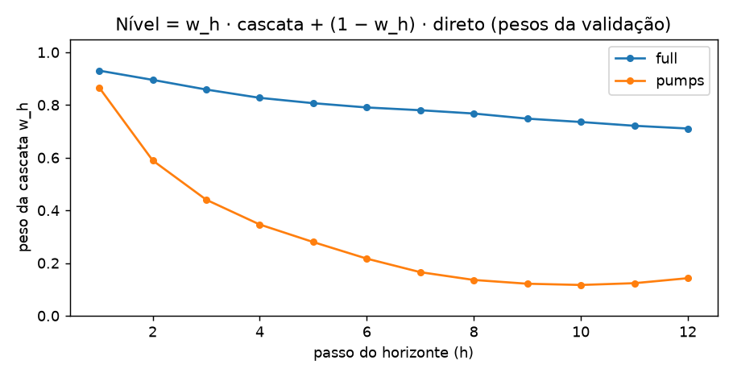
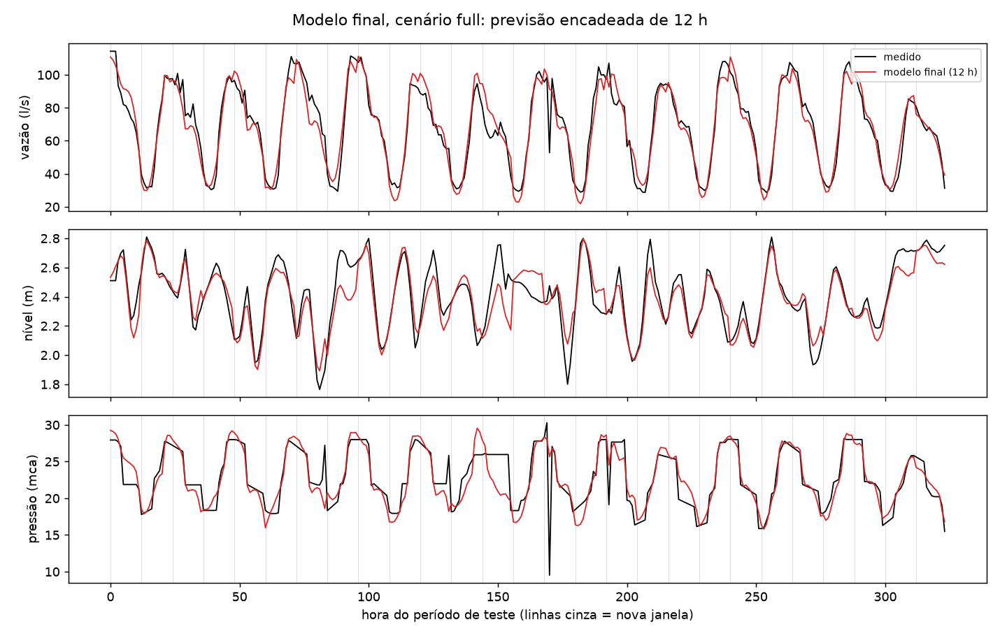
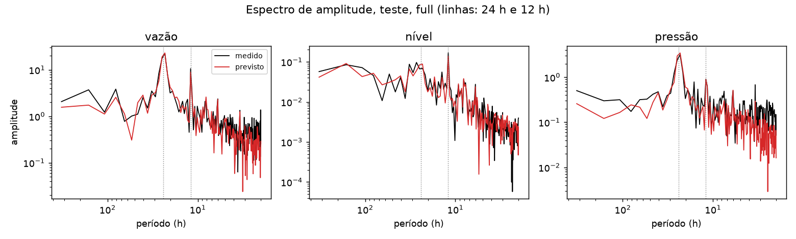
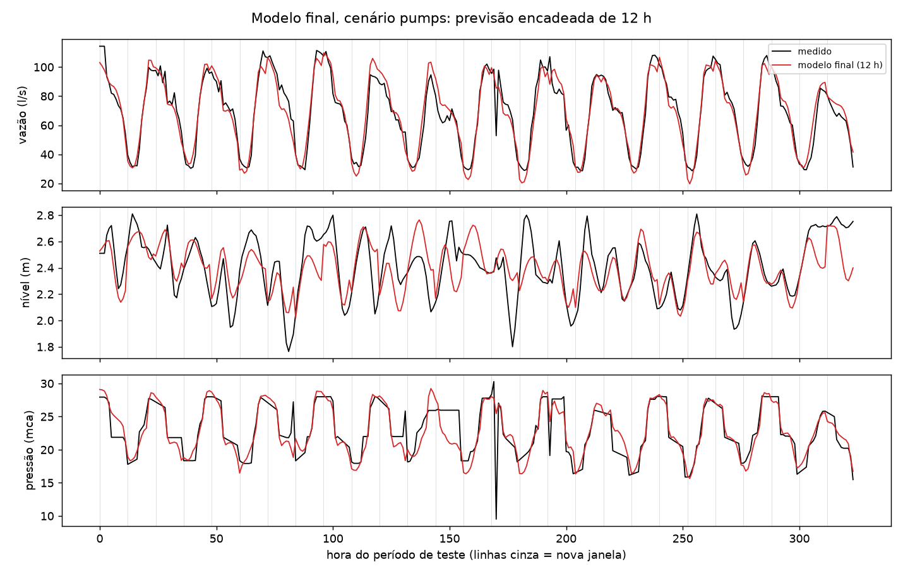
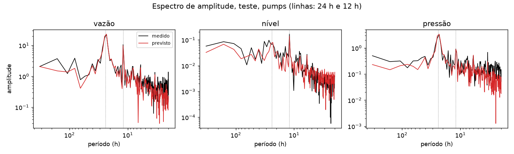
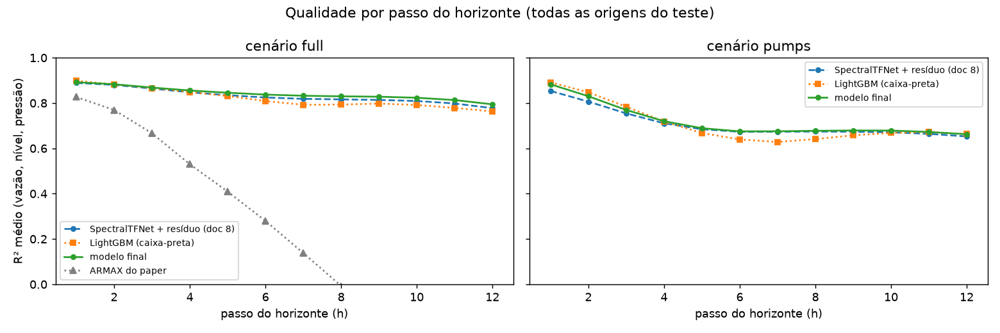
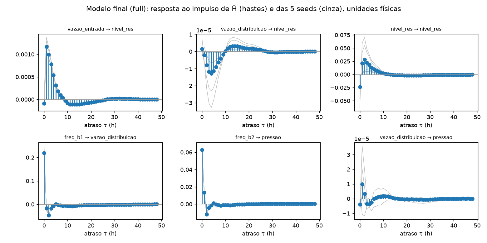
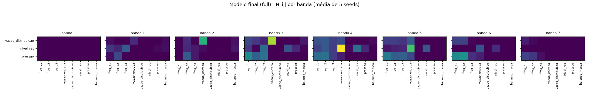

# Modelo final: SpectralTFNet com ensemble de `H` médio e nível combinado

> **Atualização (2026-10-22):** o modelo final do TCC foi enxugado para o
> SpectralTFNet do doc 8 **com a combinação do nível por passo, sem
> ensemble e sem busca de hiperparâmetros**. O ensemble rendia +0,003 e o
> Optuna, +0,000 a +0,003. O modelo enxuto dá 0,833 (`full`) e 0,719
> (`pumps`) em 12 h e está descrito no doc 13 §5–7
> (`report_lean_model.py`). Este documento fica como registro da versão
> com ensemble.

Versão melhorada do modelo do doc 8 para o mesmo sistema MIMO do
reservatório (4 entradas: bombas `freq_b1..3` e `vazao_entrada`; 3
saídas: `vazao_distribuicao`, `nivel_res`, `pressao`). Construída em
2026-10-22/23, depois das rodadas de decomposição (doc 9) e de melhorias
(doc 10).

| Onde está | O quê |
|---|---|
| `src/mimo_sys/architectures/spectral_tf_net.py` | o modelo base (igual ao doc 8) |
| `notebooks/training/scripts/run_improvements.py` | treino das 5 seeds, `SoupSpectral` (ensemble de `H` médio) e combinação do nível |
| `src/mimo_sys/training/mass_balance_cascade.py` | `fit_level_blend` / `apply_level_blend` |
| `notebooks/training/scripts/report_final_model.py` | tabelas, gráficos e extração deste documento |
| `outputs/improvements/weights/I0_ref_*` | pesos das 5 seeds de cada cenário |
| `outputs/final_model_report.json` | todos os números abaixo |
| `docs/changes/2026-10-23-melhorias-nivel-pressao.md` | plano e decisões |

---

## 1. Resumo em 5 pontos

1. **Melhor que o modelo do doc 8 nos dois cenários**, de forma
   modesta:
   - **com a vazão de entrada futura conhecida** (`full`): R² médio em
     12 h de **0,824 → 0,836** (origem a cada 12 h, o protocolo do
     doc 8), ou 0,831 → 0,842 em todas as origens;
   - **só com as bombas conhecidas** (`pumps`, o cenário realista):
     **0,705 → 0,721**.

   O ganho vem quase todo do **nível** (0,787 → 0,816 e 0,419 → 0,465).
2. **Duas mudanças, as duas sem caixa-preta nova:**
   - (a) o nível passa a ser uma **combinação, passo a passo, da cascata
     física com a saída direta do modelo**, com 12 pesos ajustados na
     validação;
   - (b) um **ensemble de 5 seeds cuja parte linear é a média das
     funções de transferência** `H̄_ij(f)`. Continua sendo uma única
     matriz de funções de transferência (uma equação), e rende o mesmo
     que tirar a média das previsões.
3. **Estamos perto do teto do que os dados permitem**:
   - um LightGBM direto, com a mesma cascata e a mesma combinação, fica
     **estatisticamente empatado** com o grafo (§5.4);
   - os oráculos (doc 10 §2) põem a pressão em ~0,78 e o nível do `full`
     em ~0,91.
4. **Correção importante ao doc 8:** o "resíduo = 29% do sinal" estava
   errado por um bug de medição (§3). O peso real do resíduo é **61–69%**
   da energia no `full` e **73–78%** no `pumps`. A equação extraída
   explica bem menos do modelo com resíduo do que o doc 8 dizia. O
   modelo **só linear** (doc 8, 0,790) continua sendo o interpretável.
5. **A física do nível ficou explícita**: ela está na cascata
   (`a = 0,00277` m por l/s, ajustado no treino), e a aresta vazão de
   entrada → nível do `H̄` dá **+0,00285**, praticamente o mesmo número.

---

## 2. O que é o modelo final

### A ideia

O motor é o mesmo do doc 8: cada aresta do grafo é um equalizador
`H_ij(f)`, a previsão é simulada 1 h por vez e realimentada, e um resíduo
pequeno corrige o que a parte linear não pega. Por cima disso entram
duas peças.

1. **Ensemble de 5 seeds com `H` médio (`SoupSpectral`).** Treinam-se 5
   cópias do mesmo modelo com sementes diferentes (42–46). A parte
   linear final usa **a média das 5 respostas em frequência**
   (`H̄ = média(H_s)`) e dos biases. O resíduo final é a média dos 5
   resíduos. Como a simulação é recursiva, `H̄` não é exatamente a média
   das previsões, mas a diferença máxima nas janelas de teste é 0,002 (na
   escala de 0 a 1), e o R² é igual até a terceira casa.
2. **Nível combinado.** O modelo tem duas previsões de nível:
   - a **direta**, saída do grafo;
   - a da **cascata física**,
     `nível(t+1) = nível(t) + a·(vazão de entrada − vazão prevista) + b`,
     alimentada pela vazão que o próprio modelo prevê.

   O nível final é `w_h·cascata + (1 − w_h)·direto`, com um peso por passo
   do horizonte ajustado por mínimos quadrados **na validação**.



| passo | 1 | 2 | 3 | 4 | 6 | 8 | 10 | 12 |
|---|---|---|---|---|---|---|---|---|
| `w_h`, full | 0,93 | 0,90 | 0,86 | 0,83 | 0,79 | 0,77 | 0,74 | 0,71 |
| `w_h`, pumps | 0,87 | 0,59 | 0,44 | 0,35 | 0,22 | 0,14 | 0,12 | 0,14 |

Os pesos fazem sentido físico:
- **perto da origem** a cascata vale quase tudo: ela parte do nível
  medido e integra pouco erro;
- **com o horizonte**, o erro integrado da vazão prevista cresce e a
  saída direta ganha peso;
- **no `pumps`** a cascata perde peso rápido, porque precisa adivinhar a
  vazão de entrada (usa a do dia anterior, com R² de só ~0,20 nessa
  variável).

### Passo a passo de uma previsão de 12 h

1. Monta a sequência: as últimas 168 h de todas as séries e as próximas
   12 h das entradas conhecidas (bombas; mais a vazão de entrada no
   `full`).
2. Roda a simulação recursiva de 12 passos com `H̄` e soma a média dos 5
   resíduos. Daí saem a vazão, a pressão e o nível direto.
3. Roda a cascata física com a vazão prevista e obtém o nível da
   cascata.
4. Nível final = combinação com os pesos `w_h`.

A previsão inteira passa por `evaluation.forecast_at_origin`, que só
recebe o passado e as entradas futuras conhecidas. Os testes de
perturbação e replay (`tests/test_causality.py`) garantem que nada do
futuro vaza.

### Janelas de entrada e saída

| Cenário | Janela de entrada | Entradas futuras conhecidas | Horizonte |
|---|---|---|---|
| `full` | 168 h | bombas + vazão de entrada, 12 h | 12 h |
| `pumps` | 168 h | só bombas, 12 h | 12 h |

O resto da configuração é idêntico ao doc 8: 8 bandas, resíduo de 16,
batch 128, loss da cascata 1,0, lasso 1e-3 e `backcast_weight=0`.

---

## 3. O resíduo, medido corretamente

**Errata do doc 8.** No `SpectralTFNet.forward`, `out = linear` seguido
de `out += resíduo` somava o resíduo **dentro do mesmo tensor** guardado
como "parte linear". O `nonlinearity_share` dividia então a energia do
resíduo pela energia de (linear + resíduo) + resíduo, e por isso dava
~29%. As previsões nunca foram afetadas, só essa medida. Corrigido em
2026-10-23, com teste em `tests/test_architectures.py`.

| | full | pumps |
|---|---|---|
| Peso do resíduo por seed (energia, janelas de teste), **correto** | 0,61–0,69 | 0,73–0,78 |
| O mesmo no modelo final (`H̄` + média dos resíduos) | 0,66 | 0,75 |
| R² nas janelas de teste, modelo completo (vazão / nível direto / pressão) | 0,925 / 0,649 / 0,763 | 0,927 / 0,431 / 0,770 |
| R² só com a parte linear, tirando o resíduo | 0,482 / 0,419 / 0,501 | 0,430 / 0,088 / 0,475 |

Leitura:

- **No modelo com resíduo, a parte linear e o resíduo se ajustam um ao
  outro.** Sozinha, a parte linear prevê mal. O resíduo vê o passado de
  cada saída e assume boa parte da autodinâmica, por isso as auto-arestas
  lineares do nível encolhem (§7).
- **O modelo só linear, treinado sem resíduo, é outra coisa:** chega a
  R² médio de 0,790 e é o que o doc 8 usou na extração (balanço de massa
  nas arestas). Na explicabilidade, **o modelo linear continua sendo a
  referência**. O modelo final troca parte dessa leitura por +0,03–0,05
  de R².

---

## 4. Como ler as métricas

As métricas são as mesmas do doc 8 §4 (R², RMSE, SMAPE, R² e SMAPE
espectrais). Os resultados vêm em dois protocolos de origem, e os dois
importam:

| Protocolo | Origens no teste | Para quê |
|---|---|---|
| **Origem a cada 12 h** (forecast encadeado, igual ao doc 8) | 27 | comparável com as tabelas do doc 8 |
| **Todas as horas** | 321 | mais robusto: 12× mais origens, e todo passo cai em todos os horários do dia |

Com só 27 janelas, diferenças de ~0,01 no protocolo de 12 h estão dentro
do ruído. As decisões foram tomadas na validação, com todas as origens e
bootstrap pareado (doc 10). Tudo é média de 3 seeds para os modelos
individuais. O modelo final é um só (o ensemble).

---

## 5. Resultados

### 5.1 Horizonte de 12 h, cenário `full` (vazão de entrada conhecida)

Origem a cada 12 h, mesmo teste e mesmo ARMAX do doc 8 §5.3.

| Modelo | vazão: R² / RMSE (l/s) / SMAPE | nível: R² / RMSE (m) / SMAPE | pressão: R² / RMSE (mca) / SMAPE | **R² médio** | R² espectral (v/n/p) | SMAPE espectral (v/n/p) |
|---|---|---|---|---|---|---|
| ARMAX MOGWO (free-run) | 0,569 / 16,5 / 19,9% | 0,285 / 0,189 / 5,9% | 0,144 / 3,51 / 12,3% | **0,333** | 0,73 / 0,77 / 0,63 | 75% / 64% / 81% |
| Ensemble de 5 redes (doc 7, não extraível) | 0,931 | 0,783 | 0,744 | **0,819** | — | — |
| SpectralTFNet + resíduo (doc 8, 3 seeds) | 0,924 / 6,91 / 8,9% | 0,787 / 0,103 / 3,1% | 0,761 / 1,85 / 5,3% | **0,824** | 0,96 / 0,86 / 0,82 | 51% / 55% / 70% |
| LightGBM direto + cascata + combinação (caixa-preta, só régua) | 0,934 / 6,43 / 7,2% | 0,824 / 0,094 / 2,8% | 0,792 / 1,73 / 4,4% | **0,850** | 0,95 / 0,89 / 0,85 | 50% / 52% / 69% |
| **Modelo final** | **0,926 / 6,80 / 8,7%** | **0,816 / 0,096 / 3,0%** | **0,765 / 1,84 / 5,3%** | **0,836** | 0,96 / 0,89 / 0,82 | 51% / 54% / 71% |

**Em todas as origens** (321): doc 8 0,831, LightGBM 0,821 e **modelo
final 0,842**. Ou seja, nesse protocolo a ordem entre o modelo final e o
LightGBM se inverte; veja §5.4.



O nível acompanha melhor os patamares do que no doc 8, porque a
combinação corrige a deriva da cascata nos passos finais de cada janela.
Os maiores erros continuam sendo os mesmos eventos do doc 8: a falha da
pressão perto da hora 170 e a mudança de fase da operação entre as horas
150 e 200.



Os picos de 24 h e 12 h batem. Abaixo de ~6 h o previsto continua com
menos energia que o medido: o modelo suaviza a alta frequência, que é
imprevisível em 12 h (doc 9 §4).

### 5.2 Horizonte de 12 h, cenário `pumps` (só bombas conhecidas)

O cenário realista: a vazão de entrada futura não é conhecida. Não há
ARMAX aqui, porque ele usa todas as entradas.

| Modelo | vazão: R² / RMSE / SMAPE | nível: R² / RMSE / SMAPE | pressão: R² / RMSE / SMAPE | **R² médio** | R² espectral (v/n/p) | SMAPE espectral (v/n/p) |
|---|---|---|---|---|---|---|
| SpectralTFNet + resíduo (doc 8, 3 seeds) | 0,928 / 6,72 / 8,9% | 0,419 / 0,170 / 5,5% | 0,767 / 1,83 / 5,3% | **0,705** | 0,96 / 0,68 / 0,83 | 54% / 65% / 70% |
| LightGBM direto + cascata + combinação (só régua) | 0,935 / 6,40 / 7,2% | 0,464 / 0,164 / 5,1% | 0,790 / 1,74 / 4,5% | **0,730** | 0,95 / 0,70 / 0,85 | 48% / 65% / 69% |
| **Modelo final** | **0,928 / 6,71 / 8,8%** | **0,465 / 0,164 / 5,3%** | **0,768 / 1,82 / 5,3%** | **0,721** | 0,96 / 0,72 / 0,83 | 54% / 64% / 70% |

Em todas as origens: doc 8 0,708, LightGBM 0,707 e **modelo final
0,718**.





Vazão e pressão ficam iguais às do `full`: elas dependem das bombas, que
continuam conhecidas. O nível cai para ~0,47 porque depende da vazão de
entrada, que agora é desconhecida. É o limite de informação medido no
doc 10 §2.

### 5.3 Qualidade a cada hora do horizonte



R² médio das 3 saídas no passo, em todas as origens do teste (variância
total do teste, como no doc 8 §5.4).

| passo | ARMAX (full) | doc 8, full | **final, full** | LightGBM, full | doc 8, pumps | **final, pumps** | LightGBM, pumps |
|---|---|---|---|---|---|---|---|
| 1 h | 0,83 | 0,889 | **0,892** | 0,898 | 0,853 | **0,883** | 0,891 |
| 3 h | 0,67 | 0,864 | **0,868** | 0,866 | 0,754 | **0,769** | 0,784 |
| 6 h | 0,28 | 0,824 | **0,837** | 0,809 | 0,673 | **0,675** | 0,639 |
| 12 h | < 0 | 0,777 | **0,794** | 0,763 | 0,653 | **0,662** | 0,663 |

- **O ganho do modelo final está nos passos longos do `full`** (passo
  12: 0,777 → 0,794). É onde a cascata sozinha acumula erro e a
  combinação passa peso para a saída direta.
- **No `pumps` o ganho está no início do horizonte** (passo 1: 0,853 →
  0,883). Ali a cascata, que parte do nível medido, é muito melhor que a
  saída direta.
- **O LightGBM é melhor nos passos curtos e pior nos do meio.** No total
  os dois empatam (§5.4).

### 5.4 Significância

Bootstrap pareado (blocos de 24 origens) e Diebold–Mariano, no teste:

| Comparação | full | pumps |
|---|---|---|
| Modelo final − doc 8, todas as origens | +0,011 (IC +0,004..+0,022) | +0,010 (IC −0,022..+0,030) |
| Modelo final − LightGBM, todas as origens | +0,021 (IC −0,012..+0,068; DM p = 0,28) | +0,011 (IC −0,023..+0,061; DM p = 0,56) |
| Modelo final − LightGBM, origem a cada 12 h | −0,014 (IC −0,031..+0,006; DM p = 0,27) | −0,009 (IC −0,060..+0,063; DM p = 0,67) |

- **Contra o doc 8**, o ganho é claro no `full`. No `pumps` ele foi
  decidido na validação (+0,015, IC +0,001..+0,025; doc 10 §4), e no
  teste o sinal é o mesmo, mas o IC contém o zero.
- **Contra o LightGBM** é empate nos quatro casos. Um grafo extraível
  com 387 parâmetros lineares chega no mesmo lugar que uma caixa-preta
  forte, e por isso a melhora restante depende de informação nova, não
  de um modelo maior.

---

## 6. O que cada decisão vale

Na validação, todas as origens, Δ do R² médio contra o modelo do doc 8
(doc 10 §4):

| Variante | full | pumps | Decisão |
|---|---|---|---|
| Combinação nível direto + cascata | +0,007 | +0,013 | entra |
| + ensemble de 5 seeds, média das previsões | +0,008 | +0,015 | — |
| + ensemble de 5 seeds com `H` médio | +0,009 | +0,014 | **entra** (o mesmo resultado, e é uma equação) |
| Treino sem as falhas de sensor | −0,009 | +0,004 | não |
| O grafo prevê a vazão de entrada (R² 0,45 nela) | — | +0,007 | não |
| Arestas Hammerstein (curva das bombas) | −0,011 | +0,002 | não |
| Sem resíduo, só linear | −0,032 | −0,019 | não (o resíduo vale 0,03–0,05) |
| Decompor as saídas (wavelet, EWT, sazonal; doc 9) | ≤ +0,003 | ≤ +0,012 | não |

### O que não funcionou

- **Decompor as saídas e somar** (wavelet à trous, EWT corrigido,
  sazonal de 24 h): no melhor caso empata (doc 9).
- **Dar peso igual às bandas na loss:** −0,03 a −0,16.
- **Limpar as falhas de sensor do treino:** sem ganho. Valeu como
  verificação de que os resultados anteriores não estavam distorcidos
  pelas falhas.
- **Prever a vazão de entrada no próprio grafo:** a entrada melhora,
  mas o nível não.
- **Curva das bombas explícita (Hammerstein):** o oráculo já mostrava
  que a não linearidade estática da pressão quase não existe (0,775
  linear contra 0,782 boosting).
- **Correção online do fluxo não instrumentado; termo MA sobre erros
  passados:** pioram ou não mudam.

---

## 7. Explicabilidade

### 7.1 A equação (rota A)

O modelo final tem **uma** matriz de funções de transferência, a média
das 5 seeds:

```
ŷ_i(t) = Σ_j Σ_τ h̄_ij(τ) · s_j(t − τ) + b̄_i  +  r̄_i(passado de y_i)
h̄_ij = iFFT( média_s H_ij^(s) )
nível(t+h) = w_h · cascata(t+h) + (1 − w_h) · ŷ_nível(t+h)
```

onde `r̄_i` é a média dos 5 resíduos (a parte sem equação; §3).



As hastes são `h̄_ij`; as linhas cinza são as 5 seeds. As seeds
concordam na forma (bombas → vazão e pressão em 0–2 h, vazão de entrada →
nível em 1–8 h) e divergem só na amplitude das arestas fracas.

**Balanço de massa**, soma dos coeficientes nas primeiras 3 h, em
unidades físicas:

| Aresta | `H̄` (full) | 5 seeds (full) | `H̄` (pumps) | Física |
|---|---|---|---|---|
| vazão de entrada → nível | **+0,00285** m por l/s | +0,0025 a +0,0035 | +0,00067 | `+a`, com gray-box `a` = 0,00277 |
| vazão de distribuição → nível | −0,00002 | −0,00006 a 0 | ~0 | `−a` |
| nível → nível (1–3 h) | 0,072 | 0,012 a 0,18 | 0,041 | integrador |

Leitura:

- **No `full`, a aresta da entrada bate com a física**, com 3% de
  diferença do gray-box.
- **As arestas da saída e a auto-aresta do nível quase sumiram**, ao
  contrário do modelo linear do doc 8 (−0,0019 e 0,93). No modelo com
  resíduo, a autodinâmica do nível foi para o resíduo, e o nível final
  vem sobretudo da cascata, onde o balanço de massa está **escrito
  explicitamente** (`a`, `b`).
- **No `pumps`, a aresta da entrada encolhe** (+0,00067), porque a
  entrada futura é desconhecida e entra só pelo passado.
- **Para ler o balanço de massa nas arestas**, o modelo certo continua
  sendo o linear do doc 8 §7.

### 7.2 O grafo (rota B)



Mesmo padrão do doc 8 §7.2:
- **as auto-arestas dominam as bandas intermediárias**;
- **a vazão de distribuição é o emissor cruzado mais forte** da vazão e
  da pressão;
- **as bombas pesam nas bandas rápidas** da vazão e da pressão;
- **as bandas extremas ficam quase vazias**, cortadas pelo lasso.

O grafo do `pumps` está em `figures/stf_final_band_strength_pumps.png`.

---

## 8. Os tetos

Resumo do doc 10 §2. São oráculos no teste, com os valores verdadeiros
no lugar das previsões.

| Saída | Modelo final | Teto medido | O que falta |
|---|---|---|---|
| vazão | 0,926 | — | — |
| nível, full | 0,816 | ~0,91 (cascata com a vazão verdadeira) | o erro integrado da vazão prevista |
| nível, pumps | 0,465 | limitado pela vazão de entrada, que é só 20–45% previsível | informação sobre a vazão de entrada futura |
| pressão | 0,765 | ~0,78 (mapa estático com vazão, nível e bombas verdadeiros) | variáveis não medidas: pressão a montante ou manobra de válvula |

---

## 9. Limitações e próximos passos

- **O resíduo pesa mais que o doc 8 dizia** (61–78% da energia). Fechar
  essa parte com equação (destilar o resíduo com PySR) ficou mais
  importante, não menos.
- **O nível no `pumps`** só melhora com informação nova sobre a vazão de
  entrada: a programação da adutora, se existir, ou uma variável a
  montante.
- **A pressão está no teto das variáveis medidas.** O próximo ganho
  depende de instrumentação, não de modelagem.
- **Não houve retreino em treino+validação**: os pesos da combinação
  precisam de previsões fora da amostra na validação.
- **O protocolo de 12 h tem só 27 janelas.** Para comparações finas, use
  o de todas as origens com IC (§5.4).
