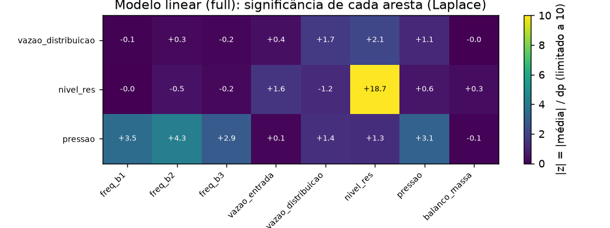
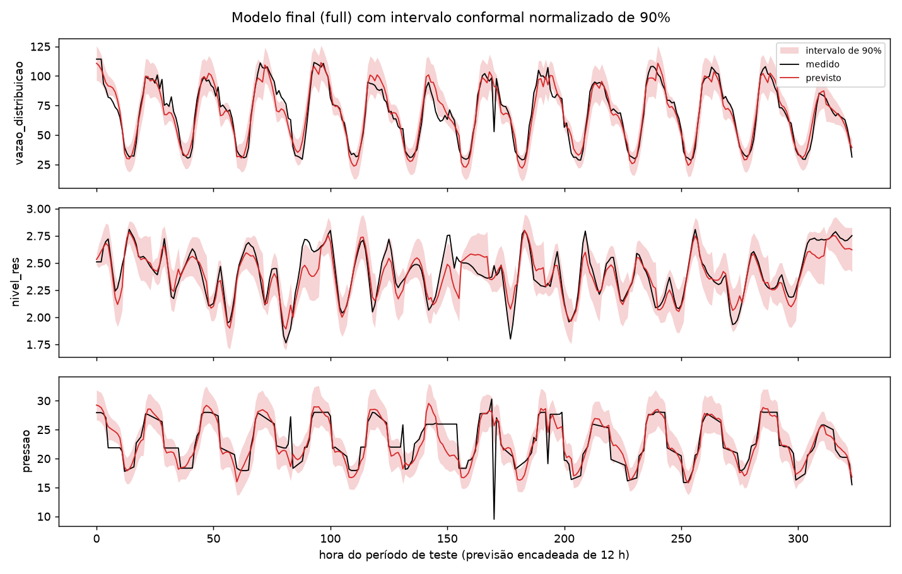

# Incerteza, bayesiano e explicabilidade: o que foi testado depois do modelo final

Continuação do doc 11. Testa cinco frentes sugeridas depois do modelo
final: (1) regime por setpoint de pressão, (2) resíduo explícito, (3)
cascata com fuga, (4) bayesiano nas partes interpretáveis (Laplace no
`H`, cascata em PyMC) e (5) estimativa do ruído, ou seja, intervalos de
previsão. O protocolo é o mesmo dos docs 9–11: `forecast_at_origin`,
todas as origens, 3–5 seeds, decisão na validação e teste uma vez.

| Onde está | O quê |
|---|---|
| `src/mimo_sys/training/uncertainty.py` | Laplace (Gauss-Newton generalizada), método delta, `log σ` explícito, conformal |
| `src/mimo_sys/training/mass_balance_cascade.py` | cascata com fuga, `fit_mass_balance_simulation` |
| `src/mimo_sys/architectures/spectral_tf_net.py` | `regime_per_step`, `gate_idx`, `residual_kind="chebyshev"` |
| `src/mimo_sys/training/features.py` | `seasonal_median` (setpoint estimado, causal) |
| `notebooks/training/scripts/run_improvements.py` | variantes R1–R3 e P1 |
| `notebooks/training/scripts/report_uncertainty.py` | Laplace, intervalos e PyMC |
| `outputs/uncertainty_report.json`, `outputs/improvements/report.txt` | todos os números |
| `tests/test_uncertainty.py` | cobertura do conformal, Laplace PSD, método delta contra diferenças finitas |

---

## 1. Resumo em 5 pontos

1. **O modelo final do doc 11 não muda.** Nenhuma das cinco frentes
   melhora o R² de forma robusta, coerente com o teto de informação do
   doc 10.
2. **Os intervalos de previsão funcionam:** o conformal por passo dá
   cobertura de **0,78–0,84** no nominal de 80% e de **0,87–0,94** no de
   90%, no teste. A equação `log σ` diz **quando** a previsão é menos
   confiável: a pressão quando as bombas mexem, o nível conforme o passo.
3. **A equação ganhou intervalo de credibilidade (Laplace):**
   - vazão de entrada → nível: **+0,00345 [+0,00306, +0,00384]** m por
     l/s;
   - vazão de distribuição → nível: **−0,00230 [−0,00327, −0,00133]**.

   O balanço de massa é significativo e tem sinais opostos. Só 4 das 24
   arestas têm ganho estático significativo (|z| > 3).
4. **A cascata bayesiana (PyMC, Student-t) é um diagnóstico, não uma
   melhora:**
   - ela encontra cauda de Cauchy (ν ≈ 1,0), as falhas de sensor;
   - o intercepto `b` sai ≈ 0, então o `b` dos mínimos quadrados era
     artefato das falhas;
   - a área implícita é **1.118 m² [1.114, 1.123]**.

   Para prever em 12 passos, o `b` dos mínimos quadrados continua melhor.
5. **O resíduo pode virar equação, com custo:** o polinômio de Chebyshev
   empata com o MLP na validação, mas perde 0,012–0,015 no teste, quase
   tudo na pressão. É a opção "tudo em equação" para quem precisar dela.

---

## 2. Regime por setpoint de pressão

### O que foi feito

As séries sugerem pressão controlada em patamares (28/26/20 mca) por
horário. O setpoint foi estimado de forma **causal**: a mediana da mesma
hora nos 7 dias anteriores (`seasonal_median`). Como só usa dias
anteriores, ele é conhecido para qualquer horizonte de até 24 h, e o
teste de perturbação (`tests/test_causality.py`) passa. **Sozinho, esse
setpoint prevê a pressão do teste com R² 0,747**, contra 0,551 de
"igual a ontem" e 0,765 do modelo final.

Foram testadas três variantes:
- **R1:** setpoint como entrada futura conhecida;
- **R2:** R1 mais 3 bancos de `H` trocados **a cada passo do horizonte**
  pelo setpoint. É um ARX chaveado, uma equação por regime. O gate de
  regime do doc 8 escolhia um banco por janela inteira, então não podia
  captar trocas ao longo do dia;
- **R3:** R1 com o resíduo de Chebyshev (§3).

### Resultado (com a combinação do nível e o ensemble, como no modelo final)

| Variante | full val | full teste | pumps val | pumps teste |
|---|---|---|---|---|
| Modelo final (doc 11) | 0,889 | 0,842 | 0,778 | 0,718 |
| R1: setpoint como entrada | 0,891 | 0,843 | 0,778 | 0,718 |
| R2: setpoint + regime por passo | 0,890 | 0,843 | 0,775 | 0,718 |

**Empate.** A pressão fica em ~0,76 com ou sem o setpoint: o modelo já
extrai do passado da própria pressão o que a mediana de 7 dias carrega.
Para ganhar, a informação precisa ser **nova**, como a tabela real de
setpoints se ela mudar em relação aos dias anteriores, e isso só a
operação pode fornecer.

---

## 3. Resíduo explícito (Chebyshev)

O MLP do resíduo carrega 61–78% da energia (doc 11 §3) e não tem
equação. A alternativa testada:

```
r_i[h] = Σ_{l=1..24} Σ_{k=1..3} c[i, h, l, k] · T_k( z_i(t − l) )
```

Um polinômio de Chebyshev de grau 3 sobre os 24 últimos valores
centrados da própria saída. Começa em zero e tem coeficientes
explícitos.

| Variante | full val | full teste (v / n / p) | pumps val | pumps teste |
|---|---|---|---|---|
| Modelo final, resíduo MLP | 0,889 | 0,842 (0,925 / 0,837 / 0,763) | 0,778 | 0,718 |
| P1: resíduo de Chebyshev | 0,892 | **0,827** (0,926 / 0,819 / 0,737) | 0,779 | **0,706** |
| R3: setpoint + Chebyshev | 0,891 | 0,829 | 0,779 | 0,707 |

Na validação empata, até um pouco acima. **No teste perde 0,012–0,015**,
quase tudo na pressão, que cai de 0,763 para 0,737. O polinômio sobre o
próprio passado extrapola pior na mudança de horário que o teste tem
entre as horas 150 e 200 (doc 9 §6). **Decisão:** o modelo final mantém
o MLP. O Chebyshev fica registrado como a versão 100% em equação, com
esse custo conhecido.

---

## 4. Cascata com fuga

`nível(k) = nível(k−1) + a·q̄ + b − λ·(nível(k−1) − nível_ref)`, a fuga
do "fluxo não instrumentado" da doc 1 §5. Os três parâmetros foram
ajustados pelo **erro da simulação de 12 passos** no treino, e não pelo
erro de 1 passo.

| Ajuste | a | b | λ (τ) | nível só cascata (teste) | modelo combinado (teste) |
|---|---|---|---|---|---|
| 1 passo, sem fuga (atual) | 0,00277 | 0,0047 | 0 | full 0,816 / pumps −0,135 | full **0,842** / pumps **0,718** |
| 12 passos, vazão de entrada real | 0,00229 | 0,0049 | 0,072 (14 h) | full 0,774 / pumps 0,259 | full 0,823 / pumps 0,716 |
| 12 passos, entrada sazonal (pumps) | 0,00138 | 0,0035 | 0,166 (6 h) | pumps 0,310 | pumps 0,714 |

- **No `full`, a fuga atrapalha.** Com a vazão de entrada conhecida, o
  integrador puro é o modelo certo.
- **No `pumps`, a fuga melhora muito a cascata sozinha** (de −0,135 para
  0,31), porque segura a deriva quando a entrada é chutada. Mas a
  combinação com o nível direto já fazia esse papel, e o ganho some.

**Não entra.**

---

## 5. Bayesiano nas partes interpretáveis

### 5.1 Laplace sobre o `H` do modelo linear

Posterior gaussiana dos 387 parâmetros lineares do modelo **só linear**
(o interpretável, `I6_clean_linear`, seed 42), por Gauss-Newton
generalizada. O jacobiano é o da **simulação recursiva de 12 passos**, a
mesma saída usada no treino. Os intervalos dos coeficientes saem pelo
método delta, que é exato para coeficientes lineares em `H`; o teste
compara o gradiente com diferenças finitas.

**Balanço de massa** (soma das primeiras 3 h, unidades físicas, IC 95%):

| Aresta | full | pumps | 5 seeds (full) | Física |
|---|---|---|---|---|
| vazão de entrada → nível | **+0,00345 [+0,00306, +0,00384]** | +0,00140 [−0,0067, +0,0095] | 0,00336–0,00351 | `+a`, gray-box limpo 0,00300 |
| vazão de distribuição → nível | **−0,00230 [−0,00327, −0,00133]** | **−0,00268 [−0,00378, −0,00157]** | −0,00249 a −0,00213 | `−a` |
| nível → nível (1–3 h) | **0,767 [0,700, 0,834]** | 0,748 [0,672, 0,824] | 0,72–0,79 | integrador |

- **No `full`, as duas arestas do balanço são significativas e de sinais
  opostos**, na ordem de grandeza da física. A entrada sai um pouco
  acima do gray-box, mas o intervalo de credibilidade é largo o
  bastante para o resultado ser coerente.
- **No `pumps`, a aresta da entrada deixa de ser significativa**, como
  deveria: a entrada futura não é conhecida e só o passado dela entra.



**Arestas significativas pelo ganho estático** (soma de 48 lags),
|z| > 3, 4 de 24 nos dois cenários:
- nível → nível;
- bomba 2 → pressão (+0,050 ± 0,012);
- bomba 1 → pressão (+0,038 ± 0,011);
- pressão → pressão.

A bomba 3 → pressão fica no limite (z = 2,9). Ressalva: o ganho estático
soma os lags, e efeitos dinâmicos de sinais opostos podem se cancelar.
Uma aresta não significativa aqui pode ainda importar numa banda; o
grafo por banda do doc 8 §7.2 continua sendo a leitura dinâmica.

**A dispersão entre seeds não é a incerteza.** O desvio entre as 5 seeds
é só ~5% (full) e ~9% (pumps) do desvio da Laplace. As seeds convergem
para quase o mesmo `H` porque veem os mesmos dados; o que limita a
precisão da equação é o volume de dados, e é isso que a Laplace mede.

### 5.2 Cascata gray-box em PyMC

Modelo: `Δnível ~ StudentT(ν, a·q̄ + b, σ)`, com `a > 0` (HalfNormal), no
treino **cru**, com as falhas. NUTS com 4 cadeias de 1.500 amostras;
r̂ ≈ 1,00 e ESS > 3.000.

| | PyMC (Student-t, treino cru) | Mínimos quadrados (cru) | Mínimos quadrados (limpo) |
|---|---|---|---|
| `a` (m por l/s) | **0,00322 [0,00321, 0,00323]** | 0,00277 | 0,00300 |
| `b` (m/h) | **0,00035 [−0,00005, 0,00077]** | 0,00474 | 0,00558 |
| ν | **1,02** [1,00, 1,05] | — | — |
| área implícita | **1.118 m² [1.114, 1.123]** | 1.300 m² | 1.200 m² |

Leitura:

- **ν ≈ 1 é cauda de Cauchy.** O modelo encontrou sozinho que o treino
  tem falhas grossas, sem precisar das regras de limpeza.
- **O intercepto robusto é ~0.** O `b` dos mínimos quadrados era
  inflado pelas falhas. Fisicamente, não há uma deriva constante
  inexplicada.
- **Para prever, o `b` dos mínimos quadrados continua melhor:** o nível
  pela cascata com a média do posterior dá 0,784 no teste, contra 0,809.
  Em 12 passos o `b` corrige o viés relativo dos dois medidores de
  vazão, e um viés de 0,005 m/h vira 0,06 m no fim do horizonte.
- **A incerteza dos parâmetros é desprezível para a previsão:** a faixa
  de 90% vinda só de `a` e `b` tem 0,005 m e cobre 3% dos pontos. O erro
  do nível vem do erro da vazão prevista, não do gray-box.

**Valor:** a cascata bayesiana é um diagnóstico de qualidade de dados e
uma medida física com incerteza (a área). Não melhora a previsão.

---

## 6. Intervalos de previsão (estimativa do ruído)

Duas versões, calibradas na validação e avaliadas no teste, com todas as
origens:

- **conformal por passo:** a largura é o quantil conformal de |erro| em
  cada (passo, saída), na segunda metade da validação;
- **conformal normalizado:** a largura é `q · σ(x)`, com
  `log σ = β · [1, passo, passo², sen(hora), cos(hora), bombas_mexem,
  nível_origem]` ajustado na primeira metade da validação. É uma equação
  explícita da incerteza.

| Cenário | Saída | Nominal 80%: cobertura / largura | Nominal 90%: cobertura / largura |
|---|---|---|---|
| full | vazão | 0,80 / 15,9 l/s | 0,88 / 20,4 l/s |
| | nível | 0,84 / 0,24 m | 0,94 / 0,32 m |
| | pressão | 0,78 / 3,2 mca | 0,88 / 4,5 mca |
| pumps | vazão | 0,82 / 16,7 l/s | 0,91 / 21,9 l/s |
| | nível | 0,77 / 0,39 m | 0,90 / 0,54 m |
| | pressão | 0,78 / 3,2 mca | 0,87 / 4,4 mca |

(conformal por passo; o normalizado dá coberturas iguais e scores de
Winkler 3–7% piores)



- **A cobertura bate com o nominal** dentro de ±0,04, exceto a pressão
  no nominal de 90%, que fica em 0,87–0,88, puxada pelo evento do meio
  do teste. Para a operação, um nível com ±0,16 m (90%, `full`) ou ±0,27
  m (`pumps`) é uma faixa útil.
- **O `log σ` explícito não melhora o intervalo**, porque o passo do
  horizonte, que é o que mais pesa, já está no conformal por passo. **Mas
  a equação é informativa:**
  - **pressão:** σ cresce com o movimento das bombas (coeficiente +0,34
    no `full` e +0,48 no `pumps`, ou seja, até +62% por unidade de
    movimento);
  - **vazão:** σ depende da hora do dia (cos(hora) +0,42);
  - **nível:** σ cresce com o passo do horizonte, que é o integrador
    acumulando o erro da vazão.

**Recomendação:** publicar o modelo final com o conformal por passo e
usar o `log σ` como explicação de quando confiar menos.

---

## 7. Ambiente

- PyMC 6.3 e ArviZ 1.3 entraram como extra opcional `bayes`
  (`uv run --extra ml --extra bayes ...`).
- O PyMC exige `cachetools < 7`, então o lock desceu o `cachetools` de
  7.2 para 6.2.6. Quem usa é o MLflow, e a faixa dele aceita; os 191
  testes passam.
- Para sincronizar o ambiente, use `uv sync --extra ml --extra tune
  --extra bayes --all-groups`. Sem `--all-groups`, o `uv sync` remove o
  grupo `plot` (plotly/kaleido/seaborn).

---

## 8. Limitações e próximos passos

- **Os intervalos são marginais por passo, não conjuntos sobre as 12 h.**
  Para decisões que dependem do caminho inteiro (o nível nunca passar de
  X), é preciso um conformal conjunto ou simulação de trajetórias.
- **O conformal supõe que validação e teste são permutáveis.** Uma
  mudança de operação, como a do teste, quebra isso. Recalibrar com uma
  janela móvel em produção resolve na prática.
- **A Laplace mede incerteza de dados, não de estrutura.** Se faltar uma
  variável (pressão a montante, setpoint real), os intervalos da equação
  ficam estreitos demais.
- **O maior ganho possível continua sendo informação nova** da operação
  (doc 11 §8): programação da adução e tabela real de setpoints.
