# GOTAS: rede neural em grafo interpretável para identificação de um sistema MIMO de abastecimento de água

Relatório consolidado do trabalho: o problema, o estudo de referência, o
caminho até a arquitetura final, a construção do modelo bloco a bloco,
o protocolo experimental, os resultados comparados ao artigo em simulação
livre e o modelo extraído (equação e grafo). Os detalhes de
cada etapa estão nos documentos numerados desta pasta, citados como
"doc N". A versão em LaTeX está em `overleaf/main.tex`.

---

## Resumo

O reservatório São José (Sanepar, Curitiba/PR) é um sistema MIMO com
quatro entradas (frequência de três bombas e vazão de entrada) e três
saídas (vazão de distribuição, nível do reservatório e pressão). Este
trabalho propõe o **GOTAS** (*Graph Operator for Transfer-function ARX
in the Spectral domain*), um modelo de identificação para
previsão de várias horas à frente que continua explicável em nível de
equação.

1. **O modelo.** É uma rede neural em grafo: cada série é um nó, e cada
   aresta é uma função de transferência aprendida no domínio da
   frequência. O grafo é simulado recursivamente como um ARX, usa as
   entradas cujo futuro é conhecido (programação das bombas) e tem o
   nível corrigido por uma cascata física de balanço de massa, combinada
   passo a passo com a saída direta. São 3,3 mil parâmetros, um único
   modelo, sem ensemble e sem busca de hiperparâmetros.
2. **A comparação com o artigo, em simulação livre.** No nosso teste,
   o GOTAS chega a **0,862 em 6 h** e **0,833 em 12 h**, contra
   0,606 e 0,333 do ARMAX. Só com a programação das bombas conhecida,
   chega a 0,719 em 12 h. Em 1 passo, no protocolo original, os dois são
   equivalentes.
3. **A qualidade ao longo do horizonte.** O R² cai de 0,89 no passo de
   1 h para 0,79 no de 12 h. O ARMAX em simulação livre fica abaixo de
   zero a partir de 8 h.
4. **O modelo extraído.** A parte linear é uma equação explícita:
   - as bombas determinam a vazão e a pressão na própria hora;
   - o nível responde à vazão de entrada com coeficiente de 0,0029 m por
     l/s, o mesmo do balanço de massa, que também está explícito na
     cascata.

   Experimentos de oráculo indicam que o desempenho restante é limitado
   pela informação disponível nos dados.

---

## 1. Introdução

### 1.1 O problema

Estações de bombeamento e reservatórios de abastecimento são sistemas
dinâmicos acoplados. A frequência das bombas altera a vazão e a pressão
de distribuição; a diferença entre a vazão que entra e a que sai é
integrada no nível do reservatório. Modelos desse acoplamento servem
para prever o estado do sistema algumas horas à frente, projetar
controladores e entender a física da planta.

A identificação de sistemas oferece duas famílias de modelos para isso.
Os **lineares clássicos** (ARX, ARMAX) são interpretáveis, mas têm
estrutura genérica e se degradam em horizontes longos. As **redes
neurais** são precisas, mas não devolvem uma equação. Este trabalho
busca um modelo com a precisão da segunda família e a legibilidade da
primeira.

### 1.2 O ponto de partida

Ferrari, Leandro e Coelho (2025) usaram 1.100 das 2.216 amostras
horárias do reservatório São José e estimaram um ARMAX MIMO de ordem 3
com seis metaheurísticas: três mono-objetivo (GA, GWO, CS) e três
multiobjetivo (NSGA-II, MOGWO, MOCS), com 100 execuções cada. O estudo
mostrou que a formulação multiobjetivo resolve o ajuste conjunto das
três saídas: os melhores modelos atingiram R² de 0,94–0,96 em vazão e
nível e de 0,84–0,86 em pressão, enquanto as versões mono-objetivo
tinham dificuldade com o nível.

A avaliação do artigo é de previsão um passo à frente (1 h), o protocolo
usual de identificação para esse tipo de modelo (doc 12-protocolo). Este
trabalho parte dessa identificação e se pergunta o que muda quando o
objetivo passa a ser **prever várias horas à frente** (o uso operacional
de um modelo de reservatório) **mantendo a física legível no modelo**.
O horizonte maior traz duas dificuldades: o erro de cada hora se acumula
no nível, que é um integrador, e o modelo precisa saber o que as bombas
farão nas próximas horas.

### 1.3 Objetivos e contribuições

O objetivo é um modelo de identificação que (i) preveja as três saídas
com qualidade em 12 h, (ii) seja explicável em nível de equação e de
grafo de acoplamento, e (iii) seja avaliado de forma reprodutível e
válida para uso em produção.

As contribuições são:

- **uma arquitetura nova por combinação**, o GOTAS: uma rede
  neural em grafo cujas arestas são funções de transferência em bandas
  de frequência, usada como simulador ARX recursivo, com as entradas
  futuras conhecidas e uma cascata física para o nível;
- **a comparação com o ARMAX de referência em simulação livre** de 6 e
  12 h, o uso operacional de um modelo de reservatório, com persistência
  e sazonal ingênuo como referências mínimas;
- **o modelo extraído:** a equação e o grafo de interações aprendidos,
  com o balanço de massa recuperado nas arestas;
- **um contrato de produção testado:** a previsão só recebe o passado e
  as entradas futuras conhecidas, e testes de perturbação e replay
  garantem que nada do futuro vaza;
- **a medição do teto de informação:** oráculos mostram onde o
  desempenho é limitado pelos dados.

### 1.4 Redes neurais em grafo para séries temporais

Uma rede neural em grafo (GNN) representa o problema como nós que
trocam mensagens pelas arestas. Em cada camada, o nó `i` recebe uma
mensagem de cada vizinho `j`, soma as mensagens e atualiza o próprio
estado:

```
m_ji = ψ(h_j, h_i)                  mensagem de j para i
h_i' = φ(h_i, Σ_{j ∈ N(i)} m_ji)     agregação e atualização
```

Em séries temporais multivariadas, **cada nó é uma série** e carrega uma
janela do seu passado, e as arestas representam a dependência entre as
séries. As GNNs espaço-temporais alternam uma operação no tempo, dentro
de cada nó, com uma operação no grafo, entre os nós:
- a **DCRNN** (Li et al., 2018) usa difusão no grafo dentro de uma
  célula recorrente, num codificador–decodificador (figura abaixo);
- a **STGCN** (Yu et al., 2018) empilha convoluções no tempo e no grafo;
- o **StemGNN** (Cao et al., 2020) aplica a transformada de Fourier no
  tempo e no grafo.

Nessas redes, a mensagem é uma combinação de vetores latentes, sem
significado físico direto.

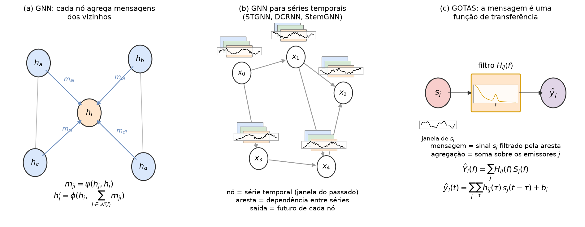

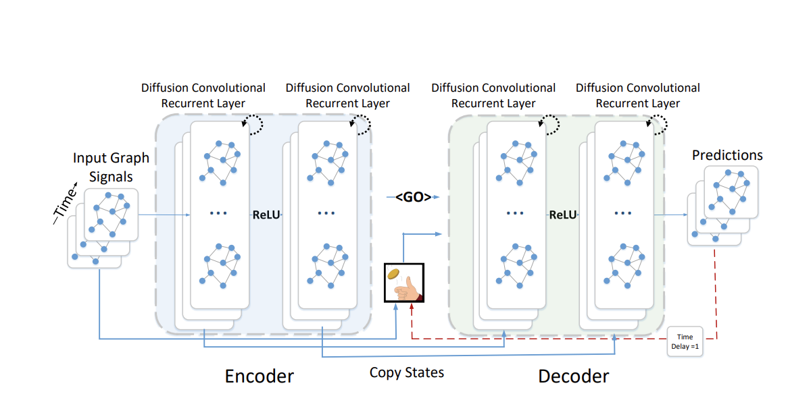

*Fonte da segunda figura: Li, Yu, Shahabi e Liu (2018),
[arXiv:1707.01926](https://arxiv.org/abs/1707.01926).*

A proposta deste trabalho é uma GNN em que **a mensagem é física**
(painel c da primeira figura):
- a mensagem `m_ji` é o sinal do emissor `s_j` filtrado por uma resposta
  em frequência `H_ij(f)`;
- a agregação é a soma;
- a atualização é a própria saída prevista.

Com isso, a aresta *é* uma função de transferência, e o grafo inteiro é
uma matriz de funções de transferência MIMO. É a mesma classe do ARMAX
do artigo (§3.1), com a equação legível nos parâmetros.

---

## 2. O sistema e os dados

### 2.1 Variáveis

| Símbolo | Variável | Unidade | Papel |
|---|---|---|---|
| `u1, u2, u3` | frequência das bombas B1, B2, B3 | Hz | entrada |
| `u4` | vazão de entrada (adutora) | l/s | entrada |
| `y1` | vazão de distribuição | l/s | saída |
| `y2` | nível do reservatório | m | saída (estado) |
| `y3` | pressão de distribuição | mca | saída |

São 2.216 amostras horárias, de 27/07/2014 a 27/10/2014. Usamos o
conjunto completo com divisão cronológica 70/15/15:
- **treino:** 1.545 amostras;
- **validação:** 331 amostras;
- **teste:** 332 amostras, nas linhas 1.876–2.207.

Para a comparação no protocolo do artigo, também usamos o recorte dele:
estimação nas linhas 550–1150 e validação nas linhas 1500–2000.

### 2.2 Qualidade dos dados

O treino contém **22 amostras com falha de sensor**: nível abaixo de
1 m, salto de nível acima de 0,3 m/h, pressão abaixo de 5 mca, vazão
negativa e vazão travada no fundo de escala (199,6 l/s) depois de
paradas. Validação e teste estão limpos.

Limpar essas amostras dobra o R² de 1 passo do balanço de massa (de
0,47 para 0,84, doc 1 §4). No modelo final, porém, a limpeza não muda o
desempenho (doc 10 §4). Ela serviu como verificação de que os resultados
não estavam distorcidos pelas falhas.

### 2.3 A física conhecida

- **Nível:** é um integrador do desbalanço de vazão. Com discretização
  trapezoidal, `Δy2[k] = a · ½(q[k] + q[k−1]) + b`, com `q = u4 − y1`.
  No treino, `a` = 0,00277 m por l/s, o que corresponde a uma área de
  ~1.200–1.300 m².
- **Vazão e pressão:** são relações quase algébricas. A pressão é
  dominada pela vazão (perda de carga); a vazão, pelas bombas.

### 2.4 Análise exploratória

A análise exploratória (doc 5) mostrou:
- todas as séries são estacionárias (ADF);
- o ciclo diário (≈ 24 h, com harmônico em 12 h) concentra a maior
  parte da energia;
- a vazão de entrada é a causa de Granger mais forte do nível, com lag
  de 1 h (`p ≈ 5·10⁻¹²⁴`);
- a coerência entre vazão de entrada e nível chega a 0,98;
- o núcleo físico (vazão de entrada, vazão, nível, pressão) é
  cointegrado.

Pelo comportamento das séries (doc 11 §8 e respostas da análise de
controle):
- **bombas:** têm inversor de frequência e são operadas por setpoints;
- **pressão:** tudo indica que é controlada em patamares por horário
  (28/26/20 mca);
- **vazão de entrada:** é estrangulada quando o nível está alto.

Isso importa para o que conta como "entrada conhecida no futuro" (§5.2).

### 2.5 A análise exploratória em figuras

A EDA de séries temporais (`notebooks/eda/03_eda_series_temporais.ipynb`,
doc 5) olhou os dados em quatro frentes: tempo, frequência, causalidade
e identificação clássica. Cada achado abaixo virou uma decisão de
desenho do modelo, resumida na tabela do fim desta seção.

**Tendência e sazonalidade.** A decomposição STL, com período de 24 h,
separa um ciclo diário de amplitude estável nas três saídas ao longo dos
90 dias. A tendência varia em escala de dias, sem deriva de longo prazo.
O resíduo contém ruído de alta frequência e os eventos isolados de falha
de sensor.

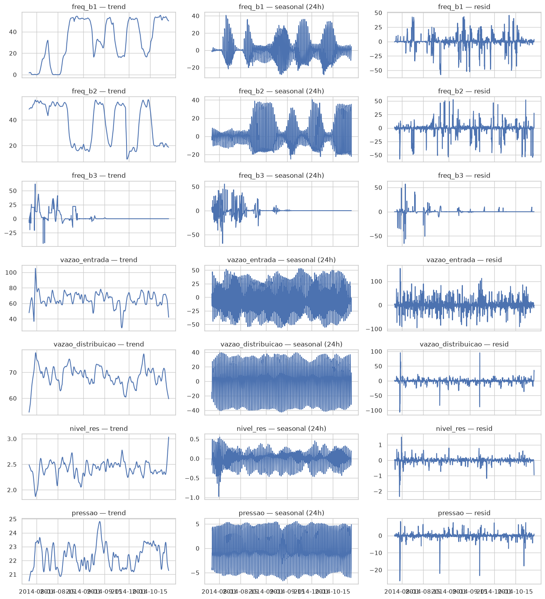

**Memória e ordem.** A autocorrelação das saídas decai devagar e oscila
com período de ~24 h. A autocorrelação parcial do nível e da pressão
corta em 1–2 lags: um AR de ordem baixa capta a dinâmica imediata, mas o
ciclo diário pede memória longa. Foi por isso que a janela de entrada
de 168 h (7 dias) saiu melhor que a de 24 h na varredura (doc 8 §6.4).

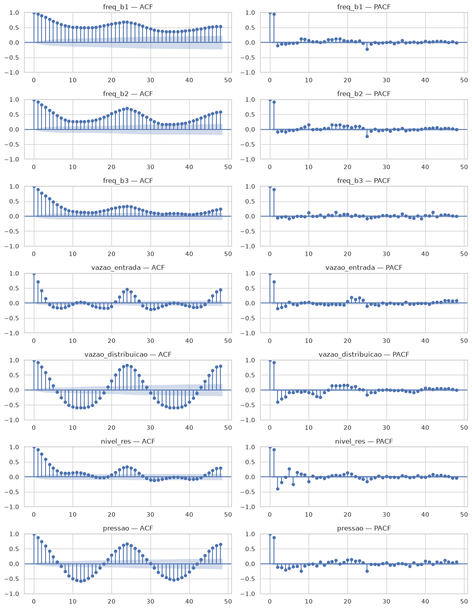

**Domínio da frequência.** O periodograma de Welch mostra, em todas as
séries, um pico dominante em 23–26 h. Nas bombas aparecem picos
secundários em ~128 h e ~256 h, ligados a trocas de regime de operação.
Vazões e nível também têm energia no harmônico de 12 h. O espectrograma
mostra que a energia do ciclo diário é **persistente** ao longo de todo o
período, ou seja, não é efeito de um trecho isolado. Essa concentração
em poucas faixas de frequência justifica parametrizar cada aresta por
**bandas**, e não por bin.

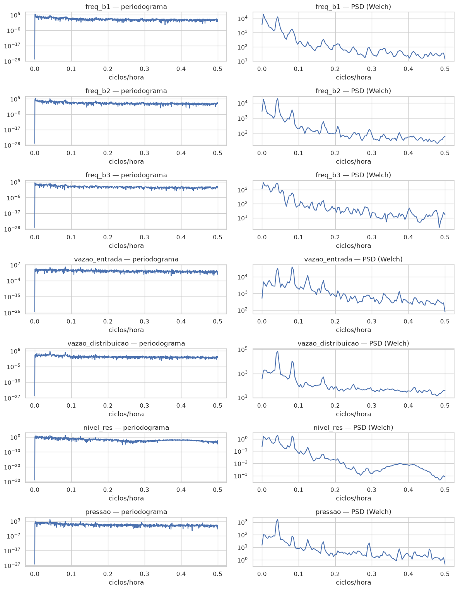

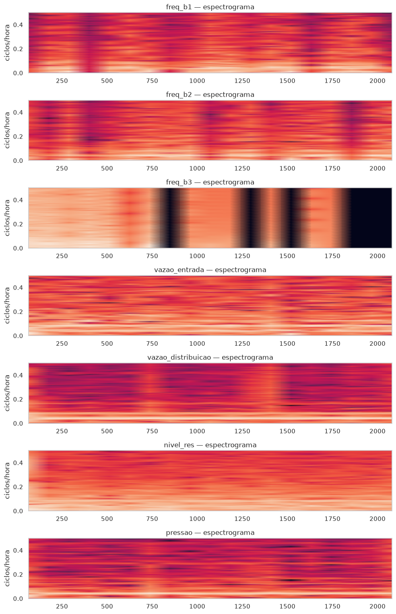

**Acoplamento entrada → saída.** A coerência entre a vazão de entrada e
o nível chega a **0,98** no harmônico de 12 h: a relação é quase linear
e invariante no tempo nessa banda, o equivalente em frequência à
causalidade de Granger com lag de 1 h. As bombas acoplam mais com a
pressão e a vazão (0,72–0,77 perto de 24 h) do que com o nível, o que é
coerente com a perda de carga depender da vazão. Coerência alta por
faixa de frequência é exatamente o que uma aresta `H_ij(f)` modela.

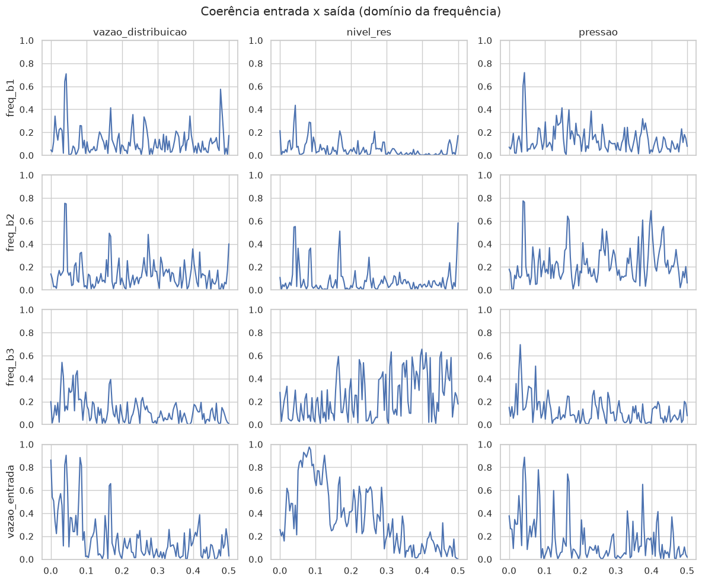

**Estrutura de longo prazo.** As quatro variáveis do núcleo físico
(vazão de entrada, vazão de distribuição, nível e pressão) são
cointegradas entre si, e o teste de Johansen dá rank completo: nenhuma
variável "passeia livremente" em relação às outras. É a evidência
estatística de que pertencem ao mesmo balanço físico.

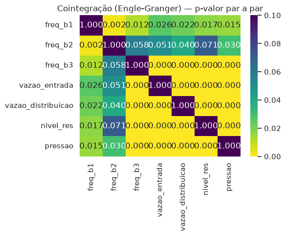

**Agrupamento por forma.** O agrupamento hierárquico sobre a distância
DTW separa dois grupos: as bombas que de fato operam (B1, B2) e as três
saídas físicas, com vazão de distribuição e pressão como o par mais
próximo (DTW 18,0, que também é a maior correlação linear, 0,86). A
bomba 3, quase sempre parada, e a vazão de entrada, que é a forçante
externa, ficam isoladas. O grafo do modelo tem um nó por variável, e
esses grupos aparecem depois nas arestas fortes do grafo aprendido.

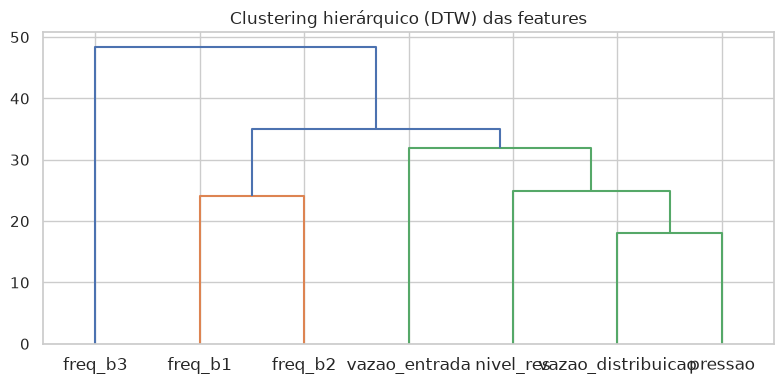

**Identificação clássica.** A resposta ao impulso empírica, a correlação
cruzada normalizada, tem pico em 1–2 h para vazão de entrada → nível e
picos mais espalhados para os pares com a vazão de distribuição. Os 12
modelos ARX de ordem 2, um por par entrada→saída, são todos estáveis,
com polo dominante entre **0,94 e 0,997**. A dinâmica é lenta, com
constante de tempo de dezenas de horas. Daí duas consequências:
- prever 1 h à frente é muito mais fácil que prever 12 h;
- um modelo de função de transferência precisa ser **simulado
  recursivamente** para acompanhar essa dinâmica no horizonte.

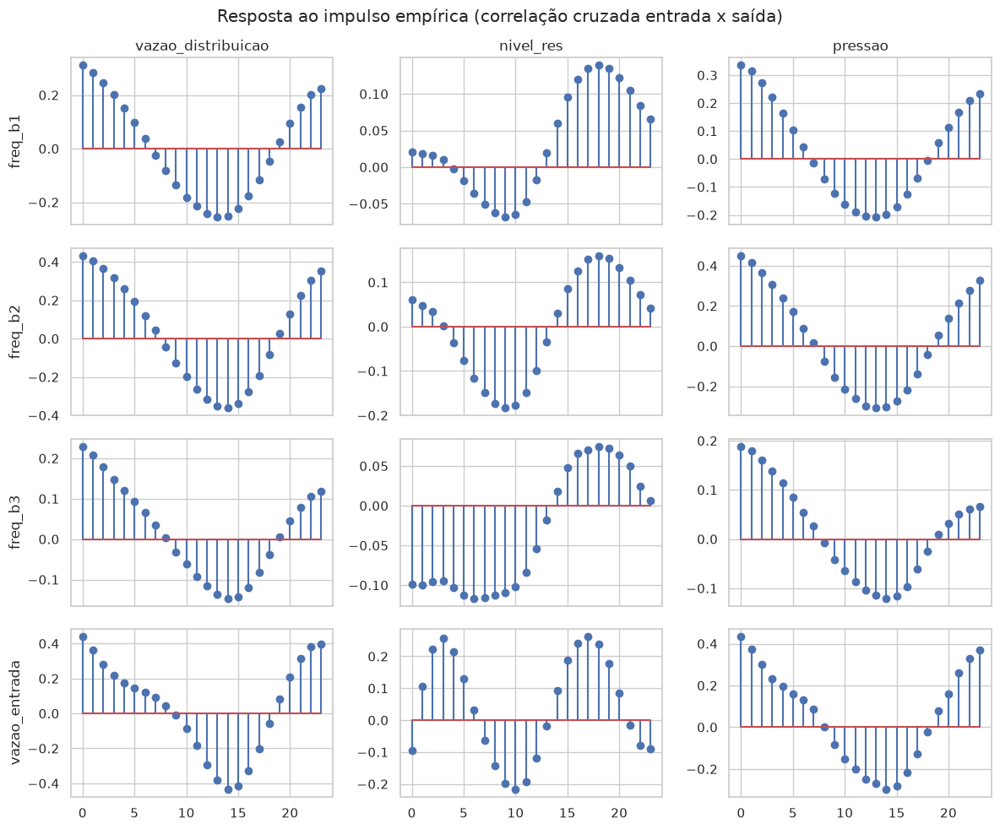

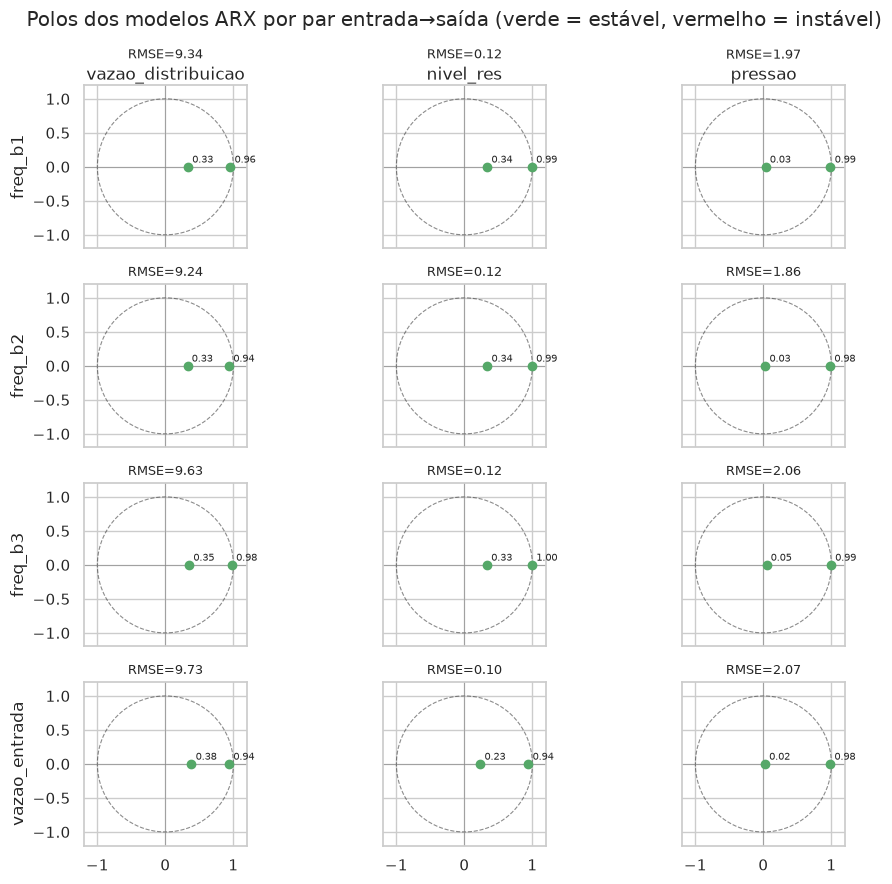

**Onde está a variância.** Decompondo cada saída em bandas por wavelet
causal (doc 9, Fase 1), o ciclo diário (16–32 h) e a componente lenta
(> 32 h) concentram a maior parte da variância. O nível é o caso mais
extremo: 47% da variância dele está acima de 32 h, a deriva do
integrador. Comparando com o erro do modelo de referência, o ciclo
diário está praticamente resolvido (erro/sinal de 0,02–0,03 em vazão e
pressão), e o erro que sobra fica na deriva lenta e no ruído de 2–8 h.
Essa medida orientou a busca por ganhos adicionais (doc 10).

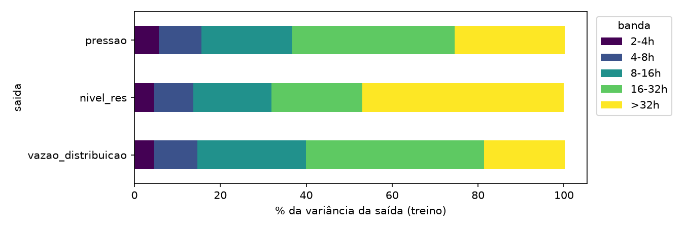

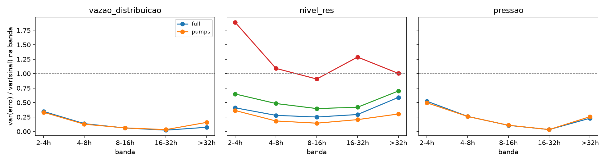

**Da EDA para a arquitetura**

| Achado da EDA | Decisão no modelo |
|---|---|
| O nível só se correlaciona com a integral do desbalanço, e não com os valores instantâneos | cascata física de balanço de massa para o nível |
| Coerência alta por faixa de frequência (0,98 entre vazão de entrada e nível) | aresta = função de transferência `H_ij(f)` |
| Energia concentrada em poucas faixas (24 h, 12 h, vários dias) | `H_ij` parametrizado por 8 bandas log-espaçadas |
| Ciclo diário dominante e persistente; ACF com memória de vários dias | janela de entrada de 168 h |
| Polos entre 0,94 e 0,997 (dinâmica lenta) | simulação ARX recursiva de 1 passo, iterada no horizonte |
| Bombas quase binárias, alternadas; bomba 3 quase parada | só centralizar, sem dividir pelo desvio (desvio ≈ 0 nas janelas paradas) |
| Núcleo físico cointegrado e agrupado por DTW | grafo com um nó por variável; lasso por aresta para revelar o acoplamento |
| Falhas de sensor no resíduo da STL e nos boxplots | regras de limpeza e verificação de robustez (doc 10) |

### 2.6 Dependência entre as séries: por que um grafo

O grafo só se justifica se o passado de uma série ajuda a prever outra
**depois** de descontada a memória de cada uma. Testamos isso no treino
(1545 h) com dois critérios
([report_graph_dependency.py](../notebooks/training/scripts/report_graph_dependency.py)):
Granger condicional num VAR das 7 séries (ordem 24 por AIC, teste de Wald)
e correlação cruzada após pré-branqueamento AR, com o lag do pico.

| Aresta | Granger p | Correlação pré-branqueada (lag) | Leitura física |
|---|---|---|---|
| vazão de entrada → nível | 7e-80 | +0,36 (1 h) | balanço de massa |
| vazão de distribuição → nível | 6e-10 | +0,12 (2 h) | balanço de massa |
| vazão de distribuição → pressão | 9e-16 | +0,59 (0 h) | hidráulica da rede |
| bombas 1 e 2 → pressão | 0,01 | +0,32 / +0,36 (0 h) | curva das bombas |
| bombas 1, 2, 3 → vazão de distribuição | ≤ 2e-3 | +0,18 a +0,26 (0 h) | bombeamento |
| nível → pressão | 2e-22 | +0,13 (15 h) | efeito lento |
| bombas 1 e 2 → nível | 0,33 / 0,55 | fraca | sem aresta direta |
| bomba 3 → pressão | 0,17 | — | não significativa |

Três leituras sustentam a abordagem:

- **Há dependência cruzada condicional**, que um modelo univariado por
  saída descarta. As arestas mais fortes são as da física (§2.3).
- **O grafo não é completo**: as bombas chegam ao nível só através da
  vazão. Isso justifica um grafo esparso aprendido com lasso por aresta.
- **Os atrasos variam por aresta** (0 h nas bombas, 1–2 h no balanço,
  ~15 h no nível → pressão). Por isso a aresta é um filtro no tempo,
  `H_ij(f)`, e não um peso escalar.

Ressalvas: com 1545 h quase todo p sai pequeno, e o que discrimina são as
arestas que **não** passam. A correlação distribuição → nível sai
positiva, embora a física diga negativa. A sazonalidade diária que o
pré-branqueamento não remove é a explicação provável; a direção vem do
coeficiente do modelo (§8.3).

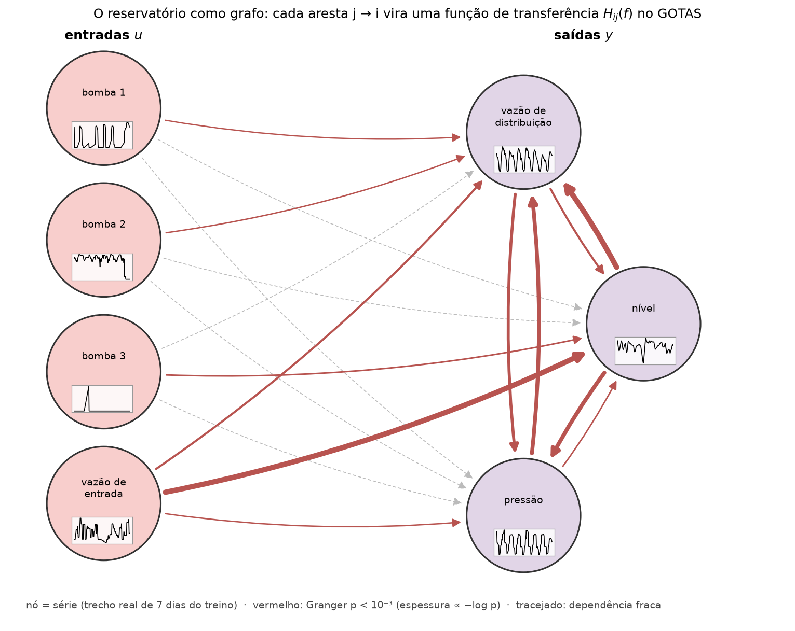

---

## 3. O estudo de referência em detalhe

### 3.1 O modelo

Para cada saída `i`, com lags de 1 a 3:

```
y_i[k] = − Σ_{l=1..3} a_il · y_i[k−l]
         − Σ_{j≠i} Σ_{l=1..3} a_ijl · y_j[k−l]
         + Σ_{m=1..4} Σ_{l=1..3} b_iml · u_m[k−l]
         + Σ_{l=1..3} c_il · e_i[k−l]
```

Isso dá 24 coeficientes por saída e **72 no total** (Tabela 3 do artigo;
algumas docs anteriores deste projeto diziam ~120, número
superestimado). Os coeficientes são estimados por metaheurística no
espaço [−1, 1].

### 3.2 O protocolo de avaliação

- **Horizonte:** 1 passo (1 h), em modo série-paralelo: os regressores
  de saída são os valores medidos.
- **Entradas:** `u[k−1..k−3]`.
- **Termo MA:** usa o resíduo da parte ARX.
- **Modelo reportado:** a solução de compromisso da frente de Pareto
  mais próxima de R² = 1 nas três saídas.

Para comparar os dois trabalhos no mesmo terreno, o GOTAS também
foi treinado e avaliado exatamente nesse protocolo (§7.1).

### 3.3 Os números publicados

| Algoritmo | R² vazão | R² nível | R² pressão | R² médio |
|---|---|---|---|---|
| MOCS | 0,939 | **0,960** | **0,863** | **0,921** |
| MOGWO | **0,948** | 0,953 | 0,836 | 0,912 |
| NSGA-II | 0,942 | 0,950 | 0,837 | 0,910 |
| GWO | 0,949 | 0,411 | 0,829 | 0,730 |
| CS | 0,946 | −3,23 | 0,822 | −0,49 |
| GA | 0,932 | −15,86 | 0,631 | −4,77 |

Melhor modelo na validação, Tabela 2 do artigo. Os coeficientes MOGWO da
Tabela 3 foram usados para recalcular o ARMAX nos nossos experimentos, e
o recálculo bate com a tabela (0,948 / 0,954 / 0,824).

---

## 4. Como chegamos à arquitetura

A arquitetura final não foi o ponto de partida. Ela resultou de uma
sequência de hipóteses, cada uma testada e substituída pela seguinte
quando a evidência apontava outro caminho.

### 4.1 Hipótese inicial: GNN mais regressão simbólica

A ideia inicial seguia Cranmer et al. (2020): treinar uma *Message
Passing Neural Network* (MPNN) sobre os sete nós do sistema, regularizar
a mensagem com L1 e destilar a mensagem e a atualização por regressão
simbólica (PySR). A triagem de arquiteturas (doc 3) separou dois papéis:
- **extração:** MPNN e SymbolicGraphNetwork, cujas funções internas
  recebem variáveis com nome;
- **acurácia:** StemGNN, Seq2SeqLatentGNN e FourierGNN, que operam sobre
  latentes sem nome e não admitem esse tipo de extração.

**O que mostrou:** em 12 h, todas as redes superaram o ARMAX em
simulação livre (vazão 0,87–0,92, pressão 0,59–0,74). O nível, porém,
ficou entre 0,25 e 0,46 em todas (doc 6).

### 4.2 Diagnóstico: o nível é um integrador

O nível é o único **estado** do sistema. O erro de cada hora na vazão
prevista se acumula nele. Um teste de oráculo foi decisivo: com a vazão
de distribuição **verdadeira**, o balanço de massa prevê o nível com R²
de ~0,91. Ou seja, o problema não era o nível em si, mas a vazão
prevista.

Disso nasceu a **cascata física**: o modelo neural prevê a vazão, e o
nível sai do balanço de massa alimentado por essa previsão (doc 7). Com
um ensemble de 5 redes mais a cascata, o R² médio chegou a 0,809, e a
0,819 com a cascata treinada junto. Dos 5 membros, porém, só 2 eram
extraíveis.

### 4.3 Por que a MPNN não bastava

Ao inspecionar as mensagens, apareceu uma limitação estrutural: a soma
de mensagens da MPNN não consegue expressar a **subtração** `u4 − y1`
que o balanço de massa exige. Um modelo com arestas lineares (FIR,
`LinearEdgeNet`) recuperava os sinais opostos, mas ficava abaixo da MPNN
em acurácia.

Ao mesmo tempo, a análise de erro mostrou que **63% do erro do nível
vinha da baixa frequência da vazão prevista**. Nenhum modelo até ali via
as **entradas futuras conhecidas**: a programação das bombas nas
próximas 12 h. Sem elas, a rede precisava adivinhar o que as bombas
fariam, e esse chute virava exatamente o viés de baixa frequência que a
cascata integrava.

### 4.4 O desenho do GOTAS

O GOTAS foi desenhado para resolver os dois problemas ao mesmo
tempo, em cinco decisões:

1. **A aresta é uma função de transferência** `H_ij(f)`, aplicada no
   domínio da frequência (FilterNet; FITS). A aresta *é* a equação, sem
   regressão simbólica, e a subtração vira apenas um sinal negativo no
   filtro.
2. **Poucas bandas:** cada `H_ij` é parametrizado por 8 valores
   complexos em bandas log-espaçadas, interpolados entre os bins da FFT
   (iCSNN). Com só ~1,5 mil amostras de treino, a parte linear inteira
   tem 387 parâmetros.
3. **Simulação recursiva de 1 passo:** um filtro aplicado de uma vez não
   consegue prever vários passos do próprio passado (testado: R²
   negativo). O filtro passou a ser o modelo de 1 passo, iterado 12
   vezes com a previsão realimentada, como se simula um ARX.
4. **Entradas futuras conhecidas na mesma sequência:** as bombas, e no
   cenário `full` também a vazão de entrada, entram no horizonte; as
   saídas futuras ficam zeradas. Foi o maior ganho isolado: +0,147 de R²
   médio.
5. **Só centralizar, sem dividir pelo desvio:** com as bombas
   desligadas, o desvio da janela é ~0, e a divisão fazia a previsão
   explodir (R² de −10⁶).

Completam o desenho:
- a **cascata física diferenciável** como termo de loss, para o
  gradiente do erro do nível chegar à vazão;
- um **resíduo não linear pequeno, iniciado em zero**, que só cresce se
  ajudar;
- um **lasso por grupo (aresta, banda)**, que zera arestas ou bandas
  inteiras.

O resultado foi **um modelo único com R² médio de 0,824 em 12 h**, acima
do ensemble de 5 redes (0,819), e com a equação legível nas arestas
(doc 8).

### 4.5 Rigor: o contrato de produção e o que não funcionou

Com o modelo definido, o trabalho passou a garantir que os números
valessem em produção e a procurar ganhos adicionais:

- **Contrato de produção** (doc 9 §2): uma API de previsão que só recebe
  o passado e as entradas futuras conhecidas. Testes automáticos
  mostram que perturbar o futuro não muda a previsão. Isso revelou que o
  EWT e o filtro Savitzky-Golay do pré-processador vazavam o futuro; os
  dois estavam desligados no treino, então os resultados não foram
  afetados.
- **Decomposição das saídas** em wavelet causal (à trous), EWT corrigido
  e diferença sazonal, prevendo as componentes e somando: nenhuma
  melhora (doc 9).
- **Combinação do nível por passo:** o único ganho que entrou no modelo
  final, +0,006 no `full` e +0,014 no `pumps` em 12 h (doc 10). No
  `pumps` ela é necessária: a cascata sozinha leva o nível a R²
  negativo.
- **Testados e descartados por não acrescentarem desempenho:**
  - ensemble de 5 treinos com `H` médio (+0,003);
  - busca de hiperparâmetros com Optuna (+0,000 no `full`, +0,003 no
    `pumps`);
  - limpeza do treino;
  - arestas Hammerstein;
  - prever a vazão de entrada no grafo;
  - setpoint de pressão estimado e ARX chaveado;
  - resíduo polinomial e cascata com fuga (docs 10 e 12).

---

## 5. Arquitetura final

> No código, o modelo é a classe `SpectralTFNet`
> (`src/mimo_sys/architectures/spectral_tf_net.py`); o nome GOTAS é o usado
> no artigo.

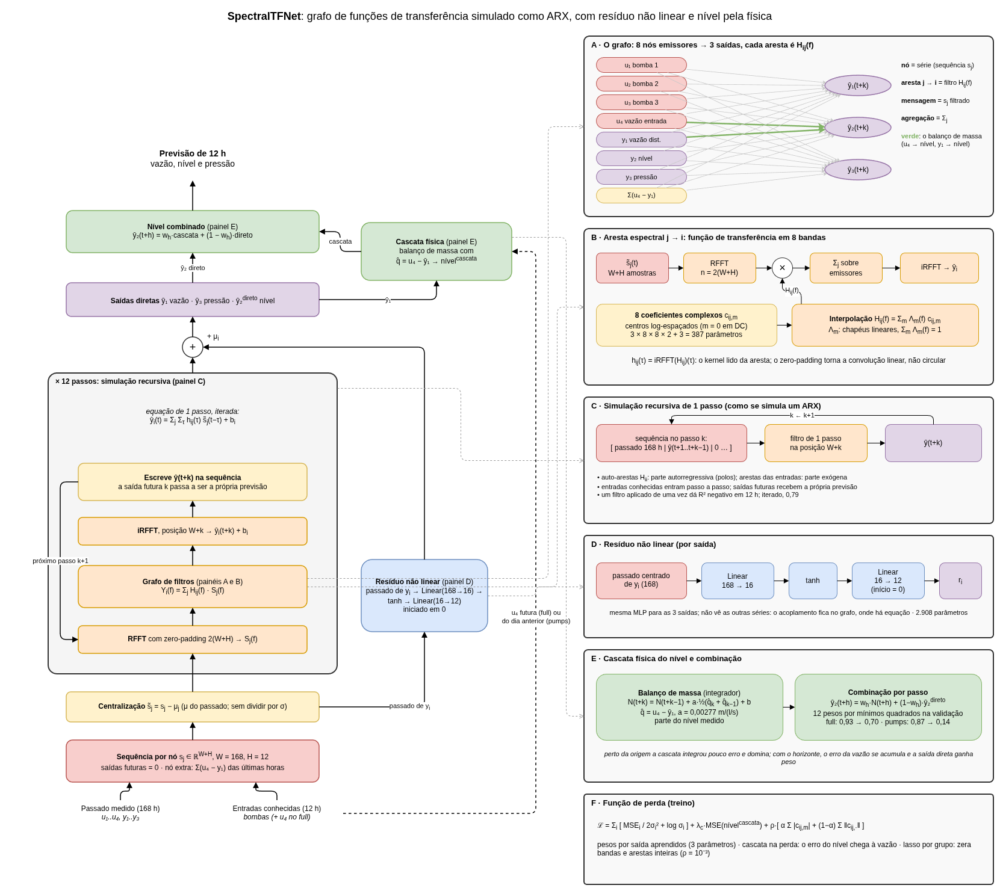

Fonte editável: [stf_arquitetura.drawio](figures/stf_arquitetura.drawio),
gerada por
[figure_architecture_drawio.py](../notebooks/training/scripts/figure_architecture_drawio.py).
A explicação peça por peça, com código executável, está no notebook
`docs/.explanation_code/arquitetura_spectral_tf_net.ipynb`.

O modelo final é o GOTAS do doc 8 com uma única adição, a
combinação do nível por passo (§5.6). Os blocos aparecem abaixo na ordem
em que uma previsão é calculada.

### 5.1 Nós e sequência de entrada

O grafo tem `N = 8` nós:
- as quatro entradas `u1..u4`;
- as três saídas `y1..y3`;
- um nó derivado com a soma móvel do desbalanço, `Σ(u4 − y1)`. Ele dá ao
  modelo uma versão já integrada da grandeza que move o nível.

Para prever a partir da hora `t`, cada nó `j` recebe uma sequência de
`W + H` amostras, com `W = 168` h de passado e `H = 12` h de horizonte:

```
s_j = [ x_j(t−W+1) … x_j(t) | x_j(t+1) … x_j(t+H) ]
```

- **Entradas conhecidas** (as bombas, e no `full` também a vazão de
  entrada) trazem no horizonte o valor programado.
- **Saídas** começam em **zero** no horizonte e são preenchidas pelo
  próprio modelo (§5.4).
- **Centralização:** só se subtrai a média do passado,
  `s̃_j = s_j − μ_j`, sem dividir pelo desvio. Uma bomba desligada a
  janela inteira tem desvio ≈ 0, e ligá-la no horizonte daria um valor
  normalizado da ordem de 10⁵.

### 5.2 A aresta espectral

Cada aresta `j → i` é um filtro linear invariante no tempo. No tempo, é
uma convolução com a resposta ao impulso `h_ij`; na frequência, é um
produto pela resposta em frequência `H_ij(f)`:

```
ŷ_{i←j}(t) = Σ_τ h_ij(τ) · s̃_j(t − τ)   ⟺   Ŷ_{i←j}(f) = H_ij(f) · S_j(f),   S_j = RFFT(s̃_j)
```

- **Zero-padding.** A FFT faz convolução *circular*, em que o fim da
  série contamina o começo. Completando com zeros até
  `n = 2(W+H) = 360`, a convolução fica linear. São 181 bins de
  frequência.
- **Bandas.** Um coeficiente complexo por bin daria 181 por aresta, que
  sobreajusta com ~1,5 mil amostras de treino. Cada aresta tem então só
  **8 coeficientes complexos** `c_ij,m`, um por banda, com centros
  log-espaçados (o primeiro em DC). A resposta em cada bin é interpolada
  entre os centros vizinhos:

```
H_ij(f) = Σ_m Λ_m(f) · c_ij,m,     Σ_m Λ_m(f) = 1
```

  Os `Λ_m` são funções-chapéu fixas; só os `c` são aprendidos (iCSNN). O
  espaçamento log dá tantos parâmetros às componentes lentas quanto às
  rápidas.
- **Tamanho.** A parte linear tem 3 saídas × 8 emissores × 8 bandas × 2
  reais + 3 vieses = **387 parâmetros**.

### 5.3 Agregação no grafo

Cada saída soma as mensagens de todos os emissores, inclusive dela mesma
(a auto-aresta `H_ii`):

```
Ŷ_i(f) = Σ_j H_ij(f) · S_j(f)
ŷ_i    = iRFFT(Ŷ_i) + b_i  =  Σ_j Σ_τ h_ij(τ) · s̃_j(t − τ) + b_i
```

Há duas formas de ler essa equação:
- **como GNN** (§1.4): a mensagem é `h_ij * s̃_j`, a agregação é a soma e
  a atualização é a identidade;
- **como identificação de sistemas:** é uma matriz de funções de
  transferência MIMO. As auto-arestas fazem o papel do polinômio
  autorregressivo, e as arestas das entradas, da parte exógena. A
  diferença para o ARMAX é que cada aresta tem 168 h de memória,
  restrita a 8 bandas, e é estimada por gradiente.

### 5.4 Simulação recursiva

Um filtro invariante aplicado de uma vez não prevê vários passos a
partir do passado da própria saída: o passo `k` precisaria do lag `k`,
e o mesmo kernel serve a todas as posições. Testado assim, o R² em 12 h
foi negativo. Por isso a equação de §5.3 é o modelo de **um passo**,
iterado como se simula um ARX:

```
para k = 1..12:
    S = RFFT(sequência atual)
    ŷ(t+k) = [iRFFT(Σ_j H_ij S_j)](posição W+k) + b
    escreve ŷ(t+k) na posição W+k das saídas      ← realimentação
```

As entradas conhecidas não mudam: entram passo a passo com o valor
programado. O modelo é, portanto, um **simulador** do sistema ao longo
do horizonte, e não um preditor direto de 12 valores.

### 5.5 Resíduo não linear

A parte linear não capta, por exemplo, a curva das bombas. Uma MLP
pequena soma uma correção a cada saída, olhando só o passado centralizado
da própria saída:

```
r_i = W2 · tanh(W1 · ỹ_i^passado + β1) + β2,     168 → 16 → 12
```

- é a mesma rede para as três saídas (2.908 parâmetros);
- não vê as outras séries nem as entradas futuras, então o acoplamento
  entre as variáveis fica todo no grafo, onde há equação;
- a última camada começa em zero, de modo que o modelo nasce linear e o
  resíduo só cresce se ajudar.

A saída direta de cada variável é `ŷ_i = linear_i + r_i + μ_i`.

### 5.6 Cascata física e combinação do nível

O nível é o único estado do sistema e integra o erro da vazão prevista.
A cascata calcula um segundo nível a partir do último nível medido,
pelo balanço de massa com a vazão prevista pelo grafo:

```
N(t+k) = N(t+k−1) + a · ½(q̂(t+k) + q̂(t+k−1)) + b,     q̂ = u4 − ŷ1
```

- **Os coeficientes:** `a` = 0,00277 m por l/s e `b`, por mínimos
  quadrados no treino. O `a` corresponde a uma área de ~1.300 m²
  (3,6 m³ / `a`), verificável na planta.
- **No `pumps`:** `u4` futura é substituída pela do dia anterior.

Perto da origem, a cascata integrou pouco erro e é muito precisa; com o
horizonte, o erro da vazão se acumula. O nível final combina as duas
estimativas com um peso por passo:

```
ŷ2(t+h) = w_h · N(t+h) + (1 − w_h) · ŷ2^direto(t+h),     h = 1..12
```

Os 12 pesos `w_h ∈ [0, 1]` são ajustados por mínimos quadrados na
validação. Eles vão de 0,93 a 0,70 no `full` e de 0,87 a 0,14 no
`pumps`, onde a cascata integra também o erro da vazão de entrada
estimada.

### 5.7 Função de perda e treino

```
ℒ = Σ_i [ MSE_i / 2σ_i² + log σ_i ]                         pesos por saída aprendidos
  + λ_c · MSE(nível da cascata)                              física na perda
  + ρ · [ α Σ |c_ij,m| + (1 − α) Σ_(i,j) ‖c_ij,·‖ ]          sparse-group lasso
```

- **Pesos por saída** (Kendall, Gal e Cipolla, 2018): `σ_i` é um
  parâmetro, as saídas ruidosas pesam menos e `log σ_i` impede que
  `σ_i` cresça sem limite. Trocar por um MSE simples custa 0,020 de R²
  no `full` e 0,037 no `pumps`, então o termo ficou.
- **Cascata na perda:** o erro do nível integrado chega por gradiente à
  vazão prevista.
- **Lasso por grupo:** zera bandas soltas e arestas inteiras, o que
  deixa o grafo esparso.

| Item | Valor |
|---|---|
| Janela / horizonte | `W` = 168 h / `H` = 12 h |
| Nós / bandas por aresta | 8 / 8 complexas, log-espaçadas |
| Resíduo | MLP 168 → 16 → 12, tanh, iniciada em zero |
| Otimizador | AdamW, taxa 10⁻³, weight decay 10⁻⁴, taxa reduzida no platô da validação |
| Lote / épocas | 128 / até 150, parada antecipada com paciência 25 |
| Pesos da perda | `λ_c` = 1, `ρ` = 10⁻³, `α` = 0,5 |
| Parâmetros | 387 (grafo) + 2.908 (resíduo) + 3 (`σ_i`) + 2 (cascata) + 12 (`w_h`) ≈ 3,3 mil |
| Custo | ~1,3 MFLOP e ~3 ms em CPU por previsão de 12 h; ~23 KB de pesos |

Os hiperparâmetros são os do doc 8, sem busca.

### 5.8 Cenários de informação futura

| Cenário | Conhecido no horizonte | Para quê |
|---|---|---|
| `full` | bombas e vazão de entrada | comparável ao ARMAX em simulação livre (que recebe todas as entradas) |
| `pumps` | só as bombas | o caso realista se a adução não for programada |

Ressalva importante: se as bombas operam em controle automático de
pressão, a frequência futura reage à demanda, e até o `pumps` usa uma
informação que a operação não teria (§9.3).

---

## 6. Protocolo experimental

O GOTAS e o ARMAX são comparados no nosso teste (linhas
1.876–2.207), nas mesmas origens:

| Protocolo | O que mede | Origens |
|---|---|---|
| **Simulação livre de 6 passos** (principal) | os regressores de saída são as próprias previsões, como no uso operacional | a cada 6 h, sem sobreposição (54 janelas) |
| **Simulação livre de 12 passos** (principal) | idem | a cada 12 h, sem sobreposição (27 janelas) |
| **R² por passo** | a qualidade de cada hora do horizonte | todas as horas (321), para o passo `h` não cair sempre no mesmo horário |
| **1 passo com valores medidos** (verificação) | o protocolo do artigo (série-paralelo); também no recorte dos autores | todas as horas (321) |

| Item | Escolha |
|---|---|
| Divisão | cronológica 70/15/15 |
| Previsão | `forecast_at_origin`, que recebe só o passado e as entradas futuras conhecidas |
| Métricas | R², RMSE, SMAPE por saída; R² médio das três |
| Referências mínimas | persistência (`ŷ[k+h] = y[k−1]`) e sazonal ingênuo (`ŷ[k+h] = y[k+h−24]`) |
| Sementes | média de 5 treinos; o desvio entre sementes é de 0,001 a 0,006 no R² médio |
| Decisão | na validação, com regra fixada antes de rodar; o teste é usado uma vez |

Os números saem de
[report_lean_model.py](../notebooks/training/scripts/report_lean_model.py)
(`outputs/lean_model_I0_ref.json`).

---

## 7. Resultados

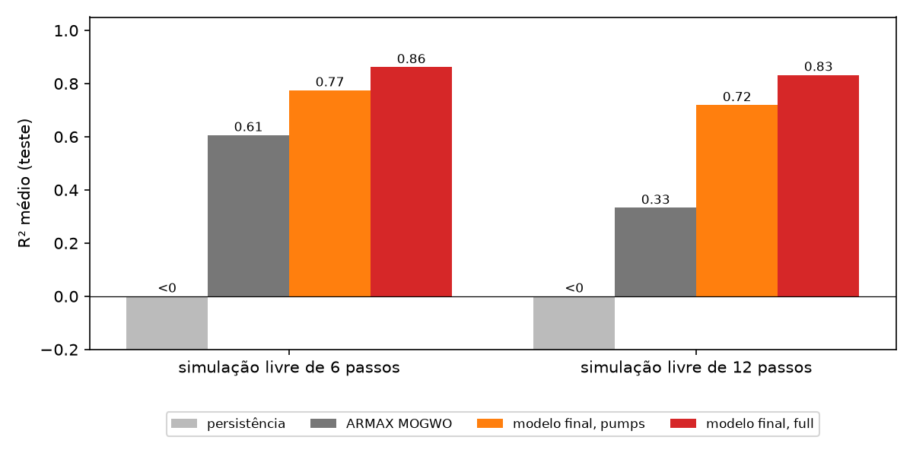

### 7.1 Simulação livre de 6 passos

Uma nova previsão a cada 6 h, sem sobreposição (R² / RMSE / SMAPE):

| Modelo | vazão (l/s) | nível (m) | pressão (mca) | R² médio |
|---|---|---|---|---|
| Persistência | −0,100 / 26,3 / 31,0% | −0,892 / 0,307 / 10,1% | −0,056 / 3,89 / 11,7% | < 0 |
| Sazonal ingênuo (24 h) | 0,847 / 9,81 / 9,5% | 0,069 / 0,216 / 7,1% | 0,539 / 2,57 / 6,9% | 0,485 |
| ARMAX MOGWO (simulação livre) | 0,706 / 13,6 / 16,7% | 0,658 / 0,131 / 4,0% | 0,454 / 2,80 / 9,6% | 0,606 |
| **GOTAS, `full`** | 0,927 / 6,78 / 8,7% | **0,882 / 0,077 / 2,5%** | 0,776 / 1,79 / 5,2% | **0,862** |
| GOTAS, `pumps` | **0,933 / 6,51 / 8,7%** | 0,609 / 0,140 / 4,4% | **0,783 / 1,76 / 5,2%** | 0,775 |

Em 6 h, o GOTAS explica 86% da variância, contra 61% do ARMAX,
com metade do erro em vazão e pressão.

### 7.2 Simulação livre de 12 passos (o uso operacional)

Uma nova previsão a cada 12 h, sem sobreposição (R² / RMSE / SMAPE):

| Modelo | vazão (l/s) | nível (m) | pressão (mca) | R² médio |
|---|---|---|---|---|
| Persistência | −0,669 / 32,4 / 38,3% | −0,859 / 0,305 / 10,0% | −1,106 / 5,50 / 18,8% | < 0 |
| Sazonal ingênuo (24 h) | 0,847 / 9,81 / 9,5% | 0,069 / 0,216 / 7,1% | 0,539 / 2,57 / 6,9% | 0,485 |
| ARMAX MOGWO (simulação livre) | 0,569 / 16,5 / 19,9% | 0,285 / 0,189 / 5,9% | 0,144 / 3,51 / 12,3% | 0,333 |
| GOTAS sem a combinação do nível (doc 8) | 0,925 / 6,88 / 8,8% | 0,794 / 0,101 / 3,1% | 0,762 / 1,85 / 5,3% | 0,827 |
| **GOTAS, `full`** | 0,925 / 6,88 / 8,8% | **0,811 / 0,097 / 3,0%** | 0,762 / 1,85 / 5,3% | **0,833** |
| GOTAS, `pumps` | **0,927 / 6,77 / 8,9%** | 0,464 / 0,164 / 5,3% | **0,766 / 1,83 / 5,3%** | 0,719 |

- **A diferença cresce com o horizonte:** 0,833 contra 0,333. O erro do
  ARMAX em vazão passa de 13,6 para 16,5 l/s, e o R² do nível dele cai de
  0,66 para 0,29. O GOTAS mantém a vazão em 6,9 l/s e o nível em
  0,81.
- **Vazão e pressão quase não dependem do cenário.** O que muda é o
  nível: sem a vazão de entrada futura, a cascata integra também o erro
  dessa estimativa, e o R² do nível cai de 0,81 para 0,46.
- **Com uma origem em cada hora do teste**, o R² médio em 12 h é de
  0,840 (`full`) e 0,716 (`pumps`).

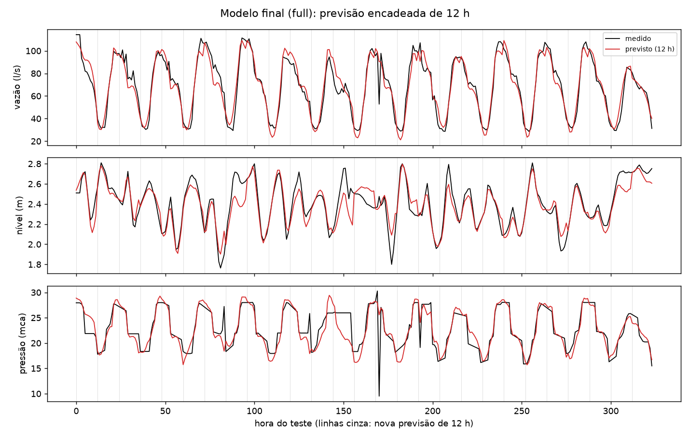

### 7.3 Qualidade a cada hora do horizonte

R² médio das três saídas no passo `h`, em todas as origens do teste:

| passo | persistência | ARMAX (simulação livre) | GOTAS `pumps` | **GOTAS `full`** |
|---|---|---|---|---|
| 1 h | 0,753 | 0,827 | 0,881 | **0,890** |
| 3 h | 0,051 | 0,666 | 0,768 | **0,867** |
| 6 h | −1,136 | 0,280 | 0,674 | **0,835** |
| 9 h | −1,691 | −0,159 | 0,677 | **0,825** |
| 12 h | −1,791 | −0,657 | 0,661 | **0,791** |

- **O ARMAX** começa perto do GOTAS no primeiro passo, o regime
  para o qual foi ajustado, e a partir de 8 h prevê pior que a média.
- **O GOTAS** perde só 0,10 de R² do passo 1 ao 12 no `full`. A
  distância entre os dois cresce de 0,06 no passo 1 para 1,45 no passo
  12.
- **No `pumps`**, a queda se concentra nas primeiras 6 h e depois se
  estabiliza, quando a combinação já passou quase todo o peso do nível
  para a saída direta.

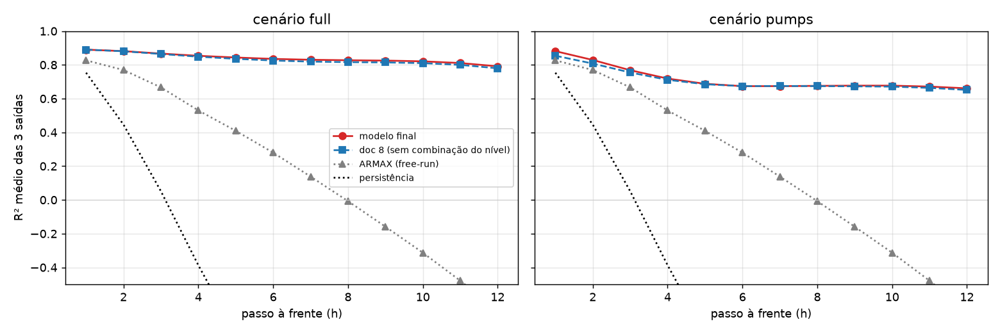

### 7.4 Janela de entrada

R² médio em 12 passos por janela de entrada (modelo linear, 1 seed, lote
128; doc 8 §6.4):

| janela | 24 h | 48 h | 96 h | 168 h | 336 h |
|---|---|---|---|---|---|
| R² médio | 0,748 | 0,751 | **0,793** | 0,792 | 0,773 |

As janelas de 96 a 168 h são as melhores: deixam o modelo ver o ciclo
diário e parte do semanal. A de 336 h acrescenta mais parâmetros
efetivos do que informação.

### 7.5 O que cada componente vale

| Componente | Efeito no R² médio, 12 h |
|---|---|
| Entradas futuras conhecidas | **+0,147** (o maior ganho isolado) |
| Resíduo não linear | +0,036 |
| Pesos por saída na perda (contra MSE simples) | +0,020 (`full`) / +0,037 (`pumps`) |
| Cascata na perda | +0,009 |
| Combinação do nível (contra só cascata no `full` ou só direto no `pumps`) | +0,006 / +0,014 |
| Ensemble de 5 treinos (descartado) | +0,003 |
| Busca de hiperparâmetros com Optuna (descartada) | +0,000 / +0,003 |
| Gate de regime, decomposição das saídas, limpeza do treino, Hammerstein, setpoint, fuga, resíduo polinomial | nenhum |

No `pumps`, a combinação do nível é necessária, e não um ajuste fino. Só
com a cascata, o nível vai a R² −0,14 (o erro da vazão de entrada
estimada se acumula), e a combinação devolve o nível ao patamar da saída
direta.

### 7.6 Verificação em 1 passo

Como verificação, o GOTAS também foi retreinado no recorte e no
protocolo dos autores: ordem 3, 1 passo com valores medidos, sem `u[k]`
(doc 8 §5.1). O recálculo do ARMAX com os coeficientes publicados
reproduz a Tabela 2 do artigo.

| R² médio em 1 passo | Janela dos autores (1500–2000) | Nosso teste |
|---|---|---|
| Persistência | 0,829 | 0,750 |
| ARMAX MOGWO | 0,909 | 0,825 |
| ARMAX MOCS (Tab. 2) | 0,921 | — |
| GOTAS | 0,902 | 0,889 |

Nesse protocolo, os dois modelos são equivalentes no médio, e o
GOTAS erra 27% menos no nível. Em 1 passo, porém, a dinâmica
lenta do reservatório faz até a persistência explicar mais de 75% da
variância, e o protocolo diferencia pouco os modelos. Por isso a
comparação principal é a de simulação livre (§7.1–7.3). No nosso teste,
o valor do GOTAS é o primeiro passo do modelo de 12 h, que usa
168 h de passado.

---

## 8. O modelo extraído

### 8.1 A equação

O modelo final é uma equação explícita mais um resíduo. Lendo a parte
linear de cada treino (`h_ij = iRFFT(H_ij)`, convertido para unidades
físicas) e tomando a média dos 5 treinos, as equações do cenário `full`
ficam, com os termos principais
([report_extracted_model.py](../notebooks/training/scripts/report_extracted_model.py),
`outputs/extracted_model.json`):

```
vazão     ŷ1(t+k) = μ1 + 0,219·ũ1(t+k) − 0,047·ũ1(t+k−2) + 0,194·ũ2(t+k) − 0,058·ũ2(t+k−2)
                       + 0,018·ũ4(t+k) + … + r1(k)

pressão   ŷ3(t+k) = μ3 + 0,066·ũ1(t+k) + 0,017·ũ1(t+k−1) + 0,063·ũ2(t+k) + 0,013·ũ2(t+k−1)
                       − 0,012·ũ2(t+k−2) + … + r3(k)

nível     ŷ2^dir(t+k) = μ2 + 0,0012·ũ4(t+k−1) + 0,0010·ũ4(t+k−2) + 0,0008·ũ4(t+k−3)
                           − 0,0004·ũ2(t+k−1) − 0,0006·ũ2(t+k−2) − 0,0005·ũ2(t+k−3) + … + r2(k)

          ŷ2(t+k) = w_k · N(t+k) + (1 − w_k) · ŷ2^dir(t+k)
          N(t+k)  = N(t+k−1) + 0,00277 · ½(q̂(t+k) + q̂(t+k−1)) + b,    q̂ = u4 − ŷ1
```

- **Notação.** `x̃ = x − média dos últimos 7 dias`. As bombas estão em
  Hz, as vazões em l/s, o nível em m e a pressão em mca.
- **O que está nas reticências:** os atrasos restantes, até 168 h; os
  valores programados das entradas nas horas seguintes; e as arestas com
  menos de 5% de peso.

A leitura:
- **Vazão e pressão** são determinadas pelas bombas 1 e 2 *na própria
  hora*, com ganho positivo (0,19–0,22 l/s e 0,06–0,07 mca por Hz) e uma
  pequena correção negativa duas horas depois. A bomba 3, quase sempre
  parada, não tem aresta relevante.
- **O nível** responde à vazão de entrada com atraso de 1 a 3 h. A soma
  desses coeficientes, **0,0029 m por l/s**, é o próprio `a` = 0,00277 do
  balanço de massa.
- **As bombas entram no nível com sinal negativo:** mais bombeamento,
  mais saída de água, nível mais baixo. É o outro lado do balanço, que o
  modelo leu pelas bombas, que determinam a vazão de saída.
- **A operação aparece nas arestas.** Os coeficientes sobre os valores
  *programados* da vazão de entrada e das bombas têm sinal oposto ao dos
  atrasos. Isso é coerente com a operação observada nos dados (§2.4): a
  adução é reduzida e as bombas são ligadas quando o nível está alto.

### 8.2 O grafo de interações

O peso de cada aresta é o desvio padrão da sua contribuição para a
saída nas janelas de teste, como fração da variação da saída. Ao lado de
cada saída aparece o peso do resíduo.

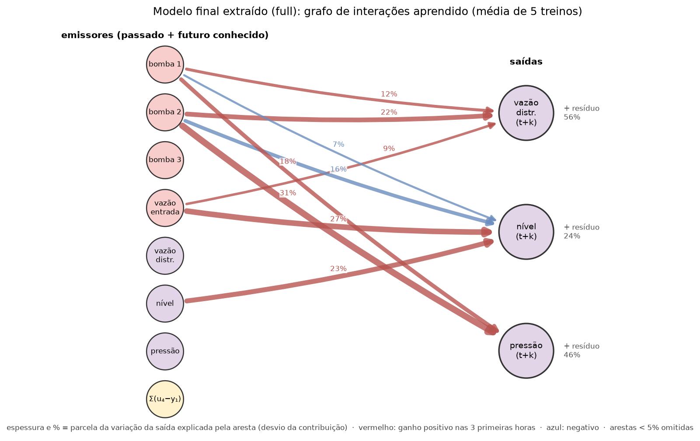

| Saída | Arestas (peso; ganho nas 3 primeiras horas) | Resíduo |
|---|---|---|
| vazão | bomba 2 (22%; +0,135 l/s por Hz) · bomba 1 (12%; +0,138) · vazão de entrada (10%; +0,030 l/s por l/s) | 56% |
| nível | vazão de entrada (27%; **+0,0029 m por l/s**) · nível (23%; +0,072) · bomba 2 (16%; −0,0017 m por Hz) · bomba 1 (7%; −0,0016) | 24% |
| pressão | bomba 2 (31%; +0,060 mca por Hz) · bomba 1 (18%; +0,074) | 46% |

- **Coincidência com a EDA:** as arestas fortes são as que a causalidade
  de Granger apontou (§2.6).
- **Estabilidade entre os treinos:** a variação é de 2% a 9%, com uma
  exceção. A auto-aresta do nível varia 84%, porque o resíduo, que
  também lê o passado do nível, divide com ela a autorregressão de forma
  diferente em cada treino.
- **Cenário `pumps`:** o grafo está em
  [stf_grafo_extraido_pumps.png](figures/stf_grafo_extraido_pumps.png).
  As arestas das bombas são as mesmas, e a vazão de entrada perde peso
  no nível, porque o futuro dela não é conhecido.

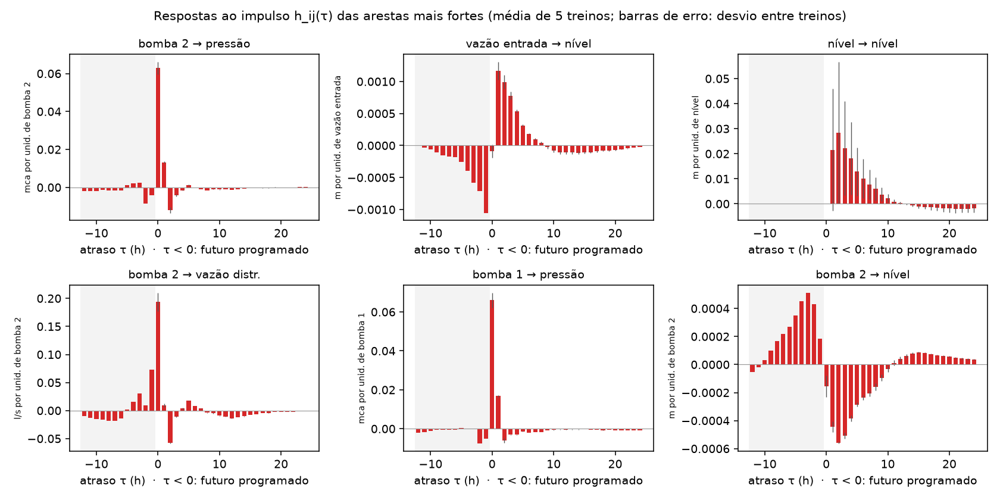

### 8.3 A física explícita e o limite da equação

- **O nível tem uma equação física explícita:** a cascata de §5.6, cujo
  coeficiente `a` é a própria área do reservatório (~1.300 m²). A
  combinação por passo diz quanto se confia nessa física a cada hora do
  horizonte.
- **O resíduo** pesa 56% na vazão, 24% no nível e 46% na pressão, e é a
  única parte sem equação fechada. Ele olha só o passado de cada saída,
  então o acoplamento entre as variáveis está todo nas arestas acima.
- **Num modelo sem o resíduo** (R² 0,79 em 12 h; doc 8 §7.1), a mesma
  leitura dá +0,0039 e −0,0019 m por l/s para as arestas da vazão de
  entrada e da vazão de distribuição no nível. A auto-aresta do nível
  fica em 0,93, um integrador.
- **Alternativa com equação:** um resíduo polinomial de Chebyshev empata
  na validação, mas perde 0,012–0,015 no teste (doc 12 §3).

---

## 9. Discussão

### 9.1 Como ler a comparação com o estudo de referência

- **Simulação livre de 6 e 12 h, a pergunta deste trabalho:** 0,862 e
  0,833 contra 0,606 e 0,333. A vantagem cresce com o horizonte, porque
  o GOTAS foi desenhado para simular o sistema (recursão, entradas
  futuras, cascata). O ARMAX entra como referência, porque foi proposto
  para 1 passo.
- **Em 1 passo, o protocolo original:** os dois modelos são
  equivalentes. A arquitetura proposta não perde nada no problema de
  partida.

O trabalho de referência resolve bem a identificação de 1 passo com
otimização multiobjetivo. Este trabalho estende a identificação para
horizontes longos, com a física explícita no modelo. As duas abordagens
são complementares: a otimização multiobjetivo poderia, por exemplo, ser
usada para ajustar o compromisso entre as três saídas no GOTAS.

### 9.2 O teto de informação

Os oráculos do doc 10 §2 mostram onde está o limite:

- **Pressão:** mesmo com vazão, nível e bombas verdadeiros no mesmo
  instante, um mapa estático explica 0,78. O modelo está em 0,76. O que
  falta é uma variável não medida: pressão a montante, abertura de
  válvula ou o setpoint real.
- **Nível no `full`:** com a vazão verdadeira, a cascata chega a 0,91. O
  modelo está em 0,81, e a diferença é o erro integrado da vazão
  prevista.
- **Nível no `pumps`:** é limitado pela vazão de entrada, que nenhum
  modelo previu acima de R² 0,45.

### 9.3 Limitações

- **Apenas 3 meses de dados** e uma única mudança de horário da operação
  no teste. A simulação livre de 12 h tem só 27 janelas.
- **O cenário `full` assume a vazão de entrada futura conhecida**, e o
  `pumps`, a frequência futura das bombas. Se as bombas estão em
  controle automático de pressão, os dois cenários são otimistas, e a
  informação honesta seria a tabela de setpoints. Isso depende de
  confirmação com a operação (doc 11 §8).
- **O resíduo não linear não tem equação** no modelo final.

### 9.4 A arquitetura é nova?

É uma combinação nova de peças conhecidas, e não um paradigma novo.
- **As peças:** GNNs para séries temporais (DCRNN, StemGNN), filtros
  espectrais aprendidos (FilterNet, FITS), GNN em frequência
  (FourierGNN), bandas com lasso (iCSNN), exógenas no horizonte (TimeXer)
  e redes que conservam massa (Mass-Conserving Perceptron).
- **O que não encontramos junto na literatura consultada:**
  - uma GNN cuja mensagem é uma função de transferência em bandas,
    usada como **simulador ARX recursivo**;
  - as entradas futuras no mesmo grafo;
  - o estado integrador corrigido por uma **cascata física** combinada
    passo a passo com a saída direta;
  - a medida explícita da não linearidade ao lado da equação.

---

## 10. Conclusão

Partindo da identificação de 1 passo de Ferrari, Leandro e Coelho
(2025), este trabalho propôs o GOTAS para prever o reservatório
São José várias horas à frente sem perder a legibilidade física. O
modelo foi desenhado a partir da física do sistema:
- cada série é um nó, e cada aresta é uma função de transferência;
- o grafo é simulado como um ARX, com as entradas futuras conhecidas;
- o nível, que é um integrador, é corrigido por uma cascata de balanço
  de massa.

Com 3,3 mil parâmetros e sem busca de hiperparâmetros, ele supera o
ARMAX de referência em simulação livre: 0,862 em 6 h e 0,833 em 12 h,
contra 0,606 e 0,333. Em 1 passo, os dois são equivalentes. O modelo
extraído mostra as bombas determinando a vazão e a pressão na própria
hora e o nível respondendo à vazão de entrada com o coeficiente do
balanço de massa.

O desempenho restante é limitado pela informação disponível, não pelo
modelo. O próximo ganho relevante depende de dados novos da operação: a
programação da adução, a tabela real de setpoints de pressão e mais
meses de histórico. Ficam como extensões a quantificação de incerteza
dos coeficientes e das previsões, explorada no doc 12, e a destilação
do resíduo em uma expressão fechada.

---

## Referências

- Ferrari, A. C. K.; Leandro, G. V.; Coelho, L. dos S. *Multi-objective metaheuristics applied for the multivariable system identification*. Int. J. Parallel, Emergent and Distributed Systems, 2025. DOI 10.1080/17445760.2025.2508174.
- Li, Y.; Yu, R.; Shahabi, C.; Liu, Y. *Diffusion Convolutional Recurrent Neural Network: Data-Driven Traffic Forecasting*. ICLR, 2018. arXiv:1707.01926.
- Yu, B.; Yin, H.; Zhu, Z. *Spatio-Temporal Graph Convolutional Networks: A Deep Learning Framework for Traffic Forecasting*. IJCAI, 2018.
- Cao, D. et al. *Spectral Temporal Graph Neural Network for Multivariate Time-series Forecasting (StemGNN)*. NeurIPS, 2020.
- Gilmer, J. et al. *Neural Message Passing for Quantum Chemistry*. ICML, 2017.
- Cranmer, M. et al. *Discovering Symbolic Models from Deep Learning with Inductive Biases*. NeurIPS, 2020.
- Yi, K. et al. *FilterNet: Harnessing Frequency Filters for Time Series Forecasting*. NeurIPS, 2024. arXiv:2411.01623.
- Xu, Z.; Zeng, A.; Xu, Q. *FITS: Modeling Time Series with 10k Parameters*. ICLR, 2024. arXiv:2307.03756.
- Yi, K. et al. *FourierGNN: Rethinking Multivariate Time Series Forecasting from a Pure Graph Perspective*. NeurIPS, 2023. arXiv:2311.06190.
- Marinucci, L.; Di Nino, L.; D'Acunto, G.; Di Lorenzo, P.; Barbarossa, S. *Inverse Cross-spectral Neural Networks for Multivariate Time Series* (iCSNN), 2026. arXiv:2610.06630.
- Wang, Y. et al. *TimeXer: Empowering Transformers for Time Series Forecasting with Exogenous Variables*. NeurIPS, 2024. arXiv:2402.19072.
- Kendall, A.; Gal, Y.; Cipolla, R. *Multi-Task Learning Using Uncertainty to Weigh Losses*. CVPR, 2018.
- Ljung, L. *System Identification: Theory for the User*. Prentice Hall, 1999.
