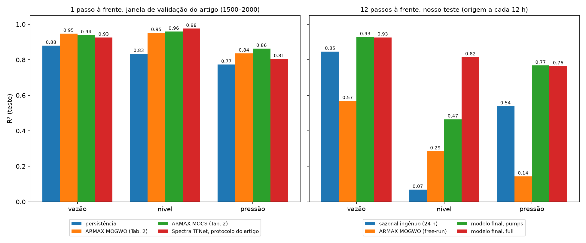

# Identificação do sistema MIMO do reservatório São José: SpectralTFNet comparado ao ARMAX multiobjetivo de Ferrari, Leandro e Coelho (2025)

Relatório consolidado do trabalho: o problema, o estudo de referência, o
caminho até a arquitetura final, o protocolo experimental, os resultados
em R² comparados ao artigo e a explicabilidade do modelo. Os detalhes de
cada etapa estão nos documentos numerados desta pasta, citados como
"doc N". A versão em LaTeX está em `overleaf/main.tex`.

---

## Resumo

O reservatório São José (Sanepar, Curitiba/PR) é um sistema MIMO com
quatro entradas (frequência de três bombas e vazão de entrada) e três
saídas (vazão de distribuição, nível do reservatório e pressão). Este
trabalho propõe o **SpectralTFNet**, um modelo de identificação para
previsão de várias horas à frente que continua explicável em nível de
equação.

1. **O modelo.** É um grafo cujas arestas são funções de transferência
   aprendidas no domínio da frequência, simuladas recursivamente como um
   ARX. Ele usa as entradas cujo futuro é conhecido (programação das
   bombas) e resolve o nível por uma cascata física de balanço de massa.
   O modelo final é um ensemble de 5 treinos cuja parte linear é a média
   das funções de transferência, ou seja, continua sendo uma única
   equação.
2. **O desempenho.** Em 12 h o R² médio é **0,836** (0,927 / 0,816 /
   0,765) com as entradas futuras conhecidas, e 0,721 quando só a
   programação das bombas é conhecida. A qualidade cai pouco ao longo do
   horizonte: de 0,89 no passo de 1 h para 0,79 no de 12 h.
3. **A explicabilidade.** Cada aresta é uma equação de convolução. O
   balanço de massa do reservatório aparece nas arestas do nível com
   sinais opostos e intervalo de credibilidade (+0,00345 e −0,00230 m
   por l/s). O modelo também entrega intervalos de previsão calibrados.
4. **O contexto.** O trabalho parte da identificação feita por Ferrari,
   Leandro e Coelho (2025), que ajustaram um ARMAX de ordem 3 com
   metaheurísticas multiobjetivo e obtiveram R² de até 0,948 / 0,960 /
   0,863 em previsão de 1 h. No mesmo protocolo de 1 h o SpectralTFNet
   chega a resultados equivalentes (0,902 contra 0,909 no médio, e 0,976
   contra 0,954 no nível). A contribuição deste trabalho é estender a
   identificação para horizontes longos, com explicabilidade. Um modelo
   caixa-preta forte (LightGBM) fica estatisticamente empatado com o
   grafo, e experimentos de oráculo indicam que o desempenho restante é
   limitado pela informação disponível nos dados.

---

## 1. Introdução

### 1.1 O problema

Estações de bombeamento e reservatórios de abastecimento são sistemas
dinâmicos acoplados. A frequência das bombas altera a vazão e a pressão
de distribuição; a diferença entre a vazão que entra e a que sai é
integrada no nível do reservatório. Modelos desse acoplamento servem
para prever o estado do sistema algumas horas à frente, projetar
controladores e entender a física da planta.

A identificação de sistemas oferece duas famílias de modelos para isso.
Os **lineares clássicos** (ARX, ARMAX) são interpretáveis, mas têm
estrutura genérica e se degradam em horizontes longos. As **redes
neurais** são precisas, mas não devolvem uma equação. Este trabalho
busca um modelo com a precisão da segunda família e a legibilidade da
primeira.

### 1.2 O ponto de partida

Ferrari, Leandro e Coelho (2025) usaram 1.100 das 2.216 amostras
horárias do reservatório São José e estimaram um ARMAX MIMO de ordem 3
com seis metaheurísticas: três mono-objetivo (GA, GWO, CS) e três
multiobjetivo (NSGA-II, MOGWO, MOCS), com 100 execuções cada. O estudo
mostrou que a formulação multiobjetivo resolve o ajuste conjunto das
três saídas: os melhores modelos atingiram R² de 0,94–0,96 em vazão e
nível e de 0,84–0,86 em pressão, enquanto as versões mono-objetivo
tinham dificuldade com o nível.

A avaliação do artigo é de previsão um passo à frente (1 h), o protocolo
usual de identificação para esse tipo de modelo (doc 12-protocolo). Este
trabalho parte dessa identificação e se pergunta o que muda quando o
objetivo passa a ser **prever várias horas à frente** (o uso operacional
de um modelo de reservatório) **mantendo a física legível no modelo**.
O horizonte maior traz duas dificuldades: o erro de cada hora se acumula
no nível, que é um integrador, e o modelo precisa saber o que as bombas
farão nas próximas horas.

### 1.3 Objetivos e contribuições

O objetivo é um modelo de identificação que (i) preveja as três saídas
com qualidade em 12 h, (ii) seja explicável em nível de equação e de
grafo de acoplamento, e (iii) seja avaliado de forma reprodutível e
válida para uso em produção.

As contribuições são:

- **uma arquitetura nova por combinação**, o SpectralTFNet: um grafo
  cujas arestas são funções de transferência em bandas de frequência,
  usado como simulador ARX recursivo, com as entradas futuras conhecidas
  e uma cascata física diferenciável para o nível;
- **uma avaliação em três níveis de protocolo**: o de 1 h do estudo de
  referência, o passo 1 do nosso horizonte e 12 h, com persistência e
  sazonal ingênuo como referências mínimas;
- **explicabilidade direta e com incerteza:** a equação é lida das
  arestas, e o balanço de massa aparece com intervalo de credibilidade
  (aproximação de Laplace);
- **um contrato de produção testado:** a previsão só recebe o passado e
  as entradas futuras conhecidas, e testes de perturbação e replay
  garantem que nada do futuro vaza;
- **a medição do teto de informação:** oráculos e um benchmark
  caixa-preta mostram onde o desempenho é limitado pelos dados.

---

## 2. O sistema e os dados

### 2.1 Variáveis

| Símbolo | Variável | Unidade | Papel |
|---|---|---|---|
| `u1, u2, u3` | frequência das bombas B1, B2, B3 | Hz | entrada |
| `u4` | vazão de entrada (adutora) | l/s | entrada |
| `y1` | vazão de distribuição | l/s | saída |
| `y2` | nível do reservatório | m | saída (estado) |
| `y3` | pressão de distribuição | mca | saída |

São 2.216 amostras horárias, de 27/07/2014 a 27/10/2014. Usamos o
conjunto completo com divisão cronológica 70/15/15:
- **treino:** 1.545 amostras;
- **validação:** 331 amostras;
- **teste:** 332 amostras, nas linhas 1.876–2.207.

Para a comparação no protocolo do artigo, também usamos o recorte dele:
estimação nas linhas 550–1150 e validação nas linhas 1500–2000.

### 2.2 Qualidade dos dados

O treino contém **22 amostras com falha de sensor**: nível abaixo de
1 m, salto de nível acima de 0,3 m/h, pressão abaixo de 5 mca, vazão
negativa e vazão travada no fundo de escala (199,6 l/s) depois de
paradas. Validação e teste estão limpos.

Limpar essas amostras dobra o R² de 1 passo do balanço de massa (de
0,47 para 0,84, doc 1 §4). No modelo final, porém, a limpeza não muda o
desempenho (doc 10 §4). Ela serviu como verificação de que os resultados
não estavam distorcidos pelas falhas.

### 2.3 A física conhecida

- **Nível:** é um integrador do desbalanço de vazão. Com discretização
  trapezoidal, `Δy2[k] = a · ½(q[k] + q[k−1]) + b`, com `q = u4 − y1`.
  No treino, `a` = 0,00277 m por l/s, o que corresponde a uma área de
  ~1.200–1.300 m².
- **Vazão e pressão:** são relações quase algébricas. A pressão é
  dominada pela vazão (perda de carga); a vazão, pelas bombas.

### 2.4 Análise exploratória

A análise exploratória (doc 5) mostrou:
- todas as séries são estacionárias (ADF);
- o ciclo diário (≈ 24 h, com harmônico em 12 h) concentra a maior
  parte da energia;
- a vazão de entrada é a causa de Granger mais forte do nível, com lag
  de 1 h (`p ≈ 5·10⁻¹²⁴`);
- a coerência entre vazão de entrada e nível chega a 0,98;
- o núcleo físico (vazão de entrada, vazão, nível, pressão) é
  cointegrado.

Pelo comportamento das séries (doc 11 §8 e respostas da análise de
controle):
- **bombas:** têm inversor de frequência e são operadas por setpoints;
- **pressão:** tudo indica que é controlada em patamares por horário
  (28/26/20 mca);
- **vazão de entrada:** é estrangulada quando o nível está alto.

Isso importa para o que conta como "entrada conhecida no futuro" (§5.2).

### 2.5 A análise exploratória em figuras

A EDA de séries temporais (`notebooks/eda/03_eda_series_temporais.ipynb`,
doc 5) olhou os dados em quatro frentes: tempo, frequência, causalidade
e identificação clássica. Cada achado abaixo virou uma decisão de
desenho do modelo, resumida na tabela do fim desta seção.

**Tendência e sazonalidade.** A decomposição STL, com período de 24 h,
separa um ciclo diário de amplitude estável nas três saídas ao longo dos
90 dias. A tendência varia em escala de dias, sem deriva de longo prazo.
O resíduo contém ruído de alta frequência e os eventos isolados de falha
de sensor.


**Memória e ordem.** A autocorrelação das saídas decai devagar e oscila
com período de ~24 h. A autocorrelação parcial do nível e da pressão
corta em 1–2 lags: um AR de ordem baixa capta a dinâmica imediata, mas o
ciclo diário pede memória longa. Foi por isso que a janela de entrada
de 168 h (7 dias) saiu melhor que a de 24 h na varredura (doc 8 §6.4).


**Domínio da frequência.** O periodograma de Welch mostra, em todas as
séries, um pico dominante em 23–26 h. Nas bombas aparecem picos
secundários em ~128 h e ~256 h, ligados a trocas de regime de operação.
Vazões e nível também têm energia no harmônico de 12 h. O espectrograma
mostra que a energia do ciclo diário é **persistente** ao longo de todo o
período, ou seja, não é efeito de um trecho isolado. Essa concentração
em poucas faixas de frequência justifica parametrizar cada aresta por
**bandas**, e não por bin.


**Acoplamento entrada → saída.** A coerência entre a vazão de entrada e
o nível chega a **0,98** no harmônico de 12 h: a relação é quase linear
e invariante no tempo nessa banda, o equivalente em frequência à
causalidade de Granger com lag de 1 h. As bombas acoplam mais com a
pressão e a vazão (0,72–0,77 perto de 24 h) do que com o nível, o que é
coerente com a perda de carga depender da vazão. Coerência alta por
faixa de frequência é exatamente o que uma aresta `H_ij(f)` modela.


**Estrutura de longo prazo.** As quatro variáveis do núcleo físico
(vazão de entrada, vazão de distribuição, nível e pressão) são
cointegradas entre si, e o teste de Johansen dá rank completo: nenhuma
variável "passeia livremente" em relação às outras. É a evidência
estatística de que pertencem ao mesmo balanço físico.


**Agrupamento por forma.** O agrupamento hierárquico sobre a distância
DTW separa dois grupos: as bombas que de fato operam (B1, B2) e as três
saídas físicas, com vazão de distribuição e pressão como o par mais
próximo (DTW 18,0, que também é a maior correlação linear, 0,86). A
bomba 3, quase sempre parada, e a vazão de entrada, que é a forçante
externa, ficam isoladas. O grafo do modelo tem um nó por variável, e
esses grupos aparecem depois nas arestas fortes do grafo aprendido.


**Identificação clássica.** A resposta ao impulso empírica, a correlação
cruzada normalizada, tem pico em 1–2 h para vazão de entrada → nível e
picos mais espalhados para os pares com a vazão de distribuição. Os 12
modelos ARX de ordem 2, um por par entrada→saída, são todos estáveis,
com polo dominante entre **0,94 e 0,997**. A dinâmica é lenta, com
constante de tempo de dezenas de horas. Daí duas consequências:
- prever 1 h à frente é muito mais fácil que prever 12 h;
- um modelo de função de transferência precisa ser **simulado
  recursivamente** para acompanhar essa dinâmica no horizonte.


**Onde está a variância.** Decompondo cada saída em bandas por wavelet
causal (doc 9, Fase 1), o ciclo diário (16–32 h) e a componente lenta
(> 32 h) concentram a maior parte da variância. O nível é o caso mais
extremo: 47% da variância dele está acima de 32 h, a deriva do
integrador. Comparando com o erro do modelo de referência, o ciclo
diário está praticamente resolvido (erro/sinal de 0,02–0,03 em vazão e
pressão), e o erro que sobra fica na deriva lenta e no ruído de 2–8 h.
Essa medida orientou a busca por ganhos adicionais (doc 10).


**Da EDA para a arquitetura**

| Achado da EDA | Decisão no modelo |
|---|---|
| O nível só se correlaciona com a integral do desbalanço, e não com os valores instantâneos | cascata física de balanço de massa para o nível |
| Coerência alta por faixa de frequência (0,98 entre vazão de entrada e nível) | aresta = função de transferência `H_ij(f)` |
| Energia concentrada em poucas faixas (24 h, 12 h, vários dias) | `H_ij` parametrizado por 8 bandas log-espaçadas |
| Ciclo diário dominante e persistente; ACF com memória de vários dias | janela de entrada de 168 h |
| Polos entre 0,94 e 0,997 (dinâmica lenta) | simulação ARX recursiva de 1 passo, iterada no horizonte |
| Bombas quase binárias, alternadas; bomba 3 quase parada | só centralizar, sem dividir pelo desvio (desvio ≈ 0 nas janelas paradas) |
| Núcleo físico cointegrado e agrupado por DTW | grafo com um nó por variável; lasso por aresta para revelar o acoplamento |
| Falhas de sensor no resíduo da STL e nos boxplots | regras de limpeza e verificação de robustez (doc 10) |

### 2.6 Dependência entre as séries: por que um grafo

O grafo só se justifica se o passado de uma série ajuda a prever outra
**depois** de descontada a memória de cada uma. Testamos isso no treino
(1545 h) com dois critérios
([report_graph_dependency.py](../notebooks/training/scripts/report_graph_dependency.py)):
Granger condicional num VAR das 7 séries (ordem 24 por AIC, teste de Wald)
e correlação cruzada após pré-branqueamento AR, com o lag do pico.

| Aresta | Granger p | Correlação pré-branqueada (lag) | Leitura física |
|---|---|---|---|
| vazão de entrada → nível | 7e-80 | +0,36 (1 h) | balanço de massa |
| vazão de distribuição → nível | 6e-10 | +0,12 (2 h) | balanço de massa |
| vazão de distribuição → pressão | 9e-16 | +0,59 (0 h) | hidráulica da rede |
| bombas 1 e 2 → pressão | 0,01 | +0,32 / +0,36 (0 h) | curva das bombas |
| bombas 1, 2, 3 → vazão de distribuição | ≤ 2e-3 | +0,18 a +0,26 (0 h) | bombeamento |
| nível → pressão | 2e-22 | +0,13 (15 h) | efeito lento |
| bombas 1 e 2 → nível | 0,33 / 0,55 | fraca | sem aresta direta |
| bomba 3 → pressão | 0,17 | — | não significativa |

Três leituras sustentam a abordagem:

- **Há dependência cruzada condicional**, que um modelo univariado por
  saída descarta. As arestas mais fortes são as da física (§2.3).
- **O grafo não é completo**: as bombas chegam ao nível só através da
  vazão. Isso justifica um grafo esparso aprendido com lasso por aresta,
  e bate com a Laplace (§8.3: 4 de 24 arestas significativas).
- **Os atrasos variam por aresta** (0 h nas bombas, 1–2 h no balanço,
  ~15 h no nível → pressão). Por isso a aresta é um filtro no tempo,
  `H_ij(f)`, e não um peso escalar.

Ressalvas: com 1545 h quase todo p sai pequeno, e o que discrimina são as
arestas que **não** passam. A correlação distribuição → nível sai
positiva, embora a física diga negativa. A sazonalidade diária que o
pré-branqueamento não remove é a explicação provável; a direção vem do
coeficiente do modelo (§8.3).

---

## 3. O estudo de referência em detalhe

### 3.1 O modelo

Para cada saída `i`, com lags de 1 a 3:

```
y_i[k] = − Σ_{l=1..3} a_il · y_i[k−l]
         − Σ_{j≠i} Σ_{l=1..3} a_ijl · y_j[k−l]
         + Σ_{m=1..4} Σ_{l=1..3} b_iml · u_m[k−l]
         + Σ_{l=1..3} c_il · e_i[k−l]
```

Isso dá 24 coeficientes por saída e **72 no total** (Tabela 3 do artigo;
algumas docs anteriores deste projeto diziam ~120, número
superestimado). Os coeficientes são estimados por metaheurística no
espaço [−1, 1].

### 3.2 O protocolo de avaliação

- **Horizonte:** 1 passo (1 h), em modo série-paralelo: os regressores
  de saída são os valores medidos.
- **Entradas:** `u[k−1..k−3]`.
- **Termo MA:** usa o resíduo da parte ARX.
- **Modelo reportado:** a solução de compromisso da frente de Pareto
  mais próxima de R² = 1 nas três saídas.

Para comparar os dois trabalhos no mesmo terreno, o SpectralTFNet também
foi treinado e avaliado exatamente nesse protocolo (§7.1).

### 3.3 Os números publicados

| Algoritmo | R² vazão | R² nível | R² pressão | R² médio |
|---|---|---|---|---|
| MOCS | 0,939 | **0,960** | **0,863** | **0,921** |
| MOGWO | **0,948** | 0,953 | 0,836 | 0,912 |
| NSGA-II | 0,942 | 0,950 | 0,837 | 0,910 |
| GWO | 0,949 | 0,411 | 0,829 | 0,730 |
| CS | 0,946 | −3,23 | 0,822 | −0,49 |
| GA | 0,932 | −15,86 | 0,631 | −4,77 |

Melhor modelo na validação, Tabela 2 do artigo. Os coeficientes MOGWO da
Tabela 3 foram usados para recalcular o ARMAX nos nossos experimentos, e
o recálculo bate com a tabela (0,948 / 0,954 / 0,824).

---

## 4. Como chegamos à arquitetura

A arquitetura final não foi o ponto de partida. Ela resultou de uma
sequência de hipóteses, cada uma testada e substituída pela seguinte
quando a evidência apontava outro caminho.

### 4.1 Hipótese inicial: GNN mais regressão simbólica

A ideia inicial seguia Cranmer et al. (2020): treinar uma *Message
Passing Neural Network* (MPNN) sobre os sete nós do sistema, regularizar
a mensagem com L1 e destilar a mensagem e a atualização por regressão
simbólica (PySR). A triagem de arquiteturas (doc 3) separou dois papéis:
- **extração:** MPNN e SymbolicGraphNetwork, cujas funções internas
  recebem variáveis com nome;
- **acurácia:** StemGNN, Seq2SeqLatentGNN e FourierGNN, que operam sobre
  latentes sem nome e não admitem esse tipo de extração.

**O que mostrou:** em 12 h, todas as redes superaram o ARMAX em
simulação livre (vazão 0,87–0,92, pressão 0,59–0,74). O nível, porém,
ficou entre 0,25 e 0,46 em todas (doc 6).

### 4.2 Diagnóstico: o nível é um integrador

O nível é o único **estado** do sistema. O erro de cada hora na vazão
prevista se acumula nele. Um teste de oráculo foi decisivo: com a vazão
de distribuição **verdadeira**, o balanço de massa prevê o nível com R²
de ~0,91. Ou seja, o problema não era o nível em si, mas a vazão
prevista.

Disso nasceu a **cascata física**: o modelo neural prevê a vazão, e o
nível sai do balanço de massa alimentado por essa previsão (doc 7). Com
um ensemble de 5 redes mais a cascata, o R² médio chegou a 0,809, e a
0,819 com a cascata treinada junto. Dos 5 membros, porém, só 2 eram
extraíveis.

### 4.3 Por que a MPNN não bastava

Ao inspecionar as mensagens, apareceu uma limitação estrutural: a soma
de mensagens da MPNN não consegue expressar a **subtração** `u4 − y1`
que o balanço de massa exige. Um modelo com arestas lineares (FIR,
`LinearEdgeNet`) recuperava os sinais opostos, mas ficava abaixo da MPNN
em acurácia.

Ao mesmo tempo, a análise de erro mostrou que **63% do erro do nível
vinha da baixa frequência da vazão prevista**. Nenhum modelo até ali via
as **entradas futuras conhecidas**: a programação das bombas nas
próximas 12 h. Sem elas, a rede precisava adivinhar o que as bombas
fariam, e esse chute virava exatamente o viés de baixa frequência que a
cascata integrava.

### 4.4 O desenho do SpectralTFNet

O SpectralTFNet foi desenhado para resolver os dois problemas ao mesmo
tempo, em cinco decisões:

1. **A aresta é uma função de transferência** `H_ij(f)`, aplicada no
   domínio da frequência (FilterNet; FITS). A aresta *é* a equação, sem
   regressão simbólica, e a subtração vira apenas um sinal negativo no
   filtro.
2. **Poucas bandas:** cada `H_ij` é parametrizado por 8 valores
   complexos em bandas log-espaçadas, interpolados entre os bins da FFT
   (iCSNN). Com só ~1,5 mil amostras de treino, a parte linear inteira
   tem 387 parâmetros.
3. **Simulação recursiva de 1 passo:** um filtro aplicado de uma vez não
   consegue prever vários passos do próprio passado (testado: R²
   negativo). O filtro passou a ser o modelo de 1 passo, iterado 12
   vezes com a previsão realimentada, como se simula um ARX.
4. **Entradas futuras conhecidas na mesma sequência:** as bombas, e no
   cenário `full` também a vazão de entrada, entram no horizonte; as
   saídas futuras ficam zeradas. Foi o maior ganho isolado: +0,147 de R²
   médio.
5. **Só centralizar, sem dividir pelo desvio:** com as bombas
   desligadas, o desvio da janela é ~0, e a divisão fazia a previsão
   explodir (R² de −10⁶).

Completam o desenho:
- a **cascata física diferenciável** como termo de loss, para o
  gradiente do erro do nível chegar à vazão;
- um **resíduo não linear pequeno, iniciado em zero**, que só cresce se
  ajudar;
- um **lasso por grupo (aresta, banda)**, que zera arestas ou bandas
  inteiras.

O resultado foi **um modelo único com R² médio de 0,824 em 12 h**, acima
do ensemble de 5 redes (0,819), e com a equação legível nas arestas
(doc 8).

### 4.5 Rigor: o contrato de produção e o que não funcionou

Com o modelo definido, o trabalho passou a garantir que os números
valessem em produção e a procurar ganhos adicionais:

- **Contrato de produção** (doc 9 §2): uma API de previsão que só recebe
  o passado e as entradas futuras conhecidas. Testes automáticos
  mostram que perturbar o futuro não muda a previsão. Isso revelou que o
  EWT e o filtro Savitzky-Golay do pré-processador vazavam o futuro; os
  dois estavam desligados no treino, então os resultados não foram
  afetados.
- **Decomposição das saídas** em wavelet causal (à trous), EWT corrigido
  e diferença sazonal, prevendo as componentes e somando: nenhuma
  melhora (doc 9).
- **Combinação do nível e ensemble de `H` médio:** os dois ganhos que
  entraram no modelo final, de +0,011 no `full` e +0,010 no `pumps`
  (doc 10).
- **Não ajudaram:** limpeza do treino, arestas Hammerstein, prever a
  vazão de entrada no grafo, setpoint de pressão estimado, ARX chaveado,
  resíduo polinomial e cascata com fuga (docs 10 e 12).

---

## 5. Arquitetura final


Fonte editável: [stf_arquitetura.drawio](figures/stf_arquitetura.drawio).

### 5.1 Formulação

Seja `s_j` a sequência do nó `j`: as últimas `W = 168` horas
centralizadas pela média do passado e, para as entradas conhecidas, as
próximas `H = 12` horas. Para cada saída `i` e cada passo do horizonte,
a previsão linear é:

```
ŷ_i(t) = iRFFT( Σ_j H̄_ij(f) · RFFT(s_j) )(t) + b_i
       = Σ_j Σ_τ h̄_ij(τ) · s_j(t − τ) + b_i
```

Nessa equação:
- `h̄_ij = iRFFT(H̄_ij)` é a resposta ao impulso da aresta `j → i`;
- a FFT usa zero-padding de `2(W+H)`, o que torna a convolução linear e
  não circular;
- a cada passo, a previsão é escrita de volta na sequência antes do
  passo seguinte.

`H̄_ij(f)` é a interpolação linear, em escala logarítmica de frequência,
de 8 valores complexos por aresta. **`H̄` é a média das funções de
transferência de 5 treinos com sementes diferentes**, então o modelo
continua sendo uma única matriz de funções de transferência. A cada
saída soma-se a média dos 5 resíduos `r_i`, uma MLP pequena sobre o
passado da própria saída.

O nível final combina a saída direta e a cascata física:

```
cascata(t+1) = cascata(t) + a · ½(q̂(t+1) + q̂(t)) + b,   q̂ = u4 − ŷ1
nível(t+h)  = w_h · cascata(t+h) + (1 − w_h) · ŷ2(t+h)
```

Os 12 pesos `w_h` são ajustados por mínimos quadrados na validação e
vão de 0,93 a 0,71 no `full` e de 0,87 a 0,14 no `pumps`. A cascata vale
quase tudo perto da origem, onde integrou pouco erro, e perde peso com o
horizonte; perde mais rápido no `pumps`, porque lá a vazão de entrada
futura é estimada pela do dia anterior.

### 5.2 Cenários de informação futura

| Cenário | Conhecido no horizonte | Para quê |
|---|---|---|
| `full` | bombas e vazão de entrada | comparável ao ARMAX em simulação livre (que recebe todas as entradas) |
| `pumps` | só as bombas | o caso realista se a adução não for programada |

Ressalva importante: se as bombas operam em controle automático de
pressão, a frequência futura reage à demanda, e até o `pumps` usa uma
informação que a operação não teria (§9.3).

### 5.3 Treino

- **Configuração:** AdamW; batch 128; até 150 épocas com parada
  antecipada pela validação.
- **Loss:** MSE por saída com pesos aprendidos (Kendall, Gal e Cipolla,
  2018), mais a loss da cascata e o lasso por grupo (peso 10⁻³).
- **Pré-processamento:** MinMax ajustado só no treino.
- **Parâmetros:** 387 lineares (`H̄` + bias), 5 × 2.908 no resíduo, 2 na
  cascata e 12 na combinação do nível.

---

## 6. Protocolo experimental

| Item | Escolha |
|---|---|
| Divisão | cronológica 70/15/15; teste nas linhas 1.876–2.207 |
| Previsão | `forecast_at_origin`, que recebe só o passado e as entradas futuras conhecidas |
| Origens | a cada 12 h (forecast encadeado, comparável ao doc 8) e em todas as horas (321 origens, mais robusto) |
| Métricas | R², RMSE, SMAPE por saída; R² médio das três; R² por passo do horizonte |
| Referências mínimas | persistência (`ŷ[k+h] = y[k−1]`) e sazonal ingênuo (`ŷ[k+h] = y[k+h−24]`) |
| Sementes | 3 a 5 por variante |
| Estatística | bootstrap pareado em blocos de 24 origens (IC 95%) e Diebold–Mariano com variância HAC |
| Decisão | na validação, com regra fixada antes de rodar; o teste é usado uma vez |

---

## 7. Resultados



### 7.1 No protocolo do artigo (1 passo, janela de validação 1500–2000)

O SpectralTFNet foi retreinado no recorte do artigo (estimação nas
linhas 550–1150) com o mesmo protocolo: ordem 3, 1 passo e sem `u[k]`.

| Modelo | R² vazão | R² nível | R² pressão | R² médio |
|---|---|---|---|---|
| Persistência | 0,880 | 0,835 | 0,773 | 0,829 |
| ARMAX MOGWO (Tab. 2) | **0,948** | 0,953 | 0,836 | 0,912 |
| ARMAX MOCS (Tab. 2) | 0,939 | 0,960 | **0,863** | **0,921** |
| ARMAX MOGWO (recalculado por nós) | 0,948 | 0,954 | 0,824 | 0,909 |
| SpectralTFNet linear | 0,926 | **0,976** | 0,805 | 0,902 |
| SpectralTFNet + resíduo | 0,927 | **0,976** | 0,796 | 0,900 |

- **Os dois modelos ficam equivalentes no médio** (0,902 contra 0,909).
- **No nível**, o SpectralTFNet erra 27% menos (RMSE de 0,036 contra
  0,049 m). É a saída em que a estrutura do modelo, com uma aresta por
  par de variáveis, mais ajuda.
- **Em vazão e pressão** o ARMAX é um pouco melhor. Uma explicação
  provável é o termo de média móvel, que usa o erro de previsão passado
  e que o SpectralTFNet não tem.
- **A persistência** fica como referência mínima. Com a dinâmica lenta
  do reservatório, ela já explica boa parte da variância em 1 h, e é
  por isso que os horizontes maiores (§7.3) diferenciam mais os
  modelos.

### 7.2 Um passo à frente no nosso teste

| Modelo | R² vazão | R² nível | R² pressão | R² médio |
|---|---|---|---|---|
| Persistência | 0,854 | 0,824 | 0,592 | 0,757 |
| ARMAX MOGWO | 0,917 | 0,934 | 0,641 | 0,831 |
| SpectralTFNet, protocolo do artigo (ordem 3, sem `u[k]`) | 0,901 | 0,973 | 0,678 | 0,850 |
| **Modelo final, passo 1, `full`** | **0,932** | **0,976** | **0,764** | **0,891** |
| **Modelo final, passo 1, `pumps`** | **0,937** | 0,945 | 0,762 | **0,881** |

O nosso período de teste é mais difícil, porque contém uma mudança de
fase na operação, e a pressão cai também para o ARMAX (0,64). No passo
1, o modelo final usa a janela de 168 h e `u[k]`, a entrada conhecida
daquela hora, que o ARMAX não usa.

### 7.3 Doze passos à frente (o uso operacional)

Origem a cada 12 h, no mesmo teste e com as mesmas janelas para todos.

| Modelo | R² vazão | R² nível | R² pressão | R² médio |
|---|---|---|---|---|
| Persistência | −0,669 | −0,859 | −1,106 | < 0 |
| Sazonal ingênuo (24 h) | 0,847 | 0,069 | 0,539 | 0,485 |
| ARMAX MOGWO (simulação livre) | 0,569 | 0,285 | 0,144 | 0,333 |
| Ensemble de 5 redes + cascata (doc 7, não extraível) | 0,931 | 0,783 | 0,744 | 0,819 |
| SpectralTFNet + resíduo (doc 8, 3 seeds) | 0,924 | 0,787 | 0,761 | 0,824 |
| **Modelo final, `full`** | **0,927** | **0,816** | **0,765** | **0,836** |
| **Modelo final, `pumps`** | 0,929 | 0,465 | 0,768 | 0,721 |
| LightGBM direto + cascata + combinação (caixa-preta, só régua) | 0,934 | 0,824 | 0,792 | 0,850 |

Com todas as origens (321), os números ficam:
- modelo final: 0,842 no `full` e 0,718 no `pumps`;
- modelo do doc 8: 0,831 e 0,708;
- LightGBM: 0,821 e 0,707.

**Em 12 h o modelo final explica 84% da variância.** O ARMAX aparece
aqui só como referência: é o modelo de 1 passo do estudo original
rodado em simulação livre, um uso para o qual ele não foi proposto nem
ajustado.


### 7.4 Qualidade a cada hora do horizonte

R² médio das três saídas no passo `h`, em todas as origens do teste:

| passo | ARMAX (full) | doc 8 (full) | **final (full)** | final (pumps) |
|---|---|---|---|---|
| 1 h | 0,83 | 0,889 | **0,892** | 0,883 |
| 3 h | 0,67 | 0,864 | **0,868** | 0,769 |
| 6 h | 0,28 | 0,824 | **0,837** | 0,675 |
| 12 h | < 0 | 0,777 | **0,794** | 0,662 |

O modelo final perde só 0,10 de R² do passo 1 ao 12. É o efeito da
simulação recursiva, das entradas futuras conhecidas e da cascata
física. O ARMAX de 1 passo, rodado em simulação livre, é competitivo no
primeiro passo, que é o regime para o qual foi ajustado.


### 7.5 Significância e benchmark

| Comparação (todas as origens) | full | pumps |
|---|---|---|
| Modelo final − doc 8 | +0,011, IC [+0,004, +0,022] | +0,010, IC [−0,022, +0,030] (+0,015 na validação, IC > 0) |
| Modelo final − LightGBM | +0,021, IC [−0,012, +0,068], DM p = 0,28 | +0,011, IC [−0,023, +0,061], DM p = 0,56 |

O grafo extraível empata estatisticamente com o LightGBM direto
multivariado. No protocolo de origem a cada 12 h, com só 27 janelas, a
ordem se inverte (0,836 contra 0,850), também dentro do IC.

### 7.6 Intervalos de previsão

Conformal por passo e por saída, calibrado na validação (doc 12 §6):

| | Nominal 80%: cobertura no teste | Nominal 90%: cobertura no teste | Largura de 90% do nível |
|---|---|---|---|
| full | 0,78–0,84 | 0,88–0,94 | ±0,16 m |
| pumps | 0,77–0,82 | 0,87–0,91 | ±0,27 m |

### 7.7 O que cada componente vale

| Componente | Efeito no R² médio, 12 h |
|---|---|
| Entradas futuras conhecidas | **+0,147** (o maior ganho isolado) |
| Resíduo não linear | +0,034 a +0,05 |
| Cascata física (nível) | de ~0,46 para ~0,79 no nível |
| Combinação do nível | +0,007 a +0,013 |
| Ensemble de `H` médio | +0,002 |
| Gate de regime, decomposição das saídas, limpeza do treino, Hammerstein, setpoint, fuga, resíduo polinomial | nenhum |

---

## 8. Explicabilidade

### 8.1 A equação (rota A)

Cada aresta é uma resposta ao impulso `h_ij(τ)`, e o modelo é literalmente
`ŷ_i(t) = Σ_j Σ_τ h_ij(τ) s_j(t − τ) + b_i`, uma matriz de funções de
transferência MIMO, a mesma família do ARMAX. A diferença é que é
estimada por gradiente, com 168 h de memória e restrita a bandas.

O **balanço de massa aparece nas arestas do nível** do modelo linear,
com intervalo de credibilidade de 95% dado pela aproximação de Laplace
sobre a simulação de 12 passos (doc 12 §5):

| Aresta (soma das 3 primeiras horas) | Coeficiente | IC 95% | Física |
|---|---|---|---|
| vazão de entrada → nível | +0,00345 m por l/s | [+0,00306, +0,00384] | `+a`, com gray-box `a` = 0,00300 |
| vazão de distribuição → nível | −0,00230 m por l/s | [−0,00327, −0,00133] | `−a` |
| nível → nível (1–3 h) | 0,767 | [0,700, 0,834] | integrador |

Os sinais são opostos e os módulos estão na ordem de grandeza da física,
sem que o modelo tenha recebido a equação do balanço. A MPNN usada antes
não conseguia expressar essa subtração.

### 8.2 O grafo (rota B)

`|H_ij|` por banda é um grafo de acoplamento **por faixa de
frequência**:
- as auto-arestas dominam as bandas intermediárias;
- a vazão de distribuição é o emissor cruzado mais forte da vazão e da
  pressão;
- as bombas pesam nas bandas rápidas;
- as bandas extremas foram zeradas pelo lasso.

Pelo ganho estático com Laplace, 4 das 24 arestas são significativas
(|z| > 3): nível → nível, bomba 2 → pressão, bomba 1 → pressão e
pressão → pressão.

### 8.3 A física com incerteza

A cascata gray-box estimada em PyMC, com verossimilhança Student-t sobre
o treino cru, dá:
- **área implícita do reservatório:** 1.118 m², IC [1.114, 1.123],
  verificável contra a planta real;
- **ν ≈ 1,0:** cauda de Cauchy, ou seja, o modelo encontrou sozinho as
  falhas de sensor;
- **intercepto `b` ≈ 0.**

### 8.4 Limite da explicabilidade

No modelo com resíduo, a parte não linear carrega **61–78% da energia**
da saída (doc 11 §3; o doc 8 dizia 29% por um erro de medição já
corrigido). A parte linear sozinha desse modelo não prevê bem (R² ~0,48),
porque linear e resíduo se ajustam um ao outro. Por isso há dois
modelos com papéis diferentes:
- **modelo linear** (R² 0,790 em 12 h): é o modelo da equação e do
  balanço de massa;
- **modelo final** (0,836): é o modelo de previsão, e a física do nível
  dele está na cascata explícita.

Um resíduo polinomial de Chebyshev, com equação, empata na validação,
mas perde 0,012–0,015 no teste (doc 12 §3).

---

## 9. Discussão

### 9.1 Como ler a comparação com o estudo de referência

Os dois trabalhos respondem a perguntas diferentes, e a comparação foi
feita em três níveis justamente por isso:

- **No protocolo de 1 h do estudo de referência,** os dois modelos são
  equivalentes no médio (0,902 contra 0,909), e o SpectralTFNet vai
  melhor no nível. O resultado mostra que a arquitetura proposta não
  perde nada no problema original.
- **No passo 1 do nosso teste,** o modelo final chega a 0,891 contra
  0,831, mas usa mais informação: 168 h de janela e as entradas da
  própria hora.
- **Em 12 h, a pergunta deste trabalho,** o modelo final chega a 0,836.
  O ARMAX entra apenas como referência, porque foi proposto para 1 passo.

O trabalho de referência resolve bem a identificação de 1 passo com
otimização multiobjetivo. Este trabalho estende a identificação para
horizontes longos, com a física explícita no modelo. As duas abordagens
são complementares: a otimização multiobjetivo, por exemplo, poderia
ser usada para ajustar o compromisso entre as três saídas no
SpectralTFNet.

### 9.2 O teto de informação

Os oráculos do doc 10 §2 mostram onde está o limite:

- **Pressão:** mesmo com vazão, nível e bombas verdadeiros no mesmo
  instante, um mapa estático explica 0,78. O modelo está em 0,765. O que
  falta é uma variável não medida: pressão a montante, abertura de
  válvula ou o setpoint real.
- **Nível no `full`:** com a vazão verdadeira, a cascata chega a 0,91. O
  modelo está em 0,816, e a diferença é o erro integrado da vazão
  prevista.
- **Nível no `pumps`:** é limitado pela vazão de entrada, que nenhum
  modelo previu acima de R² 0,45.

O empate com o LightGBM confirma a leitura: o limite é da informação, e
não da capacidade do modelo.

### 9.3 Limitações

- **Apenas 3 meses de dados** e uma única mudança de horário da operação
  no teste. O protocolo de origem a cada 12 h tem só 27 janelas.
- **O cenário `full` assume a vazão de entrada futura conhecida**, e o
  `pumps`, a frequência futura das bombas. Se as bombas estão em
  controle automático de pressão, os dois cenários são otimistas, e a
  informação honesta seria a tabela de setpoints. Isso depende de
  confirmação com a operação (doc 11 §8).
- **O resíduo não linear não tem equação** no modelo final.
- **Os intervalos conformal supõem** que validação e teste se comportam
  da mesma forma. Em produção, a recalibração com uma janela móvel
  resolve isso.

### 9.4 A arquitetura é nova?

É uma combinação nova de peças conhecidas, e não um paradigma novo.
- **As peças:** filtros espectrais aprendidos (FilterNet, FITS), GNN em
  frequência (FourierGNN), bandas com lasso (iCSNN), exógenas no
  horizonte (TimeXer) e redes que conservam massa (Mass-Conserving
  Perceptron).
- **O que não encontramos junto na literatura consultada:**
  - o grafo de funções de transferência em bandas usado como
    **simulador ARX recursivo**;
  - as entradas futuras no mesmo grafo;
  - o estado integrador resolvido por **cascata física diferenciável**;
  - a medida explícita da não linearidade ao lado da equação.

---

## 10. Conclusão

Partindo da identificação de 1 passo de Ferrari, Leandro e Coelho
(2025), este trabalho propôs o SpectralTFNet para prever o reservatório
São José várias horas à frente sem perder a legibilidade física. O
modelo foi desenhado a partir da física do sistema: o nível é um
integrador, as entradas futuras são conhecidas e a aresta do grafo é uma
função de transferência. Ele alcança R² médio de 0,836 em 12 h com as
entradas futuras conhecidas e 0,721 só com as bombas, e é equivalente ao
ARMAX de referência no protocolo de 1 h. Além disso, mantém a equação
legível nas arestas, recupera o balanço de massa com intervalo de
credibilidade e entrega intervalos de previsão calibrados.

O desempenho restante é limitado pela informação disponível, não pelo
modelo. O próximo ganho relevante depende de dados novos da operação: a
programação da adução, a tabela real de setpoints de pressão e mais
meses de histórico.

---

## Referências

- Ferrari, J. F.; Leandro, G. V.; Coelho, L. S. *Multi-objective metaheuristics applied for the multivariable system identification*. Int. J. Parallel, Emergent and Distributed Systems, 2025. DOI 10.1080/17445760.2025.2508174.
- Cranmer, M. et al. *Discovering Symbolic Models from Deep Learning with Inductive Biases*. NeurIPS, 2020.
- Yi, K. et al. *FilterNet: Harnessing Frequency Filters for Time Series Forecasting*. NeurIPS, 2024. arXiv:2411.01623.
- Xu, Z.; Zeng, A.; Xu, Q. *FITS: Modeling Time Series with 10k Parameters*. ICLR, 2024. arXiv:2307.03756.
- Yi, K. et al. *FourierGNN: Rethinking Multivariate Time Series Forecasting from a Pure Graph Perspective*. NeurIPS, 2023. arXiv:2311.06190.
- Marinucci et al. *iCSNN*, 2026. arXiv:2610.06630.
- Wang, Y. et al. *TimeXer: Empowering Transformers for Time Series Forecasting with Exogenous Variables*. NeurIPS, 2024. arXiv:2402.19072.
- Kendall, A.; Gal, Y.; Cipolla, R. *Multi-Task Learning Using Uncertainty to Weigh Losses*. CVPR, 2018.
- Diebold, F. X.; Mariano, R. S. *Comparing Predictive Accuracy*. J. Business & Economic Statistics, 1995.
- Ljung, L. *System Identification: Theory for the User*. Prentice Hall, 1999.
