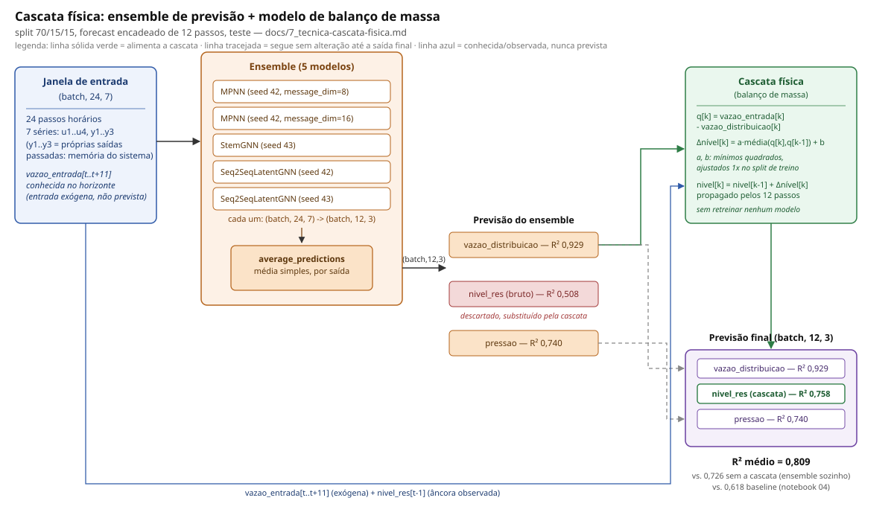
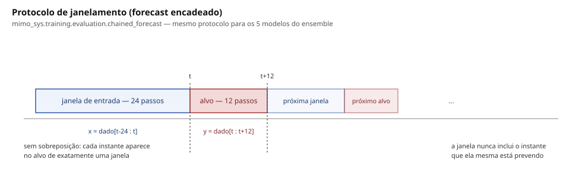

# Cascata física: usar a previsão de uma saída fácil para resolver a difícil

Complementa `docs/6_tecnicas-de-treino.md`. Enquanto aquele documento cobre
técnicas gerais de treino (augmentations, losses, RevIN, contrastivo), este
cobre a busca por R² ≥0,85 pedida pelo orientador e a técnica que mais
aproximou disso: uma cascata entre a previsão de `vazao_distribuicao` e o
modelo físico de `nivel_res`. Nota de mudança completa, com tudo que foi
tentado e descartado:
`docs/changes/2026-10-16-r2-push-experiment.md`. Notebook de comparação:
`notebooks/eda/05_mass_balance_cascade_eda.ipynb`.

## O problema

`docs/1_analise-dados-reservatorio.md` (§4-5) já tinha identificado que
`nivel_res` é o único **estado genuíno** do sistema — ele integra o
desbalanço `vazao_entrada − vazao_distribuicao` ao longo do tempo, em vez de
responder instantaneamente às entradas como `vazao_distribuicao` e `pressao`
fazem. Isso o torna estruturalmente mais difícil: qualquer modelo (MPNN,
StemGNN, Seq2SeqLatentGNN, FourierGNN) treinado para prever as 3 saídas da
mesma forma consegue R² de 0,87-0,93 em `vazao_distribuicao`/`pressao`, mas
nunca passou de ~0,46 em `nivel_res`.

O mesmo documento também mostrou uma armadilha: simular o balanço de massa
`A·dy2/dt = vazao_entrada − vazao_distribuicao` como um integrador livre
(sem realimentação, extrapolando as duas variáveis ao mesmo tempo) **diverge**
— R² entre -19 e -35 em simulação livre de 33 dias. Um termo de "fuga"
(`−λ·y2`) estabiliza a simulação, mas explica só 36% da variância, porque
ainda está tentando prever as duas coisas (nível e vazão) de uma vez sem
nenhuma informação externa sobre a vazão futura.

## As tentativas que não resolveram isso

Antes da cascata, tentei dar ao modelo mais capacidade ou mais estrutura
para aprender essa integração sozinho — nada disso superou o teto de ~0,46:

- **Prever `Δnivel_res` por passo e acumular com um "vazamento" aprendido
  dentro do próprio modelo neural** (`src/mimo_sys/training/integrator.py`).
  Quebrou o treino das outras saídas (a rede compartilha pesos entre as 3
  saídas) e, mesmo isolando isso com cabeças de correção por saída, ficou
  limitado ao mesmo teto do gray-box de 3 parâmetros do documento — o
  "vazamento" aprendido convergiu sozinho para a mesma constante física do
  documento (`e^-0.0227 ≈ 0,977` por hora), uma boa validação de que a física
  estava certa, mas sem ganho de capacidade além dela.
- **Aumentar a capacidade do modelo** (mais camadas, `hidden_size` maior):
  piorava `nivel_res` por overfit, sem ajudar — sinal de que faltava
  informação, não capacidade.
- **Feature explícita do balanço de massa como entrada** (`cumsum` do
  desbalanço, `src/mimo_sys/training/features.py`): ajudou um pouco (R²
  +0,01 a +0,04), mas não resolveu — o modelo ainda tinha que, sozinho,
  acertar tanto a física quanto prever a própria `vazao_distribuicao`
  futura.

O padrão comum a todas essas tentativas: elas pediam para um único modelo
acertar a dinâmica física **e** extrapolar `vazao_distribuicao` ao mesmo
tempo, exatamente o que o documento já tinha mostrado divergir.

## A virada: não extrapolar o que você já sabe prever bem

A pergunta que faltava fazer: já temos, no próprio projeto, um jeito de
prever `vazao_distribuicao` com R² acima de 0,92 (um ensemble de modelos
neurais, ver `docs/changes/2026-10-16-r2-push-experiment.md` §2). Por que o
modelo físico de `nivel_res` teria que extrapolar essa variável de novo, do
zero, sozinho?

Esse padrão — usar a saída já prevista por um estágio como entrada do
próximo, em vez de cada variável ser prevista isoladamente — não é
exclusivo deste projeto; é comum em pipelines de previsão de séries
temporais multivariadas quando as saídas têm uma relação causal conhecida
entre si. Olhar como outras ferramentas de pré-processamento/previsão de
séries temporais organizam esse tipo de encadeamento (inclusive sistemas
que escolhem automaticamente, por diagnóstico quantitativo, qual técnica de
suavização usar por canal) ajudou a reconhecer esse padrão como a peça que
faltava aqui — mas a implementação em si (`src/mimo_sys/training/
mass_balance_cascade.py`) é só o gray-box do documento 1, reescrito para
rodar em cascata.

### Como funciona

1. **Ajusta os 2 parâmetros do gray-box no treino**, por mínimos quadrados,
   com a mesma regra do trapézio do documento:

   ```
   Δnivel_res[k] = a · média(q[k], q[k-1]) + b,    q = vazao_entrada − vazao_distribuicao
   ```

   (`fit_mass_balance`)

2. **Propaga esse modelo pelos 12 passos do horizonte**, mas em vez de
   também prever `vazao_distribuicao`, usa a previsão que o ensemble de
   modelos neurais já fez para ela. `vazao_entrada` não precisa de
   substituto — é uma entrada conhecida no futuro (exógena), não algo que o
   sistema precisa adivinhar. (`mass_balance_cascade_forecast`)

3. **O resultado**: não precisa retreinar nenhum modelo. É uma combinação
   feita depois do fato, com 2 números ajustados uma única vez.

### Arquitetura



`vazao_distribuicao` e `pressao` saem direto da média do ensemble. Só
`nivel_res` muda de fonte: a previsão bruta do ensemble para ela
(R² 0,508) é descartada e substituída pela saída da cascata física
(R² 0,758), que usa a previsão de `vazao_distribuicao` do próprio
ensemble como entrada. Nada é retreinado — a cascata é uma combinação
pós-hoc, com `a`/`b` ajustados uma única vez no split de treino.

### Protocolo de janelamento

Os 5 modelos do ensemble (e a cascata, que herda a mesma estrutura de
janelas) seguem o protocolo padrão de `mimo_sys.training.evaluation.
chained_forecast`, igual ao dos outros experimentos do projeto:

- **`input_window = 24`** passos horários, **`output_window = 12`**
  passos de horizonte — nenhum dos 5 membros usa a janela pequena da
  rota de destilação simbólica (`input_window = 3`, ver
  `docs/4_rotas-de-extracao.md`); esta é a rota de acurácia (rota B),
  com `input_window` igual ao notebook 04.
- A janela de entrada em `t` cobre `dado[t-24 : t]`; o alvo é
  `dado[t : t+12]`. A próxima janela começa exatamente em `t+12` — sem
  sobreposição, cada instante do teste aparece no alvo de exatamente
  uma janela.
- A âncora (`nivel_res[t-1]`, o último valor observado antes da
  janela) nunca é o próprio instante sendo previsto — ver a prova de
  ausência de vazamento em `tests/test_preprocessors.py::
  test_janela_de_entrada_nunca_inclui_o_alvo`.



### Resultado medido (teste, forecast encadeado de 12 passos, escala original)

| Fonte da previsão de `vazao_distribuicao` alimentando a cascata | R² de `nivel_res` |
|---|---|
| (nenhuma — MPNN prevendo `nivel_res` diretamente) | 0,462 |
| MPNN (R² 0,920 em `vazao_distribuicao`) | 0,707 |
| Ensemble de 5 modelos (R² 0,929 em `vazao_distribuicao`) | **0,758** |

Combinado com o ensemble para as outras duas saídas:

| | `vazao_distribuicao` | `nivel_res` | `pressao` | **R² médio** |
|---|---|---|---|---|
| Melhor modelo individual | 0,920 | 0,462 | 0,739 | 0,707 |
| Ensemble de 5 (sem cascata) | 0,929 | 0,508 | 0,740 | 0,726 |
| **Ensemble + cascata física** | 0,929 | **0,758** | 0,740 | **0,809** |

Ainda não atinge a meta (0,85 médio, cada saída ≥0,8) — falta 0,042 de
médio, e tanto `nivel_res` (0,758) quanto `pressao` (0,740) continuam abaixo
de 0,8 — mas é a maior alta de R² médio de toda a busca, e vem sem custo de
treino adicional.

### Comparação completa por modelo (teste, forecast encadeado)

Cada linha é um membro do ensemble treinado isoladamente, com a mesma
receita de técnicas (`per_output_heads` + `uncertainty_weighted` +
RevIN + `mass_balance_feature`, ver `docs/6_tecnicas-de-treino.md`),
`input_window=24`, `output_window=12`. As duas últimas linhas combinam
os 5 (`run_mass_balance_cascade_v2.py`, experimento MLflow
`mimo_sys_mass_balance_cascade`).

| Modelo | `vazao_distribuicao` R² (MSE / SMAPE%) | `nivel_res` R² (MSE / SMAPE%) | `pressao` R² (MSE / SMAPE%) |
|---|---|---|---|
| MPNN (seed 42, message_dim=8) | 0,918 (51,6 / 8,1%) | 0,384 (0,031 / 6,7%) | 0,654 (4,97 / 9,6%) |
| MPNN (seed 42, message_dim=16) | 0,920 (50,1 / 8,2%) | 0,462 (0,027 / 5,2%) | 0,739 (3,75 / 5,8%) |
| StemGNN (seed 43) | 0,894 (66,4 / 9,6%) | 0,381 (0,031 / 6,2%) | 0,680 (4,59 / 6,2%) |
| Seq2SeqLatentGNN (seed 42) | 0,873 (79,9 / 10,5%) | 0,453 (0,027 / 6,7%) | 0,682 (4,57 / 6,7%) |
| Seq2SeqLatentGNN (seed 43) | 0,902 (61,5 / 9,3%) | 0,376 (0,031 / 6,0%) | 0,734 (3,81 / 6,0%) |
| Ensemble (média dos 5) | 0,929 (44,7 / 7,6%) | 0,508 (0,025 / 5,0%) | 0,740 (3,73 / 5,8%) |
| **Ensemble + cascata física** | 0,929 (44,7 / 7,6%) | **0,758 (0,012 / 3,3%)** | 0,740 (3,73 / 5,8%) |

Além do R², a cascata também reduz o MSE de `nivel_res` pela metade
(0,025 → 0,012) e o SMAPE quase pela metade (5,0% → 3,3%) — não é só
uma métrica melhorando, o erro absoluto cai de forma consistente.

### Por que não funciona para `pressao`

O documento 1 também dá um gray-box linear para `pressao` (`pressao ≈
1,02·nivel_res + 0,09·vazao_distribuicao + termos das bombas`, R² 0,80 no
treino). Alimentando esse gray-box com as previsões já em cascata de
`vazao_distribuicao` e `nivel_res`, o resultado no teste (R² 0,737) ficou
igual ao que o ensemble de redes neurais já tinha sozinho (0,740) — a rede
já captura essa relação quase tão bem quanto a equação explícita, então a
cascata não compra nada ali. A vitória da cascata é específica de
`nivel_res`, porque é a única saída cuja relação com as outras é dinâmica
(uma integral), não quase-algébrica.

## Onde está o código

- `src/mimo_sys/training/mass_balance_cascade.py` — `fit_mass_balance`,
  `mass_balance_cascade_forecast`. Testado em `tests/test_training.py`
  (recuperação exata dos coeficientes e reprodução exata da simulação
  quando a vazão prevista é igual à real).
- `src/mimo_sys/training/ensemble.py` — como os 5 modelos são combinados
  antes da cascata (ver `docs/6_tecnicas-de-treino.md`).
- `notebooks/training/scripts/run_mass_balance_cascade_v2.py` — treina os 5
  modelos, aplica a cascata, e registra métricas/figuras no MLflow
  (experimento `mimo_sys_mass_balance_cascade`).
- `notebooks/eda/05_mass_balance_cascade_eda.ipynb` — compara `ensemble_ml`
  (sem cascata) com `ensemble_cascade` (com cascata), métricas, bandas
  espectrais e plots de série/espectro.

## Próximos passos possíveis (não feitos)

- Replicar a ideia para outras relações físicas conhecidas do sistema, se
  alguma delas também for uma integral e não uma relação quase-algébrica.
- Ajustar `a`/`b` com regressão robusta em vez de mínimos quadrados simples,
  caso outliers no treino estejam distorcendo o ajuste.
- Investigar se falta mesmo um "fluxo não instrumentado" (hipótese do
  documento 1) que, se identificado, poderia levar o nível acima de 0,8
  sozinho.
