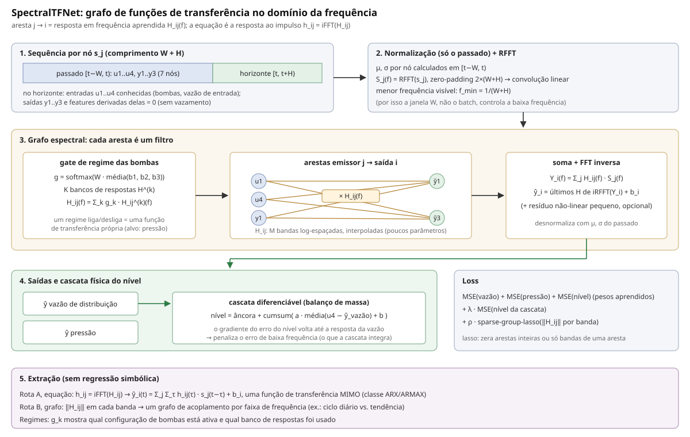
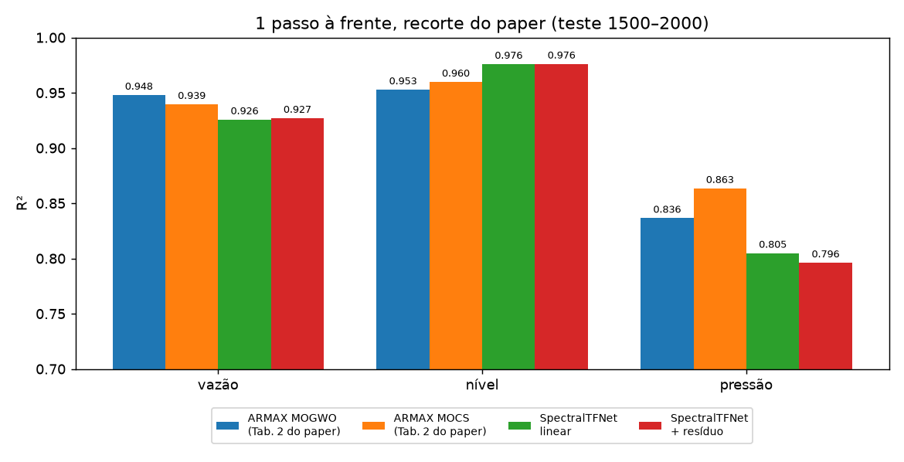
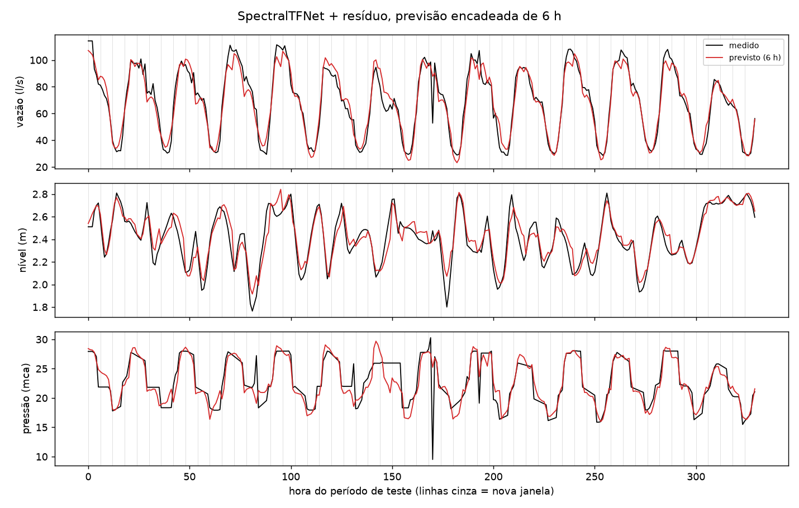
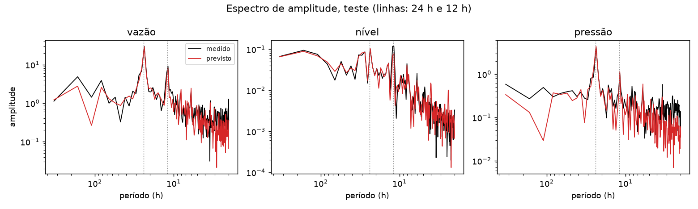
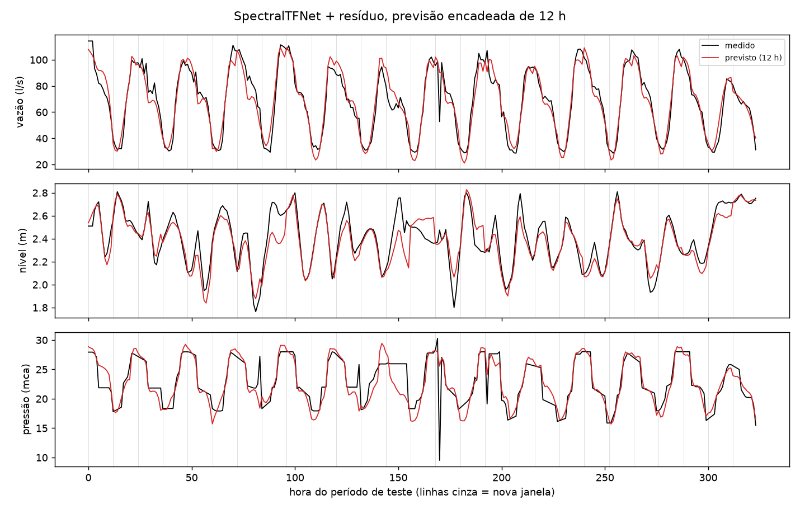
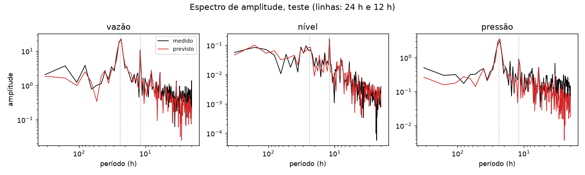
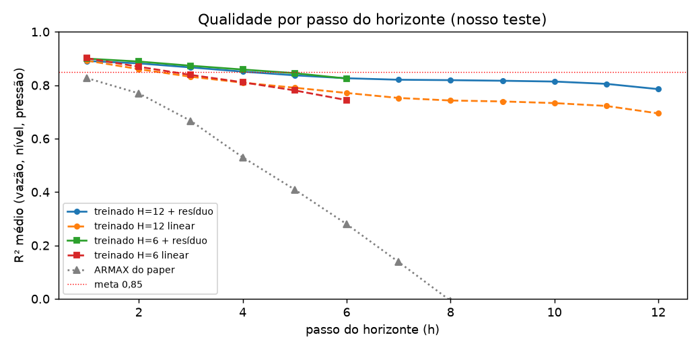
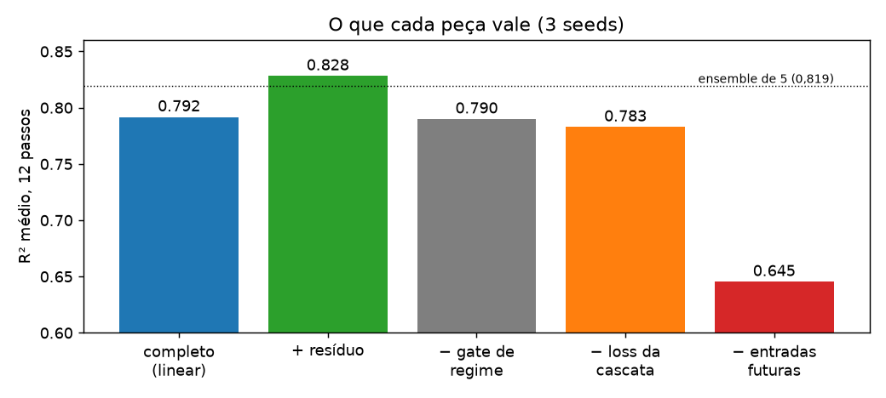
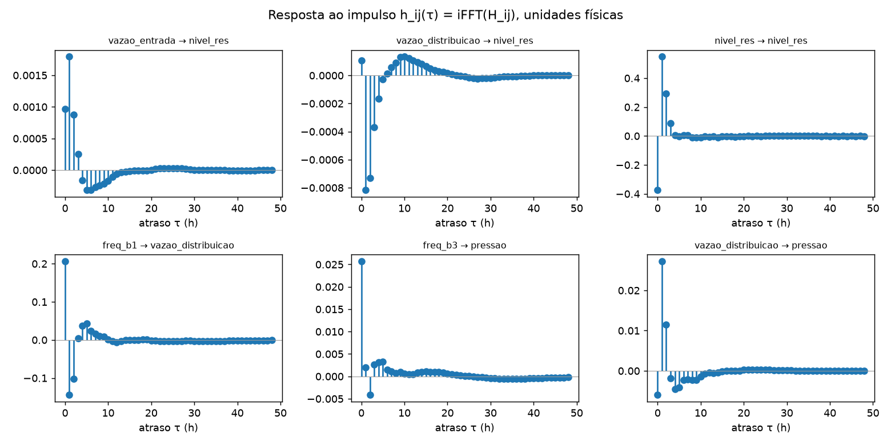
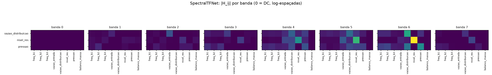

# SpectralTFNet: o modelo, os resultados e por que ele é assim

Arquitetura criada em 2026-10-20 para o sistema MIMO do reservatório
(4 entradas: bombas `freq_b1..3` e `vazao_entrada`; 3 saídas:
`vazao_distribuicao`, `nivel_res`, `pressao`).

| Onde está | O quê |
|---|---|
| `src/mimo_sys/architectures/spectral_tf_net.py` | o modelo |
| `notebooks/training/scripts/run_spectral_tf_net.py` | treino e avaliação de todas as configurações |
| `notebooks/training/scripts/extract_spectral_tf_net.py` | extração (equação e grafo) |
| `notebooks/training/scripts/report_spectral_tf_net.py` | tabelas e gráficos deste documento |
| `models/spectral_tf_net_h12_w168_s42.pth` | pesos do modelo usado na extração |
| `docs/changes/2026-10-20-spectral-tf-net.md` | plano e decisões |

---

## 1. Resumo em 5 pontos

1. **Um modelo só supera o ensemble de 5 modelos** na previsão de 12 h:
   R² médio **0,824** contra 0,819. E, ao contrário do ensemble, dá para
   ler a equação e o grafo dele.
2. **A explicabilidade é direta, sem regressão simbólica.** Cada aresta
   do grafo é um filtro; o filtro *é* a equação. O balanço de massa do
   reservatório aparece nas arestas do nível sem ter sido ensinado.
3. **O "+ resíduo"** é uma rede neural pequena que corrige o que a parte
   linear não consegue. É a única parte sem equação fechada (§3).
   **Errata (2026-10-23):** o "~29% do sinal" estava subestimado por um
   bug de medição. O valor correto é 61–69% da energia; veja o doc 11 §3.
4. **Contra o artigo (1 passo à frente)**: ganhamos no nível, perdemos um
   pouco em vazão e pressão; no médio, 0,902 contra 0,909–0,921. Em
   12 passos, 0,824 contra 0,333 do ARMAX do artigo.
5. **É inovador?** É uma combinação nova de peças que já existem,
   aplicada de um jeito que a literatura consultada não faz junta (§9).
   Não é um paradigma novo.

---

## 2. O que é o modelo, em linguagem simples

### A ideia

Pense num **equalizador de som**. Cada série (bomba, vazão, nível,
pressão) é um "canal de áudio". Para prever, por exemplo, a pressão, o
modelo pega cada canal, passa por um **equalizador próprio** (aumenta
ou corta certas frequências, atrasa ou adianta) e **soma** tudo. O que
o modelo aprende são os ajustes de cada equalizador.

- Cada equalizador é uma **aresta do grafo**: "quanto a bomba 1 influencia
  a pressão, e em que ritmo (horas, ciclo diário, semanas)".
- Um equalizador é exatamente o que a engenharia de controle chama de
  **função de transferência**. O conjunto de todos eles é uma **matriz de
  funções de transferência MIMO** — a mesma família do ARMAX do artigo,
  só que estimada por gradiente e com mais memória.



### Passo a passo de uma previsão de 12 h

1. **Monta a sequência de cada série:** as últimas **168 h** (7 dias) de
   todas as séries e, para as entradas que a operação já conhece
   (programação das bombas e vazão de entrada), também as **próximas 12 h**.
   As saídas no futuro ficam zeradas — o modelo nunca vê o que vai prever
   (há um teste automático provando isso).
2. **Centraliza** cada série pela média do passado.
3. **Vai para a frequência** (FFT), **aplica os equalizadores**
   (`H_ij(f)`), soma por saída e **volta para o tempo** (FFT inversa).
4. **Prevê 1 hora**, escreve essa previsão de volta na sequência e repete
   — 12 vezes. É assim que um modelo de função de transferência simula o
   sistema.
5. **O nível sai pela física:** a cascata
   `nível(t+1) = nível(t) + a·(vazão de entrada − vazão prevista) + b`
   (balanço de massa) usa a vazão prevista pelo próprio modelo.

### Janelas de entrada e saída

| Configuração | Janela de entrada | Entradas futuras conhecidas | Janela de saída (horizonte) | Para quê |
|---|---|---|---|---|
| **12 passos** (principal) | 168 h | sim, 12 h | 12 h | previsão operacional |
| **6 passos** | 168 h | sim, 6 h | 6 h | comparação de horizonte |
| **1 passo, protocolo do artigo** | 3 h (ordem 3) | **não** (só até `u[k−1]`) | 1 h | comparação justa com a Eq. 15 do artigo |

A janela de entrada de 168 h foi escolhida por varredura (§6.4): é o que
deixa o modelo enxergar o ciclo diário e a semana.

---

## 3. O que é o "+ resíduo"

A parte de equalizadores é **linear**: se a bomba sobe o dobro, a
contribuição dela dobra. O sistema real não é totalmente assim — a curva
de uma bomba, por exemplo, não é uma reta.

O **resíduo** é uma rede neural pequena que olha o passado da própria
saída e **soma uma correção** à previsão linear:

```
passado centrado da saída i (168 h)
   → Linear(168 → 16) → tanh → Linear(16 → 12)
   → correção para as 12 h do horizonte da saída i
```

| | Parte linear (equalizadores) | Resíduo |
|---|---|---|
| Parâmetros | **387** (3 saídas × 8 emissores × 8 bandas × 2 [real/imag] + 3 bias) | **2.908** |
| Entrada | todas as séries (passado + entradas futuras) | só o passado da própria saída |
| Como prevê | recursivo, 1 h por vez, com a previsão realimentada | as 12 h de uma vez (direto) |
| Realimentado na recursão? | sim | não (somado só no final) |

Detalhes:

- **uma única MLP compartilhada** pelas 3 saídas: a mesma rede é
  aplicada separadamente ao passado da vazão, do nível e da pressão;
- **não vê as outras séries nem as entradas futuras** — o acoplamento
  entre variáveis e o efeito das bombas ficam todos na parte linear,
  onde há equação;

- começa em **zero** (o modelo nasce 100% linear e o resíduo só cresce
  se ajudar);
- mede-se quanto ele pesa com o `nonlinearity_share`.
  **Errata (2026-10-23):** o valor publicado aqui (~29%) estava errado.
  `out += resíduo` somava o resíduo no próprio tensor da parte linear e
  inflava o denominador. Medido corretamente, o resíduo carrega **61–69%
  da energia** do modelo de 12 passos (doc 11 §3). As previsões e os R²
  deste documento não mudam;
- ganho: **+0,034** de R² médio em 12 passos (0,790 → 0,824).

Ou seja: a **equação** do modelo com resíduo descreve bem menos do que
os 71% afirmados antes. A extração da §7 foi feita no modelo **só
linear** (R² 0,790), que é o modelo interpretável. No modelo com resíduo,
parte linear e resíduo se ajustam um ao outro, e a parte linear sozinha
não prevê bem (doc 11 §3).

---

## 4. Como ler as métricas

| Métrica | O que mede | Melhor |
|---|---|---|
| **R²** | fração da variação do sinal que o modelo explica | 1 |
| **RMSE** | erro típico, na unidade física (l/s, m, mca) | 0 |
| **SMAPE** | erro percentual simétrico | 0% |
| **R² espectral** | o modelo tem a energia certa em cada período (24 h, 12 h, semana…)? Compara o espectro de amplitude previsto com o medido, sem DC | 1 |
| **SMAPE espectral** | o mesmo, em %, frequência por frequência | 0% |

O **SMAPE espectral fica alto (30–75%) em todos os modelos, inclusive no
ARMAX**: ele dá o mesmo peso às frequências altas, que têm amplitude
quase zero (ruído), e qualquer diferença pequena ali vira um percentual
grande. O **R² espectral** pesa pela energia e é o mais informativo dos
dois.

Todas as métricas abaixo: média de **3 seeds**. O nível já é o da
cascata física.

---

## 5. Resultados

### 5.1 Um passo à frente vs. o artigo

**No recorte do próprio artigo** (treino nas amostras 550–1150, teste
em 1500–2000), protocolo do artigo: ordem 3, 1 passo, sem `u[k]`.



| Modelo | Saída | R² | RMSE | SMAPE | R² espectral | SMAPE espectral |
|---|---|---|---|---|---|---|
| ARMAX MOGWO (artigo, Tab. 2) | vazão / nível / pressão | 0,948 / 0,953 / 0,836 | — | — | — | — |
| ARMAX MOCS (artigo, Tab. 2) | vazão / nível / pressão | 0,939 / 0,960 / 0,863 | — | — | — | — |
| ARMAX MOGWO (recalculado por nós) | vazão | 0,948 | 5,80 l/s | 7,4% | 0,99 | 31% |
| | nível | 0,954 | 0,049 m | 1,5% | 0,97 | 60% |
| | pressão | 0,824 | 1,58 mca | 4,8% | 0,98 | 41% |
| | **médio** | **0,909** | | | | |
| **SpectralTFNet linear** | vazão | 0,926 | 6,91 l/s | 8,1% | 0,99 | 50% |
| | nível | **0,976** | **0,036 m** | **0,8%** | 0,99 | 43% |
| | pressão | 0,805 | 1,66 mca | 4,8% | 0,98 | 44% |
| | **médio** | **0,902** | | | | |
| SpectralTFNet + resíduo | vazão | 0,927 | 6,85 l/s | 8,0% | 0,99 | 52% |
| | nível | **0,976** | **0,036 m** | **0,8%** | 0,99 | 43% |
| | pressão | 0,796 | 1,70 mca | 4,8% | 0,98 | 40% |
| | **médio** | **0,900** | | | | |

O nosso recálculo do ARMAX bate com a Tabela 2 do artigo (0,948 / 0,954 /
0,824 contra 0,948 / 0,953 / 0,836), então a comparação é válida.

**Leitura:** no nível, erro 27% menor que o do ARMAX (0,036 m contra
0,049 m). Em vazão e pressão, o ARMAX é um pouco melhor. Duas desvantagens
nossas nessa comparação: treinamos com 511 amostras (90 separadas para
validação) contra 601, e o ARMAX tem o termo de média móvel
`c·e[k−1..k−3]` (usa o erro de previsão passado), que o nosso modelo não
tem.

**No nosso período de teste** (últimos 15% da série, amostras 1876–2207),
mesmo protocolo:

| Modelo | vazão R² / RMSE / SMAPE | nível R² / RMSE / SMAPE | pressão R² / RMSE / SMAPE | **R² médio** |
|---|---|---|---|---|
| ARMAX MOGWO (artigo) | 0,916 / 7,30 / 8,1% | 0,934 / 0,058 / 1,7% | 0,641 / 2,28 / 6,1% | 0,830 |
| SpectralTFNet linear | 0,898 / 8,08 / 9,0% | 0,972 / 0,038 / 1,1% | 0,666 / 2,20 / 5,0% | 0,845 |
| **SpectralTFNet + resíduo** | 0,901 / 7,95 / 8,7% | **0,973 / 0,037 / 1,0%** | **0,678 / 2,16 / 5,0%** | **0,850** |

R² espectral (vazão / nível / pressão): ARMAX 0,99 / 0,96 / 0,94;
SpectralTFNet 0,99 / 0,99 / 0,98.

Neste período mais difícil (contém falhas de sensor), ganhamos no médio.
A pressão cai para ~0,65 **também no ARMAX** — é o período, não o modelo.

### 5.2 Horizonte de 6 h (treinado com 6)

Nosso teste, entrada 168 h + 6 h de entradas futuras, saída 6 h. O ARMAX
aqui roda em simulação livre de 6 passos (é como ele preveria 6 h).

| Modelo | Saída | R² | RMSE | SMAPE | R² espectral | SMAPE espectral |
|---|---|---|---|---|---|---|
| ARMAX MOGWO | vazão | 0,713 | 13,5 l/s | 16,8% | 0,82 | 60% |
| | nível | 0,670 | 0,130 m | 4,0% | 0,84 | 67% |
| | pressão | 0,470 | 2,78 mca | 9,5% | 0,76 | 64% |
| | **médio** | **0,617** | | | | |
| SpectralTFNet linear | vazão | 0,900 | 8,00 l/s | 10,4% | 0,96 | 60% |
| | nível | 0,818 | 0,096 m | 3,1% | 0,88 | 55% |
| | pressão | 0,751 | 1,91 mca | 5,8% | 0,86 | 77% |
| | **médio** | **0,823** | | | | |
| **SpectralTFNet + resíduo** | vazão | **0,939** | **6,22 l/s** | **7,8%** | 0,96 | 57% |
| | nível | **0,862** | **0,084 m** | **2,7%** | 0,91 | 49% |
| | pressão | **0,795** | **1,73 mca** | **5,1%** | 0,86 | 75% |
| | **médio** | **0,865** | | | | |



Com horizonte de 6 h, as janelas (linhas cinza) são mais curtas e a
previsão gruda mais no medido, principalmente no nível: há menos horas
para o erro da vazão se acumular na cascata.



Mesmo padrão do modelo de 12 h: os picos de 24 h e 12 h batem, e acima
de ~6 h o previsto tem um pouco menos energia (suaviza o ruído). Na
pressão, o previsto perde energia nos períodos longos (> 50 h) — a
tendência lenta da pressão não é capturada.

### 5.3 Horizonte de 12 h (treinado com 12) — o modelo principal

Nosso teste, entrada 168 h + 12 h de entradas futuras, saída 12 h.

| Modelo | Saída | R² | RMSE | SMAPE | R² espectral | SMAPE espectral |
|---|---|---|---|---|---|---|
| ARMAX MOGWO | vazão | 0,569 | 16,5 l/s | 19,9% | 0,73 | 75% |
| | nível | 0,285 | 0,189 m | 5,9% | 0,77 | 64% |
| | pressão | 0,144 | 3,51 mca | 12,3% | 0,63 | 81% |
| | **médio** | **0,333** | | | | |
| Ensemble de 5 (não extraível) | vazão / nível / pressão | 0,931 / 0,783 / 0,744 | — | — | — | — |
| | **médio** | **0,819** | | | | |
| SpectralTFNet linear | vazão | 0,870 | 9,03 l/s | 12,0% | 0,94 | 57% |
| | nível | 0,785 | 0,104 m | 3,4% | 0,86 | 54% |
| | pressão | 0,715 | 2,02 mca | 6,2% | 0,84 | 72% |
| | **médio** | **0,790** | | | | |
| **SpectralTFNet + resíduo** | vazão | **0,924** | **6,90 l/s** | **8,9%** | 0,96 | 51% |
| | nível | **0,787** | **0,103 m** | **3,1%** | 0,86 | 55% |
| | pressão | **0,762** | **1,85 mca** | **5,3%** | 0,82 | 70% |
| | **médio** | **0,824** | | | | |



O modelo acompanha o ciclo diário das três saídas; os erros maiores são
picos isolados (falhas de sensor na pressão, ~hora 170) e alguns
patamares do nível.



No espectro, o previsto bate com o medido nos picos de **24 h e 12 h**
(onde está quase toda a energia). Abaixo de ~6 h o previsto tem menos
energia que o medido — o modelo suaviza o ruído de alta frequência.

### 5.4 Qualidade a cada hora do horizonte



| passo | ARMAX do artigo | SpectralTFNet linear | SpectralTFNet + resíduo |
|---|---|---|---|
| 1 h | 0,83 | 0,892 | 0,891 |
| 3 h | 0,67 | 0,832 | 0,867 |
| 6 h | 0,28 | 0,771 | 0,826 |
| 12 h | < 0 | 0,694 | 0,785 |

(R² médio das 3 saídas no passo; avaliado com janelas começando em todas
as horas do dia, para que o passo `h` não caia sempre no mesmo horário.)

- O ARMAX do artigo é bom em 1 passo e despenca: depois de 8 h já é
  pior que prever a média.
- **Treinar com 6 h não deixa o passo 6 melhor** (verde × azul no
  gráfico: 0,825 contra 0,826). O 0,865 da §5.2 é a média só dos passos
  fáceis (1 a 6). Por isso o modelo de referência é o de 12 h: ele
  entrega o mesmo nos primeiros 6 passos e ainda os passos 7–12.

---

## 6. O que cada decisão vale

### 6.1 Ablações (12 passos, 3 seeds)



| Variante | R² médio | Efeito |
|---|---|---|
| Completo (linear) | 0,792 | — |
| **+ resíduo** | **0,828** | **+0,036** |
| − gate de regime das bombas | 0,790 | nenhum → removido |
| − loss da cascata | 0,783 | −0,009 (perde no nível) |
| **− entradas futuras conhecidas** | **0,645** | **−0,147** |

### 6.2 Decisões de modelagem: por que e de onde veio

| Decisão | Por quê | Evidência | Inspiração |
|---|---|---|---|
| Aresta = filtro em frequência (`H_ij(f)`) | equação e grafo saem do mesmo objeto, sem PySR; corrige o MPNN, que não conseguia subtrair dois emissores (`u4 − y1`) | balanço de massa recuperado nas arestas (§7) | FilterNet, FITS, FourierGNN |
| Filtro com 8 bandas, interpolado | poucos parâmetros (387 na parte linear) para só ~1,5 mil amostras de treino; resposta suave | treina estável em 3 seeds (±0,001) | iCSNN (bandas), FITS (modelo pequeno) |
| Lasso por grupo (aresta, banda) | zera arestas inteiras ou bandas — grafo por faixa de frequência | bandas DC e Nyquist ficaram vazias (§7.2) | iCSNN (sparse-group lasso) |
| **Usar as entradas futuras conhecidas** | o operador já sabe o que as bombas vão fazer; sem isso, a rede chuta, e o chute vira erro de baixa frequência na vazão que a cascata acumula no nível | **+0,147** (maior ganho isolado) | TimeXer, DAG (exógenas tratadas à parte) |
| Simulação recursiva de 1 passo | um filtro aplicado de uma vez não consegue prever vários passos do próprio passado (testado: R² negativo) | de negativo para 0,79 | ARX/função de transferência clássicos |
| Só centralizar, sem dividir pelo desvio | bombas desligadas = desvio ≈ 0 → divisão explodia (R² de −10⁶) | corrigiu a instabilidade | — (achado nosso) |
| Nível pela cascata física, treinada junto | o nível é um integrador do balanço de massa; o oráculo mostrou que a física resolve o nível se a vazão vier boa | +0,009; nível 0,79 vs ~0,46 dos modelos diretos | balanço de massa do doc 1; Mass-Conserving Perceptron (hidrologia) |
| Resíduo não-linear pequeno, iniciado em zero | o sistema não é 100% linear (curva das bombas); começar em zero mantém o modelo linear salvo prova em contrário | +0,036; mede 29% de não-linearidade | ideia do "resíduo penalizado" do parecer colado na conversa |
| Janela de 168 h | a menor frequência que o modelo vê é 1/(janela); 24 h não mostra nem um ciclo diário inteiro | grade: 96–168 h melhores (§6.4) | — (varredura) |
| Gate de regime das bombas | hipótese do doc 5 §11.6: bombas liga/desliga pediriam um modelo por regime | **sem efeito**, removido | FreqMoE |

### 6.3 O que não funcionou

- **Gate de regime das bombas:** zero de ganho em 3 seeds.
- **Batch 512:** menos viés mas subajuste; pior em todas as janelas.
- **Treinar com horizonte curto (6 h):** não melhora os passos que cobre.
- **Ler ganho estático em `H(0)`:** dá zero por construção (centralização);
  usar a soma dos coeficientes causais (§7.1).

### 6.4 Janela de entrada × batch (1 seed, 12 passos, linear)

| janela \ batch | 32 | 128 | 512 |
|---|---|---|---|
| 24 h | 0,777 | 0,748 | 0,748 |
| 48 h | 0,736 | 0,751 | 0,729 |
| 96 h | 0,789 | **0,793** | 0,755 |
| 168 h | **0,793** | **0,792** | 0,769 |
| 336 h | 0,763 | 0,773 | 0,763 |

---

## 7. Explicabilidade

### 7.1 A equação (rota A)

A equação do modelo é a soma das convoluções:

```
ŷ_i(t) = Σ_j Σ_τ h_ij(τ) · s_j(t − τ) + b_i
```

onde `h_ij` é a **resposta ao impulso** da aresta `j → i` (FFT inversa
do equalizador). Cada coeficiente `h_ij(τ)` diz: "quanto a série `j`, `τ`
horas atrás, empurra a saída `i` agora".



**O balanço de massa aparece sozinho** nas arestas do nível (soma dos
coeficientes das primeiras 3 h, unidades físicas):

| Aresta | Coeficiente | O que a física diz |
|---|---|---|
| vazão de entrada → nível | **+0,0039** m por l/s | entra água → nível sobe (`+a`) |
| vazão de distribuição → nível | **−0,0019** m por l/s | sai água → nível desce (`−a`) |
| nível → nível (1–3 h) | **0,93** | integrador: o nível "lembra" quase tudo |
| gray-box de referência | `a` = 0,0028 m por l/s | — |

Sinais opostos e mesma ordem de grandeza da física, **sem que o modelo
tenha recebido a equação do balanço de massa**. O MPNN usado antes não
conseguia expressar essa subtração.

### 7.2 O grafo (rota B)



Força de cada aresta em cada banda de frequência (0 = DC, 7 = mais
rápida). As auto-arestas dominam as bandas 4–6 (a do nível é a mais
forte de todas, coerente com o integrador); vazão de entrada → nível
aparece nas bandas 4–5; vazão de distribuição é o emissor cruzado mais
forte da vazão e da pressão. As bandas 0 e 7 ficaram quase vazias: o
lasso cortou o que não carrega sinal.

---

## 8. Referências usadas

| Referência | Link | O que usamos |
|---|---|---|
| Ferrari, Leandro & Coelho (2025), *Multi-objective metaheuristics applied for the multivariable system identification* | `docs/pappers/` | problema, dados, ARMAX ordem 3, métricas a bater |
| FilterNet (Yi et al., NeurIPS 2024) | [2411.01623](https://arxiv.org/abs/2411.01623) | filtro aprendido no domínio da frequência + FFT inversa |
| FITS (Xu et al., ICLR 2024) | [2307.03756](https://arxiv.org/abs/2307.03756) | modelo de frequência com ~10 mil parâmetros, bom com poucos dados |
| iCSNN (Marinucci et al., 2026) | [2610.06630](https://arxiv.org/abs/2610.06630) | agrupar frequências em bandas; sparse-group lasso por aresta ao longo das bandas |
| FourierGNN (Yi et al., NeurIPS 2023) | [2311.06190](https://arxiv.org/abs/2311.06190) | GNN no domínio da frequência com base fixa (já no repo) |
| TimeXer (Wang et al., NeurIPS 2024) | [2402.19072](https://arxiv.org/abs/2402.19072) | tratar variáveis exógenas separadamente |
| DAG (2025) | [2509.14933](https://arxiv.org/abs/2509.14933) | usar exógenas no horizonte de previsão |
| TimeFilter (2025) | [2501.13041](https://arxiv.org/abs/2501.13041) | filtragem de grafo no espaço canal × tempo |
| FreqMoE (2025) | [2501.15125](https://arxiv.org/abs/2501.15125) | mistura de especialistas por frequência (gate de regime; não ajudou) |
| *Process-Aware AI for Rainfall-Runoff Modeling* (Mass-Conserving Perceptron, 2026) | [2603.25093](https://arxiv.org/abs/2603.25093) | precedente de rede neural que conserva massa em hidrologia |
| Kendall, Gal & Cipolla (2018) | — | peso de loss aprendido por saída (`UncertaintyWeightedLoss`) |

---

## 9. É uma arquitetura nova?

**Resposta curta: é uma combinação nova, não um paradigma novo.**

Cada peça existe na literatura: filtros aprendidos em frequência
(FilterNet, FITS), GNN no domínio da frequência (FourierGNN), grafo por
bandas com lasso (iCSNN), exógenas no horizonte (TimeXer), redes que
conservam massa (MCP), e a própria matriz de funções de transferência é
teoria clássica de controle. O trabalho mais próximo encontrado é o
**GraphNARX** ([2610.23103](https://arxiv.org/abs/2610.23103), out/2026), um
NARX em grafo para dinâmica estrutural — mas no domínio do tempo e com
redes neurais nas arestas, sem leitura direta de função de transferência.

O que **não encontramos junto** em nenhum trabalho:

1. **o grafo cujas arestas são funções de transferência em bandas**,
   usado como **simulador recursivo** (ARX) — não só como camada de
   representação, como no FilterNet/FourierGNN;
2. **as entradas futuras conhecidas** entrando no mesmo grafo de filtros;
3. **o estado integrador (nível) resolvido por uma cascata física
   diferenciável** alimentada pela saída do próprio modelo;
4. **a medida explícita da não-linearidade** (resíduo iniciado em zero)
   ao lado da equação linear.

O argumento forte para o TCC não é "arquitetura inédita", e sim:
**um modelo único, pequeno (387 parâmetros lineares + 2,9 mil no resíduo), que supera o
ensemble de redes profundas em 12 h e devolve a física do sistema
legível nas arestas**. A busca de literatura foi feita no alphaXiv e não
é exaustiva; antes de afirmar novidade num texto, vale uma revisão
sistemática.

---

## 10. Limitações e próximos passos

- **Resíduo sem equação (29% do sinal):** destilar só ele com PySR (é
  uma rede pequena, com poucas entradas) para fechar a equação.
- **Pressão** fica em ~0,76 em 12 h e o ARMAX também cai neste período:
  provável limite de informação (falta pressão a montante ou abertura de
  válvula).
- **Termo de média móvel** do ARMAX (`c·e[k−j]`) não está no modelo;
  pode fechar a diferença de 0,01–0,02 no recorte do artigo.
- **Variação entre seeds** do modelo com resíduo em 12 passos é a maior
  (±0,012); um ensemble só de SpectralTFNets (todos extraíveis) ainda não
  foi testado.
